# Microsoft Fabric — Session 01

## From Data Sources to Business Insights: An End-to-End E-Commerce Architecture

**Focus:** Microsoft Fabric fundamentals and how its components fit together in a real-world Data Engineering solution  
**Format:** Conceptual walkthrough with one continuous project example  
**Duration:** 60 minutes

---

## Learning outcomes

By the end of this session, you should be able to:

- Explain why Microsoft Fabric exists and what **Software as a Service (SaaS)** changes for a Data Engineer.
- Distinguish **Capacity, Workspace, Fabric Items, and OneLake**.
- Identify the Fabric components used for **ingestion, processing, storage, orchestration, governance, deployment, and analytics**.
- Follow an e-commerce data pipeline from two source systems through **Bronze → Silver → Gold**.
- Explain where **Lakehouse, Warehouse, Spark Notebooks, Spark Job Definitions, Dataflow Gen2, and Power BI** fit.
- Recognize which components are **alternatives** and which work **together**.

### Session roadmap

| Section | Focus | Time |
|---|---|---:|
| 1 | Why Fabric? SaaS and the unified analytics platform | 7 min |
| 2 | Capacity, Workspace, Items, and OneLake | 8 min |
| 3 | Project architecture and data ingestion | 10 min |
| 4 | Medallion processing: Bronze, Silver, Gold | 13 min |
| 5 | SQL, Power BI, and data consumption | 6 min |
| 6 | Orchestration, monitoring, security, and deployment | 10 min |
| 7 | Real-time analytics, data science, and recap | 6 min |
| **Total** | | **60 min** |

---

# 1. Why Microsoft Fabric?

Consider an e-commerce company with orders in a relational database, product files in cloud storage, analytical transformations in Spark, and reports in Power BI.

A traditional Azure solution might bring together:

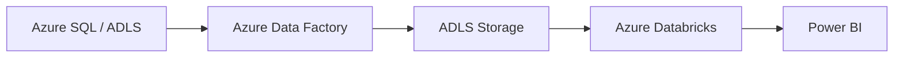

This is a valid architecture. However, teams must integrate and govern several services, manage their configurations, and monitor operations across service boundaries.

**Microsoft Fabric** is a unified **Software as a Service (SaaS)** analytics platform. It brings together managed experiences for data ingestion, data engineering, warehousing, real-time analytics, data science, and business intelligence.

### What does SaaS change?

| Microsoft manages much of the underlying platform | Data teams still manage |
|---|---|
| Service infrastructure and integrated platform operations | Pipeline design and transformations |
| Managed compute platforms | Security configuration and access decisions |
| Native integration with OneLake | Data quality, testing, and recovery |
| Common workspace-based experience | Performance, capacity usage, and costs |
| Platform maintenance | Business rules and analytical models |

> **Remember:** Fabric reduces infrastructure-management effort. It does **not** remove the need for Data Engineering skills.

Fabric can also **coexist** with Azure Data Factory, Azure Databricks, ADLS, and other existing systems. Migration is an architectural choice, not a mandatory replacement.

---

# 2. Fabric architecture: Capacity, Workspace, Items, and OneLake

There are two related—but different—ways to understand the platform: **compute allocation** and **data organization**.

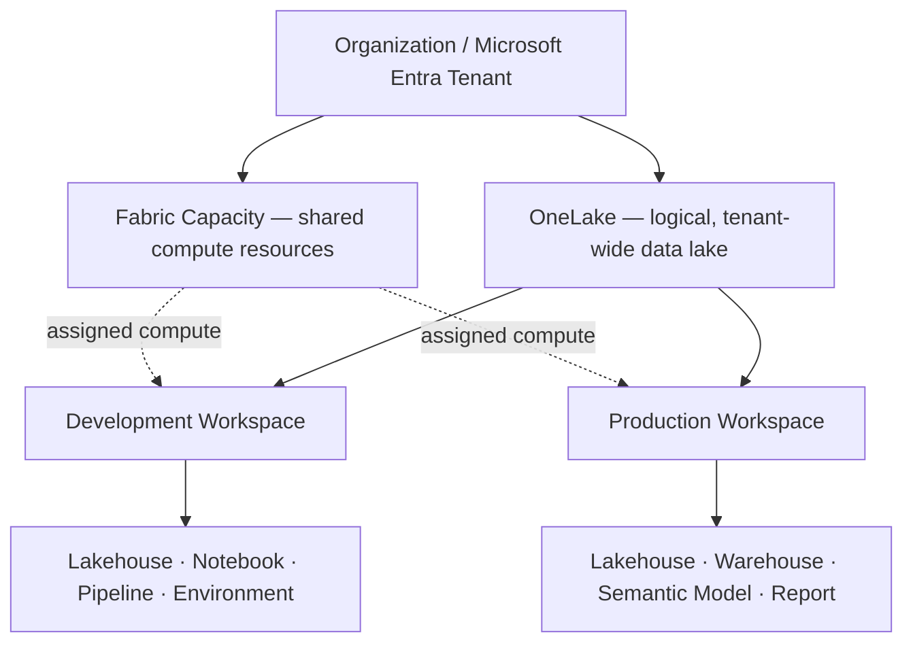

*Diagram note: Workspace membership in OneLake describes its logical storage organization. Capacity assignment describes compute allocation; OneLake is not physically stored inside the capacity.*

| Component | What it is | Example in our project |
|---|---|---|
| **Fabric Capacity** | Shared compute capacity used by Fabric workloads | Runs Spark processing, SQL workloads, pipelines, and reports |
| **Workspace** | Container for collaboration, access, and Fabric items | `Ecommerce-Dev`, `Ecommerce-Prod` |
| **Fabric Item** | An individual resource created in a workspace | Lakehouse, Pipeline, Notebook, Spark Job Definition |
| **OneLake** | Unified logical data lake for the organization | Stores files and Delta tables used by Lakehouses |
| **OneLake Catalog** | Data discovery and governance experience | Find trusted sales assets and see their context |

**Important distinctions**

- One capacity can serve **multiple workspaces**. They share capacity resources; heavy workloads may affect other workloads on that capacity.
- Multiple Lakehouses across different workspaces can store data within the **same logical OneLake**.
- **Spark Pool settings** and **workspace permissions** are configuration areas, not ordinary Fabric items like a Notebook or Lakehouse.
- A Lakehouse is an **item**. OneLake is the **storage foundation** behind it.

## OneLake and Lakehouse are not the same

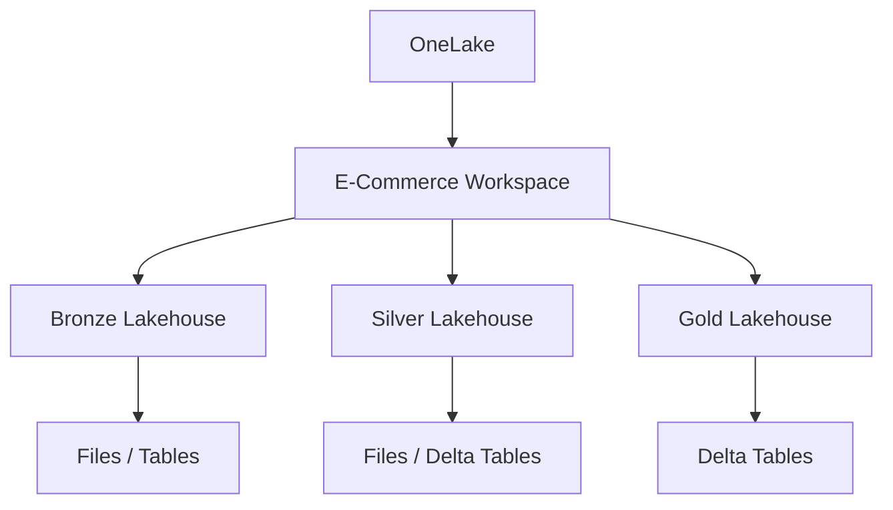

Creating three Lakehouses does **not** create three independent OneLake services. Deleting one Lakehouse does not delete the entire OneLake, although its own data and dependent processes can be affected.

---

# 3. Our running project: An e-commerce data platform

## Business requirements

The company needs to:

1. Ingest **orders and customer changes** from a relational database.
2. Ingest **product and inventory files** from ADLS Gen2.
3. Preserve a trustworthy ingestion history for auditing and replay.
4. Clean, validate, and standardize data.
5. Build business-ready fact and dimension tables.
6. Provide dashboards, governed access, and optional ML capabilities.
7. Schedule, monitor, test, and deploy the solution reliably.

## End-to-end architecture

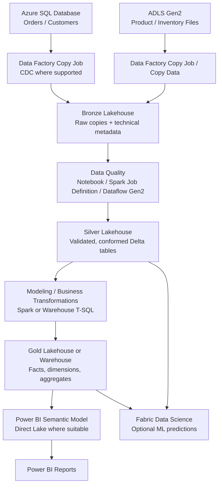

**Across the entire solution:** Data Factory Pipelines (orchestration), Monitoring Hub (execution visibility), workspace/item/OneLake security (governance), and Git/deployment tools (release management).

---

# 4. Ingestion: From source systems to Bronze

## Source A — Azure SQL Database

The database receives new orders, customer updates, and occasional deletes. We should distinguish three ingestion strategies:

| Strategy | What it captures | Important limitation |
|---|---|---|
| Full extraction | Entire source snapshot | Repeats large amounts of data |
| Watermark incremental extraction | Rows with changed timestamps/keys | Physical deletes may be invisible |
| **Change Data Capture (CDC)** | Insert, update, and delete events where supported | Requires a supported source/configuration |

### Fabric components

- **Data Factory Connection:** Provides configured source access and credentials.
- **Copy Job:** Handles full, incremental, and supported CDC replication patterns; can manage incremental state.
- **Copy Data Activity:** Copies data as an activity within a Pipeline; more customized incremental logic may require additional design.
- **Mirroring (alternative):** Continuously replicates supported operational databases into Fabric. It does not automatically meet every custom raw-event-history requirement.

> **CDC captures changes; Bronze history is a separate design decision.** A destination maintained using merge/current-state or SCD Type 2 semantics is not necessarily a complete append-only log of every source event.

For an auditable Bronze design, preserve the metadata needed for replay when available: source operation, source ordering/offset, ingestion timestamp, source identifier, and pipeline/batch identifier.

## Source B — Daily CSV and Parquet files in ADLS Gen2

Two common options:

| Component | How it works | When to choose it |
|---|---|---|
| **Copy Job / Copy Data** | Copies files into the Bronze Lakehouse | We need an independently retained copy, auditing, or controlled replay |
| **OneLake Shortcut** | References external ADLS data without copying it | We want to analyze existing files/tables in place |

### Where does a Shortcut go?

- **Lakehouse → Files:** References external files such as CSV, JSON, or Parquet, typically read through Spark.
- **Lakehouse → Tables:** References supported external **Delta tables** so they can be exposed as tables, including to the Lakehouse SQL analytics endpoint.

Security depends on both the configured external connection credentials and the relevant Fabric permissions.

**Important:** Copying a CSV into `Lakehouse / Files` does not automatically create a SQL-queryable table.

---

# 5. Medallion Architecture in Fabric

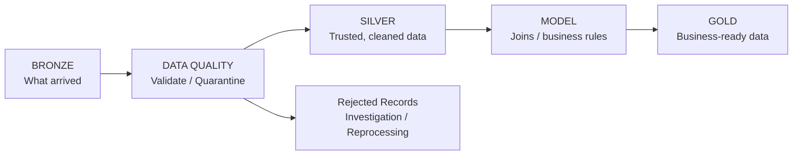

| Layer | Main responsibility | E-commerce examples |
|---|---|---|
| **Bronze** | Preserve source data and ingestion context | Raw order CDC, product file copies |
| **Silver** | Clean, deduplicate, validate, standardize, and reconcile | Trusted orders, customers, products |
| **Gold** | Present data for business questions | `fact_sales`, `dim_customer`, `dim_product`, daily revenue |

A physical historical CDC log in Bronze can preserve what arrived. Business-ready **SCD Type 2** dimensions may still be built in Silver or Gold to expose effective dates and current/historical versions for reporting.

## Which Fabric component performs transformations?

| Component | Purpose | Typical fit |
|---|---|---|
| **Fabric Notebook** | Interactive PySpark / Spark SQL development and execution | Explore data, develop transformations, debug |
| **Spark Job Definition** | Execute a modular Spark application as a workspace item | Production `.py` applications and reusable modules |
| **Fabric Environment** | Manage Spark runtime, libraries, and session configuration | Consistent dependencies across jobs |
| **Starter / Custom Spark Pools** | Managed compute for Spark sessions | Starter for standard managed configurations; Custom for additional sizing control |
| **Dataflow Gen2** | Visual transformations using Power Query | Low-code filtering, joins, cleaning, shaping |
| **Materialized Lake Views** | Declaratively define persisted, refreshable Lakehouse transformations | Managed dependency ordering and refresh of suitable datasets |

### Notebook vs Spark Job Definition

```text
Development / Exploration              Modular Production Application
--------------------------------      --------------------------------
Fabric Notebook                       main.py + supporting .py files
  └─ PySpark / Spark SQL                 └─ Spark Job Definition
      └─ Delta Tables                        └─ Fabric Environment
                                              └─ Managed Spark Compute
                                                  └─ Delta Tables
```

**Wheel packaging is not mandatory** for a PySpark Spark Job Definition. A main Python file and optional reference files can be used. Larger codebases may still benefit from package-based dependency management.

### Fabric Environment vs Spark Pool

- **Custom Pool:** Provides choices for node sizes, families, and scaling behavior.
- **Environment Item:** Defines reusable Spark session configuration, runtime, libraries, and compute settings used by Notebooks or Spark Job Definitions.
- **Capacity:** Supplies the broader available Fabric resources and affects consumption and concurrency.

### Materialized Lake Views (optional approach)

Materialized Lake Views persist computed results as Delta data. Fabric can discover dependencies and coordinate refreshes. They are **not ordinary virtual SQL views**. SQL-authored views can use refresh optimization where supported; PySpark-authored materialized lake views have different refresh limitations.

They simplify some declarative Bronze-to-Gold transformation flows, but they are not required when a modular Spark application already meets the project needs.

---

# 6. Lakehouse vs Warehouse: Two valid paths to Gold

A Gold layer does **not** require a Warehouse.

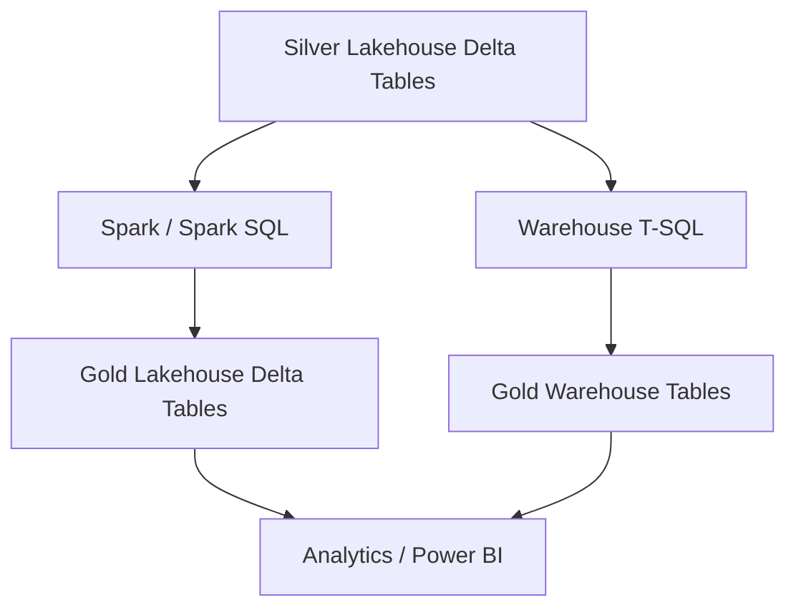

| Lakehouse approach | Warehouse approach |
|---|---|
| Spark-oriented development | T-SQL-oriented development |
| PySpark and Spark SQL build/modify Delta tables | Supported T-SQL DML, `MERGE`, stored procedures and multi-table transactions |
| Lakehouse SQL analytics endpoint provides read-oriented T-SQL access to Delta tables | Warehouse supports writing and querying its tables through T-SQL |
| Appropriate when the engineering team owns Gold transformations in Spark | Appropriate when a SQL/data-warehouse team owns analytical models |

**Both can store their table data in OneLake.** Creating physical Gold Warehouse tables may create separately materialized data; shared storage does not automatically mean there is only one physical copy.

### Lakehouse Files vs Tables

| Area | Examples | SQL analytics endpoint |
|---|---|---|
| **Files** | CSV, JSON, ordinary Parquet | Not automatically queryable as SQL tables |
| **Tables** | Registered Delta tables | Queryable with T-SQL after metadata synchronization |

A typical Spark conversion:

```python
orders_df = spark.read.option("header", True).csv("Files/orders/")
orders_df.write.format("delta").mode("overwrite").saveAsTable("orders")
```

The Lakehouse SQL analytics endpoint can then expose `orders` as a Delta table for `SELECT` queries, subject to schema configuration and metadata synchronization.

---

# 7. Making Gold data useful: SQL, Semantic Models, and Power BI

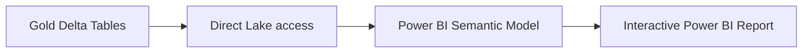

| Component | What it contributes |
|---|---|
| **Lakehouse SQL Analytics Endpoint** | Read-oriented T-SQL queries over Lakehouse Delta tables |
| **Power BI Semantic Model** | Relationships, reusable DAX measures, calculations, and analytical definitions |
| **Direct Lake** | Storage mode that lets semantic models read data from OneLake Delta tables without a traditional full import copy |
| **Power BI Reports** | Interactive sales, product, customer, and profitability visualizations |

**Example:** `Total Revenue` can be defined once as a semantic-model measure and reused across reports. The semantic model is the analytical layer between the Gold tables and the visuals.

**Direct Lake on OneLake** and **Direct Lake on SQL** have different metadata/security behavior. Direct Lake on SQL does **not** mean that every report query executes as T-SQL; some scenarios may use DirectQuery fallback.

For Session 1, remember the overall relationship:

> **Gold stores business-ready data → Semantic Model defines analytical meaning → Power BI displays it.**

---

# 8. Orchestration and operations

The transformation tools perform work. **Data Factory Pipelines** coordinate the work.

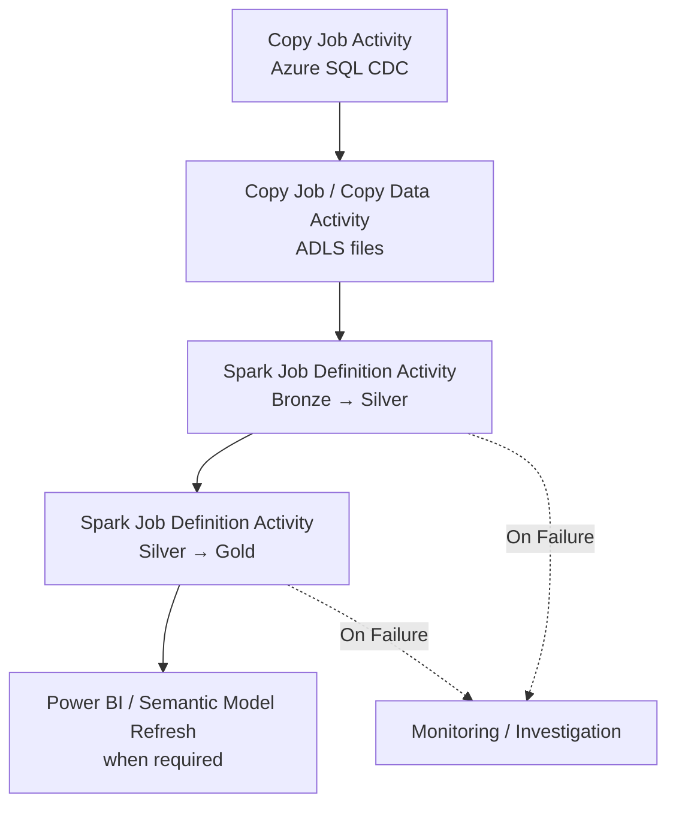

The diagram illustrates one sequential workflow. Independent ingestion activities can also run **in parallel**, with downstream processing starting only after the required sources succeed.

### Fabric components used in orchestration

| Component | Purpose |
|---|---|
| **Data Factory Pipeline** | Coordinates activities, dependencies, scheduling, and retries |
| **Copy Job Activity** | Invokes a separately configured Copy Job |
| **Copy Data Activity** | Performs a copy operation within the Pipeline |
| **Notebook Activity** | Executes a Fabric Notebook |
| **Spark Job Definition Activity** | Executes a modular Spark application |
| **Dataflow Activity** | Runs a Dataflow Gen2 transformation |
| **Monitoring Hub / Run History** | Inspects runs, statuses, failures, and operational details |

### What happens when Silver → Gold fails?

```text
Copy Job           ✓ Succeeded
Bronze → Silver    ✓ Succeeded
Silver → Gold      ✗ Failed
Report Refresh     — Not started
```

1. Open **Monitoring Hub** or the Pipeline's **Run History**.
2. Inspect the failed activity and relevant Spark job logs.
3. Correct the issue.
4. Use an appropriate **rerun-from-failure or rerun-from-selected-activity** option, where supported.
5. Verify the outputs before subsequent activities proceed.

**Design for idempotency:** Retrying an activity must not duplicate business records or lose changes. Rerun functionality does not guarantee idempotent transformations.

---

# 9. Governance, permissions, and data discovery

A real platform must control who can see the data and what they can do with it.

| Security or governance capability | Responsibility |
|---|---|
| **Microsoft Entra ID** | User identities and groups |
| **Workspace Roles** | Broad workspace-level permissions (Admin, Member, Contributor, Viewer) |
| **Fabric Item Permissions** | Access to a specific Lakehouse, Notebook, Report, or other item |
| **OneLake Security** | Granular access to supported data, including tables, rows, and columns |
| **SQL analytics endpoint security** | Applies SQL-based permissions or supported OneLake security modes, depending on configuration |
| **OneLake Catalog / Lineage** | Discover trusted assets and inspect dependencies |

### Example: Finance team access

Finance requires **read access only to `fact_sales`**, not `dim_customer`.

- Share the appropriate **Gold Lakehouse item** with minimal item permissions.
- Apply the appropriate **OneLake data security role** to restrict accessible tables.
- Check the **SQL analytics endpoint security mode** and verify effective access.
- Avoid granting broad **Contributor** workspace permissions for a read-only requirement.

> **Key principle:** An item permission and a data permission answer different questions. Access to a Lakehouse item does not automatically mean unrestricted access to every underlying table.

---

# 10. Version control, testing, and deployment

Our project uses separate **Development, Test, and Production workspaces**.

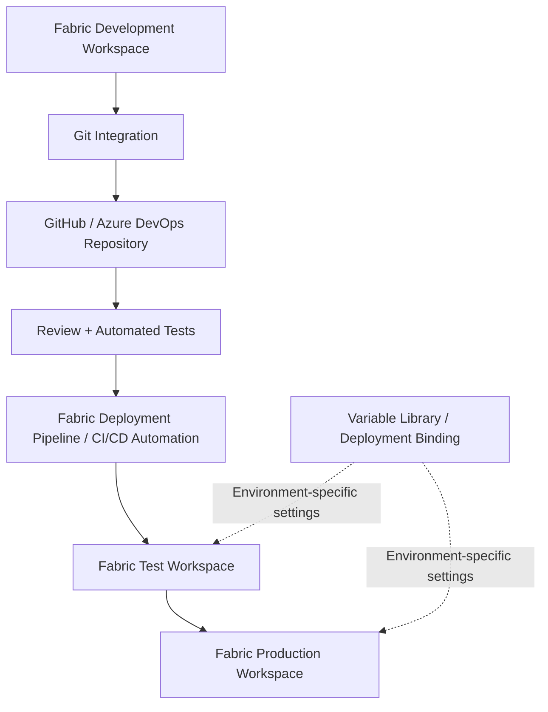

| Capability | Purpose |
|---|---|
| **Git Integration** | Version-control supported Fabric item definitions |
| **Deployment Pipelines** | Promote supported item definitions across workspace stages |
| **Variable Library** | Hold environment-specific identifiers and configurations |
| **Autobinding / Deployment Rules** | Map supported item references, such as a notebook's default Lakehouse |
| **Fabric REST APIs, CLI, and CI/CD tools** | Automate operations and deployments |
| **pytest / local Spark tests** | Validate Python and transformation logic before Fabric deployment |
| **Fabric Test Workspace** | Validate actual execution, connections, permissions, and integrations |

**Important limitations**

- Deployment does **not** automatically copy a Lakehouse's underlying files and table records into the new environment.
- A supported default-Lakehouse reference may be rebound, but **arbitrary hardcoded workspace IDs in Python code are not automatically rewritten**.
- Spark Job Definitions can use modular `.py` files without requiring wheel packaging.
- Passing local `pytest` tests does not establish that Fabric connections, library configurations, and the full Pipeline work correctly.

---

# 11. Beyond batch processing: Other Fabric capabilities

Our primary project is a **batch/incremental Medallion Architecture**, but Fabric covers additional analytical needs.

### Real-Time Intelligence

**Scenario:** Alert when payment failures cross a threshold within five minutes.

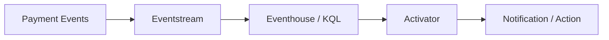

- **Eventstream:** Ingests and routes event data; can perform supported stream transformations.
- **Eventhouse / KQL:** Analyzes continuous events and time-windowed patterns.
- **Activator:** Detects configured conditions and triggers supported actions.

These capabilities are **not mandatory** for a scheduled Bronze–Silver–Gold pipeline.

### Data Science and Machine Learning

**Scenario:** Predict which customers may stop purchasing.

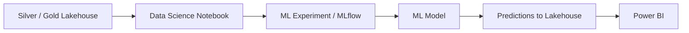

- **Data Science Notebook:** Train and evaluate models.
- **ML Experiment:** Record training runs, parameters, and metrics.
- **ML Model:** Register and manage model versions.
- **Batch scoring:** Write predictions back into Fabric for downstream analytics.

### Other areas to recognize

- **Fabric Databases:** Operational database experiences alongside analytical workloads.
- **Fabric IQ:** Additional semantic and business-context capabilities.
- **Copilot:** AI-assisted features where available and enabled.

These broaden the platform, but they do not need to be implemented during the first Medallion pipeline demonstration.

---

# 12. One-page component reference

| Project requirement | Primary Fabric component | Alternative / complementary component |
|---|---|---|
| Organize and fund compute | Capacity + Workspace | Capacity Metrics App for usage |
| Store raw and curated data | OneLake + Lakehouse | Warehouse for SQL-focused analytical tables |
| Ingest Azure SQL changes | CDC-enabled Copy Job where supported | Mirroring or custom incremental Copy approach |
| Ingest ADLS files | Copy Job / Copy Data | OneLake Shortcut |
| Implement data quality | Spark Notebook / Spark Job Definition | Dataflow Gen2 / Materialized Lake Views |
| Execute modular PySpark code | Spark Job Definition | Notebook |
| Manage Spark dependencies | Fabric Environment | Workspace defaults |
| Transform Silver into Gold | Spark + Lakehouse | Warehouse T-SQL / Materialized Lake Views |
| Query Lakehouse tables using T-SQL | SQL analytics endpoint | Warehouse SQL |
| Provide dashboards | Semantic Model + Power BI | Direct Lake as a semantic-model storage mode |
| Coordinate execution | Data Factory Pipeline | Materialized Lake View managed dependency refresh for suitable transformations |
| Investigate failures | Monitoring Hub / Run History | Spark execution logs |
| Restrict access | Item permissions + OneLake security | SQL endpoint permissions/mode |
| Version and release code | Git Integration + Deployment Pipelines | APIs, CLI, CI/CD automation |
| Analyze event streams | Eventstream + Eventhouse/KQL | Activator for conditions and actions |
| Build ML solutions | Data Science Notebook + ML Experiment/Model | Batch scoring into Lakehouse |

---

# 13. Check your understanding

1. What is the difference between **Fabric Capacity** and **OneLake**?
2. Does creating three Lakehouses create three independent OneLake storage services?
3. Why might a **CDC Copy Job** be more appropriate than a timestamp-only incremental copy for an operational database?
4. When should the team use a **OneLake Shortcut** instead of a physical copy?
5. Why can't the **Lakehouse SQL analytics endpoint** query ordinary CSV files in the Files area as registered Delta tables?
6. When might a **Spark Job Definition** be a better fit than a Notebook?
7. Is a **Warehouse** required in every Medallion Architecture project?
8. How do **Pipeline**, **Spark Job Definition**, and **Environment** differ?
9. Why is a **Semantic Model** useful between Gold Delta tables and Power BI reports?
10. What must be checked before promoting a Fabric solution from Development to Production?

---

# 14. Final architecture recap

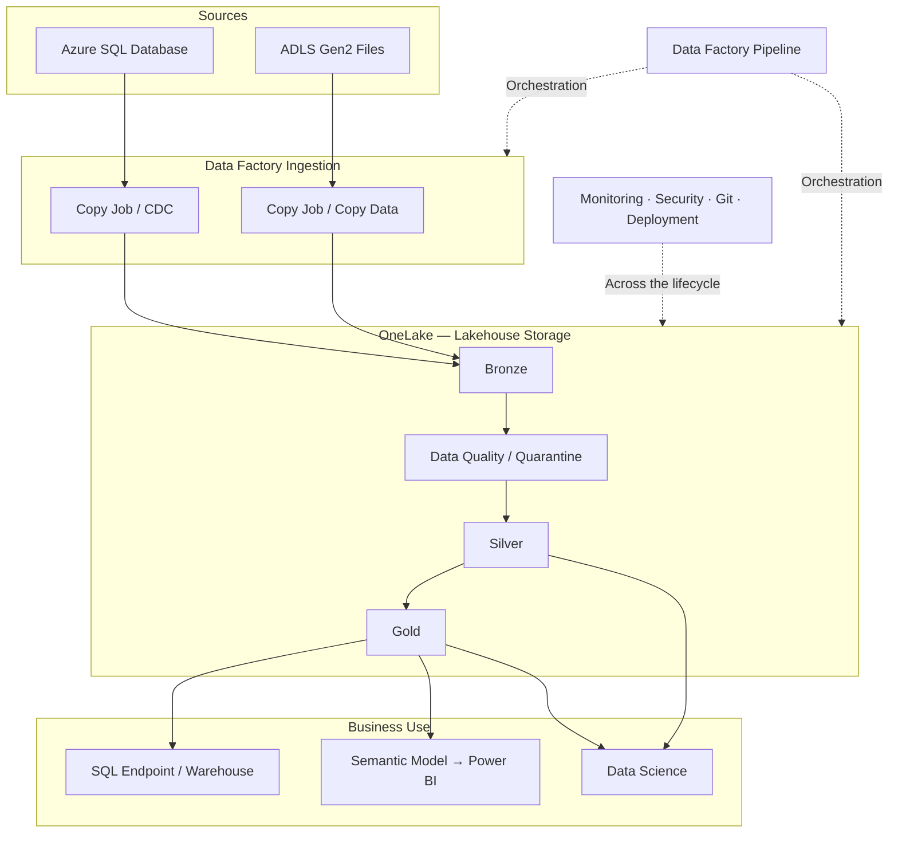

## The five ideas to remember

1. **Fabric is a unified SaaS analytics platform**, not simply a new ETL tool.
2. **Capacity supplies compute; OneLake supplies the unified data foundation; Workspaces organize Items.**
3. **Data Factory ingests and orchestrates; Lakehouse and Spark process and store; Warehouse offers a T-SQL-oriented alternative.**
4. **A semantic model gives business meaning to Gold data; Power BI makes it accessible through reports.**
5. **Security, monitoring, testing, and deployment make the solution usable in production.**

---

## Microsoft Learn — Further reading

- [What is Microsoft Fabric?](https://learn.microsoft.com/en-us/fabric/get-started/microsoft-fabric-overview)
- [OneLake overview](https://learn.microsoft.com/en-us/fabric/onelake/onelake-overview)
- [Lakehouse overview](https://learn.microsoft.com/en-us/fabric/data-engineering/lakehouse-overview)
- [Fabric Data Factory](https://learn.microsoft.com/en-us/fabric/data-factory/data-factory-overview)
- [Create a Spark Job Definition](https://learn.microsoft.com/en-us/fabric/data-engineering/create-spark-job-definition)
- [Fabric Environments](https://learn.microsoft.com/en-us/fabric/data-engineering/create-and-use-environment)
- [Materialized Lake Views](https://learn.microsoft.com/en-us/fabric/data-engineering/materialized-lake-views/overview-materialized-lake-view)
- [Fabric CI/CD overview](https://learn.microsoft.com/en-us/fabric/cicd/cicd-overview)

*Features, preview status, connectors, and available UI controls may vary by tenant, capacity, region, and Microsoft Fabric updates.*
