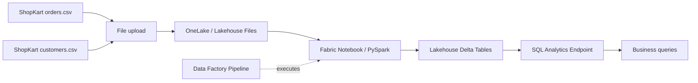
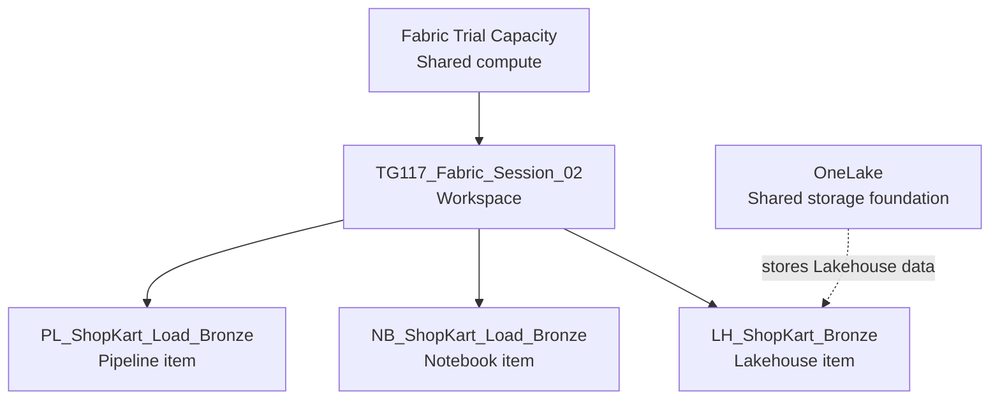
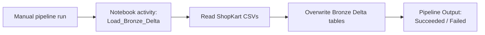
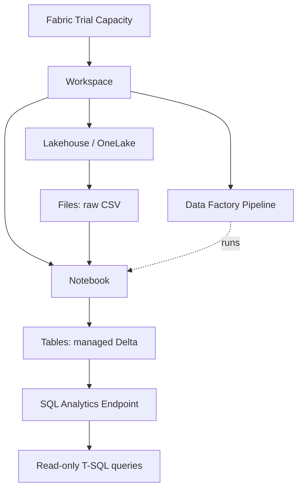

# Microsoft Fabric — Session 02

## Your First Hands-On Data Engineering Workflow

**ShopKart E-Commerce Project | Microsoft Fabric 60-Day Trial | Self-Contained Practical Workbook**

> **Session goal:** Create a workspace and Lakehouse, store two source CSV files in OneLake, read them with a Fabric Notebook, create Delta tables, query them using T-SQL, and run the Notebook from a Data Factory Pipeline.

**Estimated duration:** 2 hours  
**Platform:** Microsoft Fabric Trial capacity  
**Extra Azure services:** None  
**Source data:** Two small CSV files included in this workbook  
**Local setup:** Windows PowerShell is optional; an in-Fabric alternative is provided.

---

## 1. What You Will Build



| Responsibility | Fabric component | Result |
|---|---|---|
| Organize project resources | Workspace | One development workspace |
| Store raw files | Lakehouse → Files (OneLake) | Two CSV files |
| Process data | Notebook (PySpark) | Two Spark DataFrames |
| Persist structured data | Lakehouse → Tables | Two managed Delta tables |
| Explore data with SQL | SQL Analytics Endpoint | T-SQL queries |
| Execute a repeatable task | Data Factory Pipeline | Notebook activity and run history |

**Important distinction:** Uploading local files into a Lakehouse is a learning exercise. It is not an automated Data Factory ingestion pipeline. Automated Copy Data ingestion will be covered separately.

### Session sequence

| Part | Approx. duration |
|---|---:|
| Fabric Trial, Workspace and Lakehouse | 25 min |
| Create and upload source CSV files | 20 min |
| Notebook and Delta table creation | 40 min |
| SQL Analytics Endpoint | 15 min |
| Data Factory Pipeline and run history | 15 min |
| Verification and recap | 5 min |

---

## 2. Confirm Your Fabric Trial Environment

1. Open **https://app.fabric.microsoft.com** and sign in.
2. Open the account menu in the upper-right corner and check the trial information. Another current path is **OneLake catalog → Govern → Capacities → Trial**.
3. Open **Workspaces** from the main navigation.
4. Work in a workspace assigned to the **Fabric Trial capacity**, not an ordinary Power BI-only workspace.

A *Fabric (Free)* user license can coexist with an active **Fabric Trial capacity**. The license and the capacity are different things.

### Create the development workspace

1. Select **Workspaces → New workspace**.
2. Workspace name: **`TG117_Fabric_Session_02`**.
3. Open **Advanced** or the **Workspace type / License mode** setting, depending on the current portal layout.
4. Select **Trial / Fabric Trial** as the workspace type or assigned capacity.
5. Select **Apply** or **Create**.
6. Open **Workspace settings → Workspace type** to verify that the workspace uses the trial capacity.

If the workspace already exists, open it and confirm its capacity assignment instead of creating a duplicate.

### Understanding the hierarchy



| Term | Meaning |
|---|---|
| Capacity | Compute resources used by supported Fabric workloads |
| Workspace | A container for Fabric items and access management |
| Fabric item | A resource such as a Lakehouse, Notebook or Pipeline |
| OneLake | Unified storage for Fabric data |

---

## 3. Create the Bronze Lakehouse

1. Open the workspace **`TG117_Fabric_Session_02`**.
2. Select **New item** (or **+ New item**).
3. Search for **Lakehouse**.
4. Enter the name **`LH_ShopKart_Bronze`**.
5. Keep the default **Lakehouse schemas** option enabled, if shown.
6. Select **Create**.

The Lakehouse should display:

- **Files** — raw CSV, JSON, Parquet and other files.
- **Tables → dbo** — managed tables (in a schema-enabled Lakehouse).
- **SQL analytics endpoint** — a SQL query experience that Fabric creates along with the Lakehouse.

> **Why `dbo`?** New schema-enabled Lakehouses provide a default schema named `dbo`. When a notebook writes a table without specifying a schema, Fabric places it under the default schema.

### Create the source folder

1. Open **`LH_ShopKart_Bronze`**.
2. In the Lakehouse explorer, expand **Files**.
3. Use the **...** menu next to Files and create a new folder.
4. Name it **`shopkart_sources`**.

Expected path:

```text
LH_ShopKart_Bronze
└── Files
    └── shopkart_sources
```

The Lakehouse exists before the source data is uploaded.

---

## 4. Prepare Two Source Files

The ShopKart source systems provide two CSV datasets:

| File | What it contains | Rows (excluding header) |
|---|---|---:|
| `shopkart_orders.csv` | Order transactions | 14 |
| `shopkart_customers.csv` | Customer master data | 8 |

The orders data deliberately includes a duplicate order record, inconsistent city spelling, and a missing city. These source-data issues will be used in a later data quality session. **Do not clean the Bronze data in this session.**

### Option A — Generate both files on Windows (recommended for demonstrating file upload)

1. Open **Windows PowerShell** or **PowerShell 7** on the local computer.
2. Copy and execute the **entire block** below.
3. It creates the folder `Downloads\ShopKart-Fabric-Session02` and both CSV files in UTF-8 without a BOM.
4. Re-running the block replaces the same two local files with the same sample data.

```powershell
$folder = Join-Path $HOME 'Downloads\ShopKart-Fabric-Session02'
New-Item -ItemType Directory -Path $folder -Force | Out-Null

$orders = @'
order_id,customer_id,order_date,product_id,quantity,unit_price,order_status,city
1001,201,2026-11-01,P101,2,799.00,Delivered,Pune
1002,202,2026-11-01,P102,1,1499.00,Delivered,Mumbai
1003,203,2026-11-02,P103,3,299.00,Shipped,Nagpur
1004,204,2026-11-02,P101,1,799.00,Cancelled,Delhi
1005,201,2026-11-03,P104,2,1999.00,Delivered,Pune
1006,205,2026-11-03,P102,1,1499.00,Delivered,mumbai
1007,206,2026-11-04,P103,4,299.00,Delivered,Bengaluru
1008,202,2026-11-04,P105,1,2499.00,Shipped,MUMBAI
1009,207,2026-11-05,P101,2,799.00,Delivered,Hyderabad
1010,203,2026-11-05,P104,1,1999.00,Delivered,Nagpur
1011,208,2026-11-06,P105,1,2499.00,Returned,
1012,205,2026-11-06,P103,2,299.00,Delivered,Mumbai
1013,207,2026-11-07,P102,1,1499.00,Delivered,Hyderabad
1013,207,2026-11-07,P102,1,1499.00,Delivered,Hyderabad
'@

$customers = @'
customer_id,customer_name,city,signup_date
201,Aarav Shah,Pune,2025-09-03
202,Meera Desai,Mumbai,2025-11-21
203,Ishaan Rao,Nagpur,2026-01-15
204,Sana Khan,Delhi,2026-02-08
205,Neha Patil,Mumbai,2025-12-12
206,Rohan Gupta,Bengaluru,2026-03-05
207,Priya Nair,Hyderabad,2025-10-10
208,Arjun Mehta,Chennai,2026-04-18
'@

$utf8NoBom = New-Object System.Text.UTF8Encoding($false)
[System.IO.File]::WriteAllText((Join-Path $folder 'shopkart_orders.csv'), $orders.Trim() + "`n", $utf8NoBom)
[System.IO.File]::WriteAllText((Join-Path $folder 'shopkart_customers.csv'), $customers.Trim() + "`n", $utf8NoBom)

Get-ChildItem $folder -Filter '*.csv' | Select-Object Name, Length
Write-Host "CSV files created in: $folder"
```

**Expected result:** Two non-empty CSV files in the Downloads folder.

### Upload the files into Fabric

1. Return to the Lakehouse explorer for **`LH_ShopKart_Bronze`**.
2. Navigate to **Files → `shopkart_sources`**.
3. Select **... → Upload → Upload files** on the folder (or use the Upload action in the file pane).
4. Choose **`shopkart_orders.csv`** and **`shopkart_customers.csv`**.
5. Complete the upload and refresh the folder if necessary.
6. Open the file previews to confirm that rows and headers are visible.

Expected OneLake locations:

```text
Files/shopkart_sources/shopkart_orders.csv
Files/shopkart_sources/shopkart_customers.csv
```

**What is happening?** You have uploaded raw files to the Lakehouse's Files area. They are not yet registered as Delta tables in the SQL analytics endpoint.

### Option B — Create source files directly in a Fabric Notebook

Use this alternative only if local file upload is unavailable, or when demonstrating how Fabric can create files programmatically.

First create and attach the Notebook as described in Section 5. Then run the following cell **before** the CSV-reading cells:

```python
import notebookutils

orders_csv = """order_id,customer_id,order_date,product_id,quantity,unit_price,order_status,city
1001,201,2026-11-01,P101,2,799.00,Delivered,Pune
1002,202,2026-11-01,P102,1,1499.00,Delivered,Mumbai
1003,203,2026-11-02,P103,3,299.00,Shipped,Nagpur
1004,204,2026-11-02,P101,1,799.00,Cancelled,Delhi
1005,201,2026-11-03,P104,2,1999.00,Delivered,Pune
1006,205,2026-11-03,P102,1,1499.00,Delivered,mumbai
1007,206,2026-11-04,P103,4,299.00,Delivered,Bengaluru
1008,202,2026-11-04,P105,1,2499.00,Shipped,MUMBAI
1009,207,2026-11-05,P101,2,799.00,Delivered,Hyderabad
1010,203,2026-11-05,P104,1,1999.00,Delivered,Nagpur
1011,208,2026-11-06,P105,1,2499.00,Returned,
1012,205,2026-11-06,P103,2,299.00,Delivered,Mumbai
1013,207,2026-11-07,P102,1,1499.00,Delivered,Hyderabad
1013,207,2026-11-07,P102,1,1499.00,Delivered,Hyderabad
"""

customers_csv = """customer_id,customer_name,city,signup_date
201,Aarav Shah,Pune,2025-09-03
202,Meera Desai,Mumbai,2025-11-21
203,Ishaan Rao,Nagpur,2026-01-15
204,Sana Khan,Delhi,2026-02-08
205,Neha Patil,Mumbai,2025-12-12
206,Rohan Gupta,Bengaluru,2026-03-05
207,Priya Nair,Hyderabad,2025-10-10
208,Arjun Mehta,Chennai,2026-04-18
"""

# Relative paths in this Spark notebook refer to its default Lakehouse.
notebookutils.fs.mkdirs("Files/shopkart_sources")

notebookutils.fs.put(
    "Files/shopkart_sources/shopkart_orders.csv",
    orders_csv.strip() + "\n",
    True
)
notebookutils.fs.put(
    "Files/shopkart_sources/shopkart_customers.csv",
    customers_csv.strip() + "\n",
    True
)

for item in notebookutils.fs.ls("Files/shopkart_sources"):
    print(item.name, item.size, "bytes")
```

Here `notebookutils.fs.put(path, content, True)` writes UTF-8 text to a file and overwrites a file with the same name. **Do not run Options A and B as separate ingestion steps**; either option creates the same two source files at the same Fabric location.

> Fabric does not require a Linux terminal for this operation. A PySpark Notebook can create files directly in OneLake through NotebookUtils.

---

## 5. Create a Fabric Notebook

### Notebook navigation

1. Return to **`TG117_Fabric_Session_02`**.
2. Select **New item → Notebook**.
3. Name the Notebook **`NB_ShopKart_Load_Bronze`**.
4. Set its primary language to **PySpark (Python)** if necessary.
5. In the notebook's **Lakehouse explorer** panel, select **Add lakehouse → Existing lakehouse**.
6. Select **`LH_ShopKart_Bronze`** from the current workspace.
7. **Pin / Set as default** this Lakehouse. The default Lakehouse usually displays a pin indicator.
8. If you changed the default Lakehouse after starting a Spark session, **restart the session** before running the remaining cells.

> **Why set a default Lakehouse?** Relative paths such as `Files/shopkart_sources/shopkart_orders.csv` resolve against the Notebook's default Lakehouse in a PySpark session. Tables created with unqualified names are also associated with that default Lakehouse.

### Cell 1 — Verify the source files

```python
import notebookutils

source_dir = "Files/shopkart_sources"

files = notebookutils.fs.ls(source_dir)
for f in files:
    print(f.name, f.size, "bytes")

assert notebookutils.fs.exists(f"{source_dir}/shopkart_orders.csv")
assert notebookutils.fs.exists(f"{source_dir}/shopkart_customers.csv")

print("Source files are available in the default Lakehouse.")
```

**Expected:** Both filenames appear and the assertions pass.

### Cell 2 — Read the CSV data with explicit schemas

```python
from pyspark.sql.types import (
    StructType, StructField,
    IntegerType, StringType, DateType, DecimalType
)

orders_schema = StructType([
    StructField("order_id", IntegerType(), True),
    StructField("customer_id", IntegerType(), True),
    StructField("order_date", DateType(), True),
    StructField("product_id", StringType(), True),
    StructField("quantity", IntegerType(), True),
    StructField("unit_price", DecimalType(10, 2), True),
    StructField("order_status", StringType(), True),
    StructField("city", StringType(), True)
])

customers_schema = StructType([
    StructField("customer_id", IntegerType(), True),
    StructField("customer_name", StringType(), True),
    StructField("city", StringType(), True),
    StructField("signup_date", DateType(), True)
])

orders_df = (
    spark.read
    .option("header", "true")
    .option("dateFormat", "yyyy-MM-dd")
    .schema(orders_schema)
    .csv("Files/shopkart_sources/shopkart_orders.csv")
)

customers_df = (
    spark.read
    .option("header", "true")
    .option("dateFormat", "yyyy-MM-dd")
    .schema(customers_schema)
    .csv("Files/shopkart_sources/shopkart_customers.csv")
)

orders_df.printSchema()
customers_df.printSchema()
```

**Why explicit schemas?** They control column types instead of letting Spark guess the types from the file content. For example, `order_date` is a date and `unit_price` is a decimal.

### Cell 3 — Inspect and validate the raw data

```python
print("Orders:", orders_df.count())
print("Customers:", customers_df.count())

assert orders_df.count() == 14, "Unexpected number of order rows"
assert customers_df.count() == 8, "Unexpected number of customer rows"

orders_df.show(20, truncate=False)
customers_df.show(20, truncate=False)
```

Expected counts:

```text
Orders: 14
Customers: 8
```

### Cell 4 — Observe the source quality issues (without correcting them)

```python
from pyspark.sql.functions import col, countDistinct

print("Total rows:", orders_df.count())
print("Distinct order IDs:", orders_df.select(countDistinct("order_id")).first()[0])

orders_df.groupBy("order_status").count().orderBy("order_status").show()
orders_df.select("city").distinct().show(truncate=False)
```

Expected observations:

- There are **14 rows but 13 distinct order IDs**.
- The order statuses are Delivered (10), Shipped (2), Cancelled (1), and Returned (1).
- City values include `Mumbai`, `mumbai`, and `MUMBAI`.
- One order has an empty/missing city.

**Bronze principle:** Keep source data available as received. Cleaning and deduplication will take place later.

### Cell 5 — Save managed Delta tables in the Lakehouse

```python
(
    orders_df.write
    .format("delta")
    .mode("overwrite")
    .option("overwriteSchema", "true")
    .saveAsTable("orders_bronze")
)

(
    customers_df.write
    .format("delta")
    .mode("overwrite")
    .option("overwriteSchema", "true")
    .saveAsTable("customers_bronze")
)

print("Delta tables created successfully.")
```

**Why `overwrite`?** Running the Notebook again replaces the same demo tables rather than appending duplicate records. This makes the exercise repeatable. This is safe here because the tables contain only sample training data. Production overwrite policies depend on business requirements.

**Expected in Lakehouse explorer:**

```text
LH_ShopKart_Bronze
├── Files
│   └── shopkart_sources
│       ├── shopkart_orders.csv
│       └── shopkart_customers.csv
└── Tables
    └── dbo
        ├── orders_bronze
        └── customers_bronze
```

If schemas were disabled when the Lakehouse was created, the two tables appear directly under **Tables** instead of inside the `dbo` folder.

### Cell 6 — Verify that the Delta tables are queryable with Spark SQL

```python
spark.sql("SELECT COUNT(*) AS orders_count FROM orders_bronze").show()
spark.sql("SELECT COUNT(*) AS customers_count FROM customers_bronze").show()

spark.sql("""
    SELECT order_status, COUNT(*) AS order_rows
    FROM orders_bronze
    GROUP BY order_status
    ORDER BY order_status
""").show()
```

Expected counts: **14 orders and 8 customers**.

### Cell 7 — Examine table metadata

```python
spark.sql("DESCRIBE DETAIL orders_bronze").select(
    "format", "numFiles", "location"
).show(truncate=False)
```

**Expected:** The table format is `delta`. The storage location points to the Lakehouse's managed Tables area. `numFiles` can vary depending on how Spark writes the data.

---

## 6. SQL Analytics Endpoint — Query the Delta Tables

A Lakehouse automatically gets a SQL analytics endpoint. The endpoint provides **read-only T-SQL querying of the managed Delta tables**. It does not turn CSV files in Files into SQL tables automatically.

### Open the endpoint

1. Return to the **`TG117_Fabric_Session_02`** workspace.
2. Find the **SQL analytics endpoint** associated with **`LH_ShopKart_Bronze`**, or open the Lakehouse and use the top-right experience dropdown to switch to **SQL analytics endpoint**.
3. Select **New SQL query**.
4. Run each SQL block separately.

> **Metadata synchronization:** New Delta tables may take a short time to appear in the SQL endpoint. Refresh the explorer or the endpoint's metadata if the tables are not visible immediately.

### Query 1 — Confirm row counts

```sql
SELECT COUNT(*) AS total_orders
FROM dbo.orders_bronze;

SELECT COUNT(*) AS total_customers
FROM dbo.customers_bronze;
```

**Expected:** `14` orders and `8` customers.

### Query 2 — Review recent orders

```sql
SELECT TOP (10)
    order_id,
    customer_id,
    order_date,
    product_id,
    quantity,
    unit_price,
    order_status
FROM dbo.orders_bronze
ORDER BY order_date DESC, order_id DESC;
```

### Query 3 — Group orders by status

```sql
SELECT
    order_status,
    COUNT(*) AS number_of_rows
FROM dbo.orders_bronze
GROUP BY order_status
ORDER BY order_status;
```

Expected:

| order_status | number_of_rows |
|---|---:|
| Cancelled | 1 |
| Delivered | 10 |
| Returned | 1 |
| Shipped | 2 |

### Query 4 — Read across the two Delta tables

```sql
SELECT TOP (10)
    o.order_id,
    c.customer_name,
    o.order_date,
    o.order_status,
    o.quantity * o.unit_price AS order_amount
FROM dbo.orders_bronze AS o
INNER JOIN dbo.customers_bronze AS c
    ON o.customer_id = c.customer_id
ORDER BY o.order_id;
```

**Purpose:** A SQL user can join supported Delta tables without running a Spark Notebook.

### Query 5 — Revenue from delivered orders (raw preview)

```sql
SELECT
    SUM(quantity * unit_price) AS delivered_revenue_preview
FROM dbo.orders_bronze
WHERE order_status = 'Delivered';
```

**Expected:** `16983.00`.

> **Important:** This is a demonstration using Bronze data. The duplicated order `1013` is counted twice. Real business reporting should use validated Silver/Gold tables. The amount above is not a production-quality revenue figure.

### What cannot be done here?

The SQL analytics endpoint is **read-only for the automatically exposed underlying Delta tables**. To change the data, use Spark or a suitable Warehouse-based workflow. SQL views and other supported SQL metadata objects are a separate capability.

---

## 7. Data Factory Pipeline — Run the Notebook

A Notebook can run directly in its editor. A Data Factory Pipeline can also execute the same Notebook as an activity and record the run status.

### Create a pipeline

1. Return to the workspace **`TG117_Fabric_Session_02`**.
2. Select **New item → Data pipeline**.
3. Name it **`PL_ShopKart_Load_Bronze`**.
4. Open the pipeline editor.
5. In the **Activities** pane, search for **Notebook**.
6. Add a **Notebook activity** to the canvas.
7. Rename the activity **`Load_Bronze_Delta`**.
8. Select the activity and open its **Settings** tab.
9. Select an available connection/authentication option for your trial workspace if prompted; then choose the existing Notebook **`NB_ShopKart_Load_Bronze`** from the Notebook dropdown.
10. Save the pipeline.



### Run and monitor

1. On the pipeline **Home** tab, select **Run** (or **Save and run** if prompted).
2. Wait for the activity to finish and inspect the **Output** tab beneath the pipeline canvas.
3. Open the activity details to view its status and related Notebook execution information.
4. If available, open the **Monitoring Hub** or pipeline run history for the same run.
5. Run the pipeline a second time and confirm that the Delta tables still contain **14** and **8** rows.

**Why is the second run important?** The Notebook writes with overwrite mode, so repeated demo runs do not duplicate the sample records in the two Bronze tables.

### What this pipeline does—and does not do

| Capability | In this session? |
|---|---|
| Execute a Notebook on demand | Yes |
| Record Notebook activity status | Yes |
| Re-create the Bronze Delta tables safely for demo | Yes |
| Copy data directly from Azure SQL / ADLS using Copy Data | Not yet |
| Run a full Bronze → Silver → Gold workflow | Not yet |
| Configure scheduling, complex dependencies and retry policies | Later session |

---

## 8. End-to-End Verification

Complete the following checks after all activities finish.

| Check | Expected result |
|---|---|
| Fabric Trial | Active; workspace uses Trial capacity |
| Lakehouse item | `LH_ShopKart_Bronze` exists |
| Source folder | `Files/shopkart_sources` exists |
| Raw files | Both CSV files visible |
| Notebook item | `NB_ShopKart_Load_Bronze` exists |
| Delta tables | `orders_bronze`, `customers_bronze` under Tables |
| Order row count | 14 |
| Customer row count | 8 |
| Distinct order IDs | 13 |
| SQL endpoint | Both tables can be queried using T-SQL |
| Pipeline | Notebook activity run succeeds |
| Rerun validation | Counts remain 14 and 8 |

### Knowledge checks

1. Why do we upload the original CSV files to **Files** rather than directly creating a Gold table?
2. What is the difference between a **CSV source file** and a **managed Delta table**?
3. Why does the SQL analytics endpoint see `orders_bronze` but not automatically expose `shopkart_orders.csv` as a table?
4. Why does the Notebook use a **default Lakehouse**?
5. Which Fabric item executes our Notebook when we select **Run** on the pipeline?
6. Why is the duplicate order preserved in Bronze?

---

## 9. Troubleshooting

| Symptom | Likely cause | What to check |
|---|---|---|
| Only Power BI items appear in **New item** | Workspace is not assigned to an eligible Fabric capacity, or Fabric item creation is restricted | **Workspace settings → Workspace type**; confirm Trial capacity and permissions |
| Lakehouse creation is unavailable | Capacity or workspace permission issue | Confirm active Trial and Contributor or higher access |
| CSV path not found in Notebook | Wrong folder, filename or default Lakehouse | Confirm `Files/shopkart_sources`; run Notebook Cell 1 |
| Notebook creates tables in a different Lakehouse | Wrong default Lakehouse | Pin `LH_ShopKart_Bronze` as default; restart Spark session |
| Spark startup fails or runs slowly | Temporary resource availability or capacity limits | Reduce concurrent notebook sessions; check trial capacity status |
| SQL endpoint does not display the table yet | Background metadata discovery is still running | Refresh the endpoint's table list or its metadata after a short interval |
| SQL reports invalid object name | Wrong SQL endpoint, schema or unsynchronized table | Open the endpoint belonging to the correct Lakehouse; look under `dbo` |
| Pipeline Notebook activity fails | Notebook selection, connection permissions or Notebook error | Open **Output → activity details** and inspect Notebook logs |
| Rows double after rerun | A different Notebook may be appending rather than overwriting | Verify `.mode("overwrite")` in Cell 5 |
| `INSERT` or `UPDATE` fails in SQL endpoint | Underlying Lakehouse Delta tables are read-only through that endpoint | Perform writes using Spark / an appropriate Warehouse workflow |

### Resetting the demonstration

Re-run Notebook Cells 1–7 or re-run the pipeline. The sample Delta tables are rebuilt with the same data. Avoid deleting the entire Lakehouse unless you intend to remove the source files, registered tables, SQL endpoint and related data.

---

## 10. Session Summary



**Key ideas**

- **Workspace** organizes the Fabric items.
- **Lakehouse Files** stores raw sources in OneLake.
- **Notebook** reads sources and writes Delta tables using Spark.
- **Lakehouse Tables** stores managed Delta tables for processing and querying.
- **SQL analytics endpoint** lets SQL users query supported Delta tables without modifying them.
- **Data Factory Pipeline** can execute the Notebook and record success or failure.

**Next session:** Repeatable data ingestion using **Fabric Data Factory Copy Data / Copy Job**, then connect ingestion to transformation activities through pipeline dependencies.

---

## Official Microsoft Learn References

1. [Fabric trial capacity](https://learn.microsoft.com/en-us/fabric/fundamentals/fabric-trial)
2. [Create a Lakehouse](https://learn.microsoft.com/en-us/fabric/data-engineering/create-lakehouse)
3. [Upload CSV files into a Lakehouse](https://learn.microsoft.com/en-us/fabric/data-engineering/get-started-csv-upload)
4. [Create and use Fabric Notebooks](https://learn.microsoft.com/en-us/fabric/data-engineering/how-to-use-notebook)
5. [NotebookUtils filesystem operations](https://learn.microsoft.com/en-us/fabric/data-engineering/notebookutils/notebookutils-file-system)
6. [SQL analytics endpoint](https://learn.microsoft.com/en-us/fabric/data-engineering/lakehouse-sql-analytics-endpoint)
7. [Data Factory Notebook activity](https://learn.microsoft.com/en-us/fabric/data-factory/notebook-activity)
8. [Fabric Lakehouse schemas](https://learn.microsoft.com/en-us/fabric/data-engineering/lakehouse-schemas)
