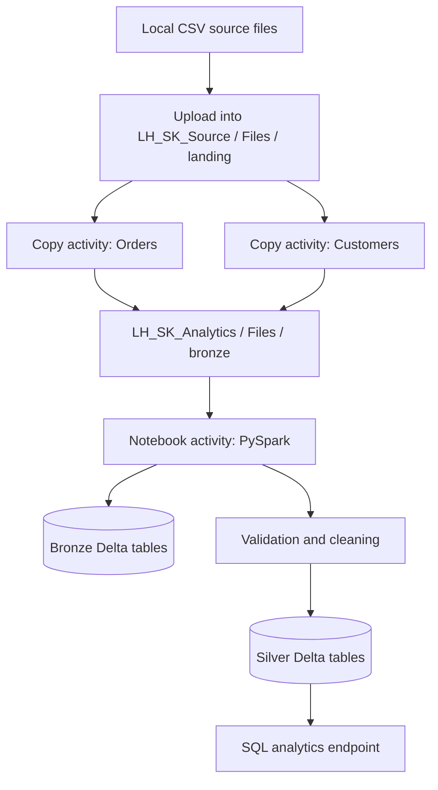
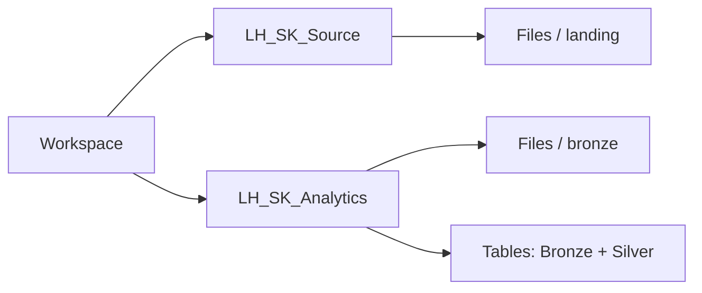
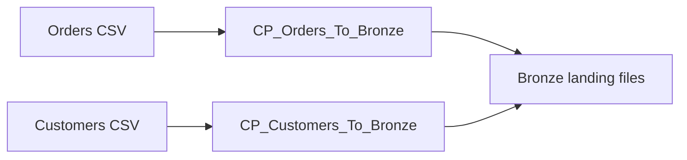
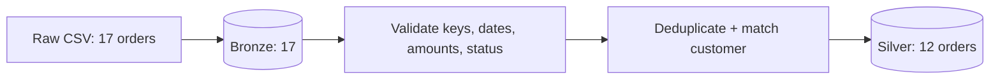
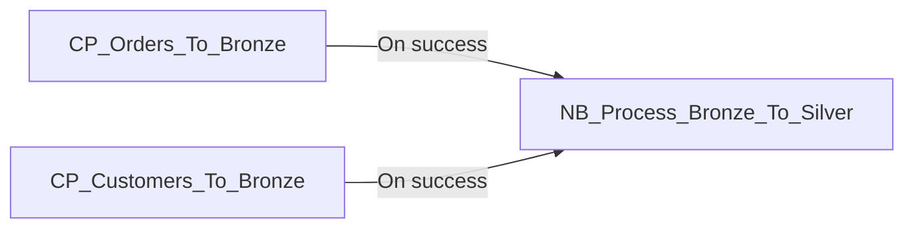
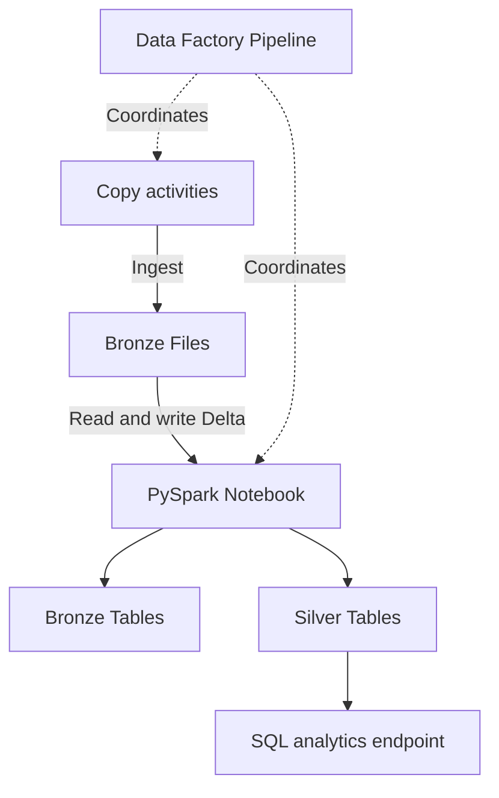

# Microsoft Fabric — Session 03

## Data Factory Ingestion, Pipeline Orchestration, and Bronze-to-Silver Processing

**Project:** ShopKart E-Commerce | **Environment:** Microsoft Fabric 60-day Trial | **Duration:** Approximately 2 hours

> **Starting point:** A Microsoft Fabric account with an active Trial capacity. This lab creates every workspace, Lakehouse, Notebook, Pipeline, source file, and table from scratch. No files or resources from earlier sessions are required.

---

## 1. Learning objectives

By the end of this session, you will be able to:

1. Create a workspace and two Lakehouses on a Fabric Trial capacity.
2. Prepare source CSV files and upload them to OneLake.
3. Configure **two Copy activities** in a Fabric Data Factory Pipeline.
4. Execute independent ingestion activities in parallel.
5. Use a **Notebook activity** only after both ingestion activities succeed.
6. Build Bronze and Silver Delta tables with PySpark.
7. Validate results using the **SQL analytics endpoint**.
8. Monitor a pipeline, investigate a failure, configure retries, and rerun safely.

### What will be created?

| Resource type | Name | Purpose |
|---|---|---|
| Workspace | `TG117_Fabric_Session03` | Container for the complete project |
| Lakehouse | `LH_SK_Source` | Simulated operational-system file exports |
| Lakehouse | `LH_SK_Analytics` | Bronze landing files and Bronze/Silver Delta tables |
| Notebook | `NB_SK_Bronze_To_Silver` | Read, validate, clean, and write Delta tables |
| Data pipeline | `PL_SK_Ingestion_To_Silver` | Run two copies followed by the Notebook |
| Local files | `shopkart_orders.csv`, `shopkart_customers.csv` | Source data created in this workbook |

### End-to-end architecture



**Important:** The source Lakehouse represents files exported from an operational system. In an actual project, the source might be Azure SQL Database, ADLS Gen2, an API, or another supported system. This exercise uses two Lakehouses so that no additional Azure services or paid source infrastructure are required.

---

## 2. Session roadmap

| Sequence | Topic | Approximate time |
|---|---|---:|
| 1 | Create workspace and Lakehouses | 15 min |
| 2 | Generate source files and upload | 15 min |
| 3 | Create and configure both Copy activities | 30 min |
| 4 | Write and validate the PySpark Notebook | 25 min |
| 5 | Connect pipeline dependencies and execute | 15 min |
| 6 | SQL verification, monitoring, retry and rerun | 20 min |

---

## 3. Create the Fabric workspace

1. Open **https://app.fabric.microsoft.com** and sign in with the Microsoft Entra organizational account that has access to your Fabric trial.
2. Select **Workspaces** in the navigation pane.
3. Select **+ New workspace**.
4. Enter the name **`TG117_Fabric_Session03`**.
5. Expand **Advanced**. Under **Workspace type**, select **Fabric Trial capacity** (or the active Trial capacity available in your tenant).
6. Select **Apply**.
7. Open the newly created workspace. Do **not** work inside the default **My Workspace** for this lab.

**Verification:** Open **Workspace settings → Workspace type** and check that the workspace is assigned to the active Trial capacity.

> **Why is this necessary?** A Fabric Free user license alone does not provide the capacity required to run Lakehouses and Spark jobs. The active Fabric Trial capacity supplies the compute used by the new workspace.

---

## 4. Create the two Lakehouses

From **`TG117_Fabric_Session03` → + New item → Lakehouse**:

1. Enter **`LH_SK_Source`**.
2. **Clear the “Lakehouse schemas” checkbox**, if it is selected. This keeps table names simple for the current exercise.
3. Select **Create**.
4. Return to the workspace and repeat the process with **`LH_SK_Analytics`**.

### What you will see

| Area | Meaning |
|---|---|
| `Files` | Stores raw files such as CSV, JSON, and Parquet |
| `Tables` | Shows Delta tables registered in the Lakehouse |
| `SQL analytics endpoint` | Provides read-only T-SQL access to supported Lakehouse Delta tables |



---

## 5. Generate the source files on Windows

The two CSV files contain deliberately imperfect records. There are duplicate rows, inconsistent text values, missing keys, invalid amounts, and an order referring to an unknown customer.

### 5.1 Open Windows PowerShell

Open **Windows PowerShell**, then paste and run this entire block. It creates both files in the `Downloads\Fabric_Session03_ShopKart` folder.

```powershell
$folder = Join-Path $env:USERPROFILE 'Downloads\Fabric_Session03_ShopKart'
New-Item -ItemType Directory -Path $folder -Force | Out-Null
$utf8 = New-Object System.Text.UTF8Encoding($false)

$customersCsv = @'
customer_id,customer_name,city,customer_status
C001,Anita Rao,Mumbai,Active
C002,Rahul Shah, MUMBAI ,Active
C003,Neha Singh,Pune,Active
C004,Farhan Ali,Delhi,Active
C005,Smita Desai, mumbai ,Active
C006,Isha Mehta,Bengaluru,Inactive
C007,Deepak Jain,Pune,Active
C004,Farhan Ali,Delhi,Active
,Unknown Customer,Nagpur,Active
C008,Tara Nair, pune ,Active
'@

$ordersCsv = @'
order_id,customer_id,order_date,amount,status
O1001,C001,2026-11-01,1200,Completed
O1002,C002,2026-11-01,850, completed
O1003,C003,2026-11-02,600,COMPLETED
O1004,C004,2026-11-02,2500,Completed
O1005,C005,2026-11-03,300,Cancelled
O1006,C001,2026-11-03,700,Completed
O1007,C006,2026-11-04,1500,Pending
O1008,C007,2026-11-04,990,Completed
O1009,C008,2026-11-05,450, Completed
O1010,C003,2026-11-05,-25,Completed
O1011,,2026-11-06,300,Completed
O1007,C006,2026-11-04,1500,Pending
O1012,C002,2026-11-06,1200,Completed
O1013,C007,2026-11-06,0,Cancelled
O1014,C004,2026-11-07,800,Completed
O1015,C005,2026-11-07,1200,Pending
O1016,C999,2026-11-08,550,Completed
'@

[System.IO.File]::WriteAllText((Join-Path $folder 'shopkart_customers.csv'), $customersCsv.Trim(), $utf8)
[System.IO.File]::WriteAllText((Join-Path $folder 'shopkart_orders.csv'), $ordersCsv.Trim(), $utf8)

Get-ChildItem $folder | Select-Object Name, Length
(Import-Csv (Join-Path $folder 'shopkart_customers.csv')).Count
(Import-Csv (Join-Path $folder 'shopkart_orders.csv')).Count
```

**Expected output:** Two CSV files; **10 customer rows** and **17 order rows** (excluding the header row in each file).

The source data is completely contained in the code block above. No external download is needed.

### 5.2 Understand the data quality problems

| Problem | Example | Expected Silver treatment |
|---|---|---|
| Duplicate customer | `C004` appears twice | Keep one record |
| Missing customer key | Empty `customer_id` in Customers | Reject the record |
| Inconsistent city | `Mumbai`, ` MUMBAI `, ` mumbai ` | Standardize to `MUMBAI` |
| Duplicate order | `O1007` appears twice | Keep one record |
| Invalid amount | `-25` or `0` | Reject non-positive amount |
| Missing reference | Order with blank customer ID | Reject the order |
| Unknown customer | Order `O1016` uses `C999` | Reject from Silver orders |
| Inconsistent order status | `completed`, `COMPLETED` | Standardize to `Completed` |

The Bronze layer will preserve these original rows. The Silver layer will apply the quality rules.

---

## 6. Upload CSV files into the source Lakehouse

1. In the Fabric workspace, open **`LH_SK_Source`**.
2. Expand **Files** in the Lakehouse Explorer.
3. Create a folder named **`landing`** under `Files`.
4. Select the **`...`** menu next to the `landing` folder.
5. Choose **Upload → Upload files**.
6. Select both files from `Downloads\Fabric_Session03_ShopKart` and upload them.

Your source Lakehouse should contain:

```text
LH_SK_Source
└── Files
    └── landing
        ├── shopkart_orders.csv
        └── shopkart_customers.csv
```

Open each CSV in Lakehouse Explorer to confirm that the header and records are visible.

> **Important:** Do not use **Load to tables** at this stage. We are deliberately keeping the source as CSV files so that Data Factory can ingest them through a Pipeline.

---

## 7. Create the Data Factory Pipeline

1. Return to the **workspace home page**.
2. Select **+ New item**.
3. Search for **`Pipeline`** (the item might be displayed as **Data pipeline** in some views).
4. Create **`PL_SK_Ingestion_To_Silver`**.
5. Open the Pipeline canvas and locate the **Activities** toolbar.

### 7.1 Add the Orders Copy activity

Select **Activities → Copy data → Add to canvas** or **Add pipeline activity → Copy activity**, depending on the layout.

Rename the activity to **`CP_Orders_To_Bronze`** using its **General** tab.

#### Source tab

| Setting | Value |
|---|---|
| Connection / source type | Lakehouse |
| Lakehouse | `LH_SK_Source` |
| Root folder | **Files** |
| File path type | **File path** |
| File | Browse to `landing/shopkart_orders.csv` |
| File format | **Binary** |

**Why Binary?** Here we want an unchanged copy of the CSV file. We will parse and type the data later with Spark. Binary copy does not require a column mapping.

#### Destination tab

| Setting | Value |
|---|---|
| Connection / destination type | Lakehouse |
| Lakehouse | `LH_SK_Analytics` |
| Root folder | **Files** |
| Destination folder path | `bronze` |
| File format | **Binary** |
| Copy behavior (if shown) | **Preserve hierarchy** |

If the destination interface exposes separate **Directory** and **File name** fields, use `bronze` and `shopkart_orders.csv` respectively. If it has one file-path picker, choose or type the corresponding destination under `Files/bronze`.

The final intended output path is:

```text
LH_SK_Analytics / Files / bronze / shopkart_orders.csv
```

**Check this path after the first successful copy.** Some File-browser layouts separate directory and filename, and the exact label can vary. The goal is an unchanged file at the path above, not a newly created Delta table.

### 7.2 Add the Customers Copy activity

Add another **Copy activity**, named **`CP_Customers_To_Bronze`**.

Use the same settings, but change the source file to **`landing/shopkart_customers.csv`** and the intended destination filename to **`shopkart_customers.csv`**.

The final intended output path is:

```text
LH_SK_Analytics / Files / bronze / shopkart_customers.csv
```

### 7.3 Why are these two activities independent?

Orders and customers can be copied in parallel because neither copy depends on the other.



Save the Pipeline. At this point, it contains only the two Copy activities.

### 7.4 Run the Copy activities first

Select **Home → Run** (or the Run option on the pipeline toolbar) to execute the Pipeline.

Open the **Output** tab to inspect activity statuses and the amount of data copied.

Open **`LH_SK_Analytics` → Files → bronze** and verify both source files exist. If an extra folder level was created, adjust **Destination → File path** or **Copy behavior**, then rerun before continuing.

**Checkpoint:** The two ingested files must be located at these exact relative paths:

```text
Files/bronze/shopkart_orders.csv
Files/bronze/shopkart_customers.csv
```

---

## 8. Create the Bronze-to-Silver Notebook

1. Return to the Fabric workspace.
2. Select **+ New item → Notebook**.
3. Name it **`NB_SK_Bronze_To_Silver`**.
4. In the Notebook's Lakehouse Explorer, select **Add lakehouse** and choose **`LH_SK_Analytics`**.
5. Make **`LH_SK_Analytics`** the **default Lakehouse** for the Notebook, if it is not already the default.
6. Select **PySpark** as the Notebook language.

The Notebook can use relative paths such as `Files/bronze/shopkart_orders.csv` because the default Lakehouse is attached.

> If you change the default Lakehouse while a Spark session is already running, stop or restart the session before executing the Notebook again.

### Cell 1 — Imports and paths

```python
from pyspark.sql import functions as F

orders_path = "Files/bronze/shopkart_orders.csv"
customers_path = "Files/bronze/shopkart_customers.csv"

print("Orders source:", orders_path)
print("Customers source:", customers_path)
```

### Cell 2 — Read the copied CSV files

```python
orders_raw = (
    spark.read
    .option("header", "true")
    .option("inferSchema", "false")
    .csv(orders_path)
)

customers_raw = (
    spark.read
    .option("header", "true")
    .option("inferSchema", "false")
    .csv(customers_path)
)

print("Raw orders:", orders_raw.count())
print("Raw customers:", customers_raw.count())

display(orders_raw.limit(10))
display(customers_raw.limit(10))
```

**Expected output:** `Raw orders: 17` and `Raw customers: 10`.

All columns are initially read as strings to preserve source values for the Bronze demonstration.

### Cell 3 — Create Bronze Delta tables

```python
(
    orders_raw.write
    .format("delta")
    .mode("overwrite")
    .option("overwriteSchema", "true")
    .saveAsTable("bronze_orders")
)

(
    customers_raw.write
    .format("delta")
    .mode("overwrite")
    .option("overwriteSchema", "true")
    .saveAsTable("bronze_customers")
)

print("Bronze tables created.")
```

The registered Delta tables appear under **`LH_SK_Analytics → Tables`**.

### Cell 4 — Clean the Customers dataset

```python
customers_prepared = (
    customers_raw
    .withColumn("customer_id", F.trim(F.col("customer_id")))
    .withColumn("customer_name", F.initcap(F.trim(F.col("customer_name"))))
    .withColumn("city", F.upper(F.trim(F.col("city"))))
    .withColumn("customer_status", F.initcap(F.trim(F.col("customer_status"))))
)

silver_customers = (
    customers_prepared
    .filter(
        F.col("customer_id").isNotNull()
        & (F.length(F.col("customer_id")) > 0)
    )
    .dropDuplicates(["customer_id"])
)

print("Silver customers:", silver_customers.count())
display(silver_customers.orderBy("customer_id"))
```

**Expected output:** `Silver customers: 8`.

### Cell 5 — Clean the Orders dataset

```python
orders_prepared = (
    orders_raw
    .withColumn("order_id", F.trim(F.col("order_id")))
    .withColumn("customer_id", F.trim(F.col("customer_id")))
    .withColumn("order_date", F.to_date(F.col("order_date"), "yyyy-MM-dd"))
    .withColumn("amount", F.col("amount").cast("decimal(12,2)"))
    .withColumn("status", F.initcap(F.lower(F.trim(F.col("status")))))
)

valid_orders = (
    orders_prepared
    .filter(
        F.col("order_id").isNotNull()
        & (F.length(F.col("order_id")) > 0)
        & F.col("customer_id").isNotNull()
        & (F.length(F.col("customer_id")) > 0)
        & F.col("order_date").isNotNull()
        & F.col("amount").isNotNull()
        & (F.col("amount") > 0)
        & F.col("status").isin("Completed", "Cancelled", "Pending")
    )
    .dropDuplicates(["order_id"])
)

silver_orders = valid_orders.join(
    silver_customers.select("customer_id"),
    on="customer_id",
    how="left_semi"
)

print("Silver orders:", silver_orders.count())
display(silver_orders.orderBy("order_id"))
```

**Expected output:** `Silver orders: 12`.

The **left-semi join** keeps only those orders whose customer exists in the Silver customer table. This removes the record with customer `C999`.

### Cell 6 — Write the Silver Delta tables

```python
(
    silver_customers.write
    .format("delta")
    .mode("overwrite")
    .option("overwriteSchema", "true")
    .saveAsTable("silver_customers")
)

(
    silver_orders.write
    .format("delta")
    .mode("overwrite")
    .option("overwriteSchema", "true")
    .saveAsTable("silver_orders")
)

print("Silver tables created.")
```

### Cell 7 — Validate all four tables

```python
expected_counts = {
    "bronze_orders": 17,
    "bronze_customers": 10,
    "silver_orders": 12,
    "silver_customers": 8,
}

for table_name, expected in expected_counts.items():
    actual = spark.table(table_name).count()
    print(f"{table_name}: actual={actual}, expected={expected}")
    assert actual == expected, f"Unexpected row count for {table_name}"

assert spark.table("silver_orders").select("order_id").distinct().count() == 12
assert spark.table("silver_customers").select("customer_id").distinct().count() == 8

print("VALIDATION PASSED")
```

### Expected results

| Table | Expected rows |
|---|---:|
| `bronze_orders` | 17 |
| `bronze_customers` | 10 |
| `silver_orders` | 12 |
| `silver_customers` | 8 |



### Why use Overwrite in this session?

`mode("overwrite")` replaces the current table contents each time the Notebook runs. This lets the same small sample be processed repeatedly without accumulating duplicate rows.

This is **full-refresh idempotency for the lab**, not a production CDC or incremental-load design. Those patterns use change tracking and/or Delta `MERGE` instead.

---

## 9. Orchestrate both copies and the Notebook

Return to **`PL_SK_Ingestion_To_Silver`**.

1. Open the **Activities** pane.
2. Search for **Notebook** and add a **Notebook activity** to the canvas.
3. Rename it to **`NB_Process_Bronze_To_Silver`**.
4. Open its **Settings** tab.
5. Under **Connection**, use the available organizational-user connection (create or select one if prompted).
6. Select **`NB_SK_Bronze_To_Silver`** in the **Notebook** selector.
7. No Notebook parameters are required for this exercise.

### Configure dependencies

Create two **On success** (green) connections:

- `CP_Orders_To_Bronze` → `NB_Process_Bronze_To_Silver`
- `CP_Customers_To_Bronze` → `NB_Process_Bronze_To_Silver`



Both Copy activities have **no dependency between them**, so they can start independently. The Notebook starts only when **both** upstream activities succeed.

**Do not connect the two copies to each other.** That would unnecessarily make the ingestion sequential.

### Execute the complete Pipeline

1. Save the Pipeline from the **Home** toolbar.
2. Stop any unnecessary interactive Spark sessions before triggering the Pipeline.
3. Select **Run**.
4. Observe both Copy activities and then the Notebook activity in **Output**.
5. Confirm that all three activities succeed.

**Trial capacity note:** If a Notebook fails with `TooManyRequestsForCapacity` / HTTP `430`, check for other active Spark sessions in **Monitoring Hub** or **Workspace settings → Job management**. Cancel only your own unnecessary jobs and retry when resources are available. A successful manual Notebook run can leave an interactive session active; close it explicitly rather than relying on the browser tab closing.

---

## 10. Query the tables through the SQL analytics endpoint

1. Open **`LH_SK_Analytics`**.
2. Use the view selector to switch from **Lakehouse** to **SQL analytics endpoint**.
3. Create a **New SQL query**.
4. Run the following statements separately or together.

```sql
SELECT COUNT(*) AS bronze_orders_count
FROM dbo.bronze_orders;

SELECT COUNT(*) AS bronze_customers_count
FROM dbo.bronze_customers;

SELECT COUNT(*) AS silver_orders_count
FROM dbo.silver_orders;

SELECT COUNT(*) AS silver_customers_count
FROM dbo.silver_customers;
```

### Explore standardized data

```sql
SELECT TOP (20)
    customer_id,
    customer_name,
    city,
    customer_status
FROM dbo.silver_customers
ORDER BY customer_id;
```

```sql
SELECT TOP (20)
    order_id,
    customer_id,
    order_date,
    amount,
    status
FROM dbo.silver_orders
ORDER BY order_id;
```

### Join the Silver tables

```sql
SELECT
    c.city,
    COUNT(*) AS order_count,
    SUM(o.amount) AS total_order_amount
FROM dbo.silver_orders AS o
INNER JOIN dbo.silver_customers AS c
    ON o.customer_id = c.customer_id
WHERE o.status = 'Completed'
GROUP BY c.city
ORDER BY total_order_amount DESC;
```

This is an exploration query, **not** a Gold table. The analytical Gold layer will be modeled in a later session.

> The Lakehouse SQL analytics endpoint allows read-only T-SQL querying of the underlying Delta tables. Use Spark or an appropriate Warehouse workflow to modify stored data.

**If a new table does not appear immediately:** Refresh the Lakehouse Explorer and SQL analytics endpoint view. Metadata synchronization can take a short time after Delta writes.

---

## 11. Monitoring, retries, and safe reruns

### 11.1 Inspect execution history

From the Pipeline editor, open the **Output** tab and inspect each activity's status, duration, and input/output information.

You can also open the **Monitor / Monitoring Hub** experience (or the newer monitoring view if enabled for your tenant) to locate the Pipeline run and its activity details.

| What to inspect | Why it matters |
|---|---|
| Pipeline run status | Overall success or failure |
| Copy activity input/output | Files copied and duration |
| Notebook activity output | Spark job result and diagnostics |
| Activity duration | Slow or blocked processing |
| Error details | Locate which step failed and why |

### 11.2 Configure simple retries

1. Select `CP_Orders_To_Bronze` on the Pipeline canvas.
2. Open the activity's **General** tab.
3. Enable **Retries**.
4. Set **Retry = 1** and **Retry interval type = Fixed**, with **Retry interval (sec) = 30**.
5. Repeat for `CP_Customers_To_Bronze`.
6. Save the Pipeline.

Retries help with transient failures. They do not fix missing files, invalid credentials, incorrect paths, or malformed data automatically.

### 11.3 Controlled failure test

1. Temporarily change `CP_Orders_To_Bronze → Source → File path` to `landing/orders_missing.csv`.
2. For this test, set the Orders Copy activity **Retry = 0** (disable retries) to avoid unnecessary waiting.
3. Save and run the Pipeline.
4. Confirm that **`CP_Orders_To_Bronze` fails** and **the Notebook does not start** because both success dependencies were not satisfied.
5. Read the error in **Output / Monitoring**.
6. Restore the correct source path: `landing/shopkart_orders.csv`.
7. Restore **Retry = 1**, save, and rerun the Pipeline.

**Expected behavior:** After restoring the path, both copies and the Notebook should succeed.

### 11.4 Validate repeatability

Run the complete Pipeline one more time without changing the source files. Then rerun the four SQL count queries.

Expected counts must remain:

```text
bronze_orders      17
bronze_customers   10
silver_orders      12
silver_customers    8
```

The copied source files use fixed target paths, and the Notebook uses Delta table overwrite mode. This is a repeatable **full-refresh** exercise; it does not demonstrate incremental CDC.

---

## 12. Troubleshooting guide

| Problem | Check / solution |
|---|---|
| `Pipeline` not visible in **New item** | Confirm you are on the **workspace home page**, search for **Pipeline**, and check the workspace is assigned to the active Fabric Trial capacity |
| `Lakehouse` not visible | Verify the active Trial workspace type and sufficient workspace permissions |
| Copy activity cannot browse source file | Confirm `LH_SK_Source → Files → landing` contains the exact CSV file |
| Source and destination file structures differ | Review Copy **Source/Destination → Root folder = Files**, selected file path, and **Copy behavior** |
| Notebook reports **Path does not exist** | Inspect `LH_SK_Analytics → Files → bronze`; confirm the two exact paths and the default Notebook Lakehouse |
| Notebook reads zero or incorrect rows | Check CSV headers, file content, and `.option("header", "true")` |
| Notebook cannot start, HTTP `430` | Stop unnecessary Spark sessions and check Fabric Trial compute contention; rerun only when resources become available |
| Table missing in SQL endpoint | Refresh metadata and verify the Notebook wrote Delta tables to the **default Lakehouse** |
| Notebook starts before all data is copied | Verify **two green On success dependencies** lead to the Notebook activity |
| Duplicate rows appear after rerun | Confirm Delta table writes use `.mode("overwrite")`, not `append` |
| Failure test keeps retrying | Disable retries for the controlled failure test and restore the settings afterward |

---

## 13. Key differences between Fabric ingestion options

| Capability | Purpose | Used in this session? |
|---|---|---|
| **Copy activity** | Moves data as a step inside a Data Factory Pipeline | **Yes** |
| **Copy Job** | Standalone data-movement item, optionally called by a Pipeline | No |
| **Mirroring** | Replicates supported operational sources into Fabric with ongoing synchronization | No |
| **Notebook activity** | Runs Fabric Notebook code as a Pipeline step | **Yes** |
| **Dataflow Gen2** | Visual Power Query-based transformation | No |

The design in this session has a clear separation of responsibilities:



---

## 14. Knowledge checks

1. Why do the Orders and Customers Copy activities run independently?
2. Why does the Notebook have **two** On success dependencies?
3. Why is the source CSV copied into `Files` rather than written directly to the Gold layer?
4. What is preserved in Bronze, and what changes in Silver?
5. What happens when one of the Copy activities fails?
6. Why is copying a file different from creating a Delta table?
7. Why is `overwrite` safe for this demonstration but not a general substitute for incremental loading?
8. Where would you check if a Pipeline succeeded but the Notebook failed to start?

### Final outcome checklist

- [ ] A new Fabric Trial workspace exists.
- [ ] Both new Lakehouses exist.
- [ ] Both CSV files exist in `LH_SK_Source / Files / landing`.
- [ ] The Pipeline copies both files to `LH_SK_Analytics / Files / bronze`.
- [ ] The Notebook writes four Delta tables.
- [ ] The SQL analytics endpoint returns the expected row counts.
- [ ] Both Copy activities run before the Notebook.
- [ ] Failure and rerun behavior have been observed.
- [ ] A second successful run does not add duplicate rows.

---

## 15. Microsoft Learn references

Official reference pages for the interface and capabilities used in this session:

1. [Create a Fabric workspace](https://learn.microsoft.com/en-us/fabric/data-engineering/tutorial-lakehouse-get-started)
2. [Create a Lakehouse](https://learn.microsoft.com/en-us/fabric/data-engineering/create-lakehouse)
3. [Upload local CSV files into Lakehouse Files](https://learn.microsoft.com/en-us/fabric/data-engineering/get-started-csv-upload)
4. [Copy data using a Copy activity](https://learn.microsoft.com/en-us/fabric/data-factory/copy-data-activity)
5. [Configure a Lakehouse in a Copy activity](https://learn.microsoft.com/en-us/fabric/data-factory/connector-lakehouse-copy-activity)
6. [Pipeline canvas and activity dependencies](https://learn.microsoft.com/en-us/fabric/data-factory/pipeline-canvas-experience)
7. [Run a Fabric Notebook from a Pipeline](https://learn.microsoft.com/en-us/fabric/data-factory/notebook-activity)
8. [Configure activity retries](https://learn.microsoft.com/en-us/fabric/data-factory/activity-retries)
9. [Read and write Lakehouse data with a Notebook](https://learn.microsoft.com/en-us/fabric/data-engineering/lakehouse-notebook-load-data)
10. [Lakehouse SQL analytics endpoint](https://learn.microsoft.com/en-us/fabric/data-engineering/lakehouse-sql-analytics-endpoint)
11. [Choose the Fabric pipeline monitoring experience](https://learn.microsoft.com/en-us/fabric/data-factory/monitor-data-factory)

---

**Next session: Delta Lake Fundamentals — Delta transaction log, ACID properties, DML, `MERGE`, version history, and time travel.**
