# Session 4 Delta Table Foundations and Internal Working

## Session overview

This session explains how analytical data is stored in a Microsoft Fabric Lakehouse and how a Delta table manages changes made to that data.

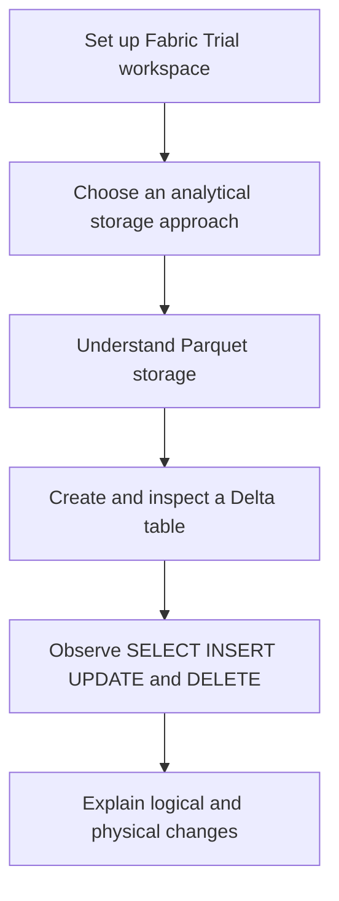

By the end of the session, you will be able to:

| Topic | What you will understand |
|---|---|
| Lakehouse design | Why a Lakehouse is suitable when analytical data is stored as files but must also behave like a table |
| Parquet | How column-based storage helps analytical queries |
| Delta table | How Parquet files and `_delta_log` work together |
| Table operations | What happens when `SELECT`, `INSERT`, `UPDATE`, and `DELETE` run |
| Storage changes | The difference between a change visible in a query and a change made to physical storage |

---

## 1 Fabric Trial setup

### 1.1 Create the workspace

1. Sign in to [Microsoft Fabric](https://app.fabric.microsoft.com).
2. Select **Workspaces** from the navigation pane.
3. Select **+ New workspace**.
4. Enter the following details:

| Setting | Value |
|---|---|
| Name | `TG117_Fabric_Session04` |
| Description | `Delta table foundations and internal working` |
| Workspace type | **Fabric Trial capacity** |

5. Select **Apply**.

The workspace must be assigned to an active Fabric Trial capacity. If the Trial option is unavailable, confirm that the trial is active and that trials are allowed for the tenant.

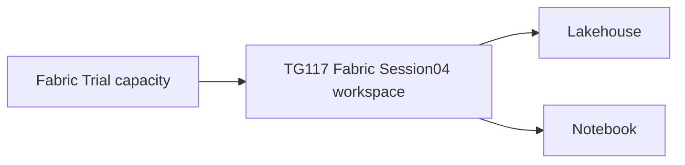

### 1.2 Create the Lakehouse

1. Open `TG117_Fabric_Session04`.
2. Select **+ New item**.
3. Search for and select **Lakehouse**.
4. Enter the name:

```text
LH_Delta_Fundamentals
```

5. If the **Lakehouse schemas** option is displayed, clear it for this session. This keeps the table names simple while learning the storage concepts.
6. Select **Create**.

The Lakehouse explorer contains two main areas:

| Area | Purpose |
|---|---|
| `Files` | Stores files and folders in formats such as CSV, JSON, and Parquet |
| `Tables` | Stores managed Delta tables |

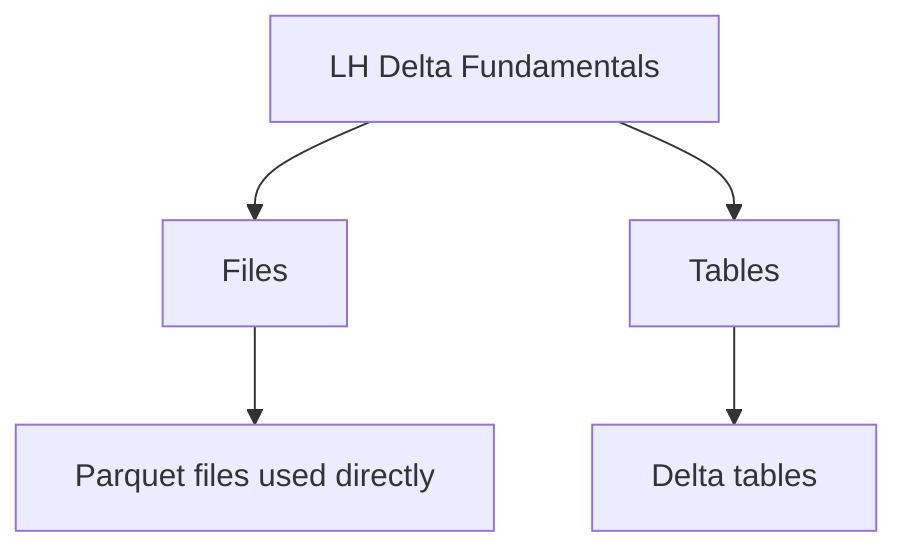

### 1.3 Create the Notebook

1. Open `LH_Delta_Fundamentals`.
2. Select **Analyze data with** from the Lakehouse ribbon.
3. Select **Notebook** and then **New notebook**.
4. Rename the Notebook:

```text
NB_Delta_Table_Foundations
```

5. In the Notebook's Lakehouse explorer, confirm that `LH_Delta_Fundamentals` is attached and marked as the default Lakehouse.

If the Notebook option is not shown on the Lakehouse ribbon, use this path:

```text
Workspace → + New item → Notebook
Notebook → Add lakehouse → Existing lakehouse → LH_Delta_Fundamentals
```

The pin icon beside a Lakehouse identifies the default Lakehouse. Relative paths used in this session will point to that Lakehouse.

### Cell 01 Verify the Notebook connection

```python
print("Spark application:", spark.sparkContext.applicationId)

assert notebookutils.fs.exists("Files")
assert notebookutils.fs.exists("Tables")

print("The default Lakehouse is accessible.")
```

Expected confirmation:

```text
The default Lakehouse is accessible.
```

The first Spark cell can take additional time because Fabric must start the Spark session.

---

## 2 Choosing an analytical storage approach

ShopKart needs to store processed order data for sales reports and analysis. New orders will arrive, incorrect values may need correction, and test records may need removal.

### Data Warehouse vs Data Lake vs Lakehouse

| Approach | How data is stored | Main strength | Limitation to consider |
|---|---|---|---|
| Data Warehouse | Structured tables | Strong SQL-based table management | Less suitable when the solution must directly work with many file formats |
| Data Lake | Files such as CSV, JSON, and Parquet | Flexible storage for different kinds of data | Plain files do not independently manage reliable table changes |
| Lakehouse | Files managed with table capabilities | Combines file-based storage with reliable analytical tables | Requires a table format that understands and manages the files |

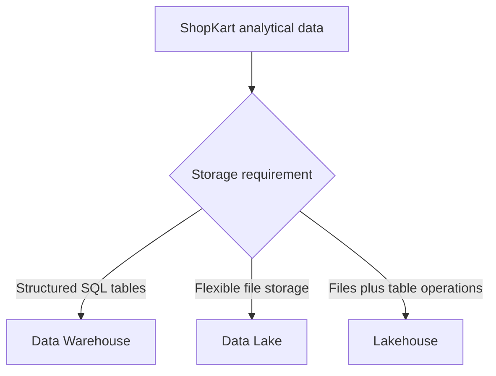

ShopKart requires file-based analytical storage together with table operations such as insert, update, and delete. A Lakehouse is therefore suitable for this requirement.

In Microsoft Fabric, Delta is the preferred table format for Lakehouse tables.

---

## 3 Row-based and column-based storage

Consider the following order data:

| order_id | customer_id | order_amount | order_status |
|---|---|---:|---|
| O1001 | C001 | 1200 | Completed |
| O1002 | C002 | 850 | Completed |
| O1003 | C003 | 600 | Pending |
| O1004 | C004 | 2500 | Completed |
| TEST001 | C999 | 1 | Test |

### Row-based view

In a row-based format, the values belonging to one record are kept together.

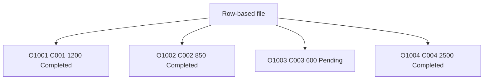

A CSV file is an example of a format that stores complete records line by line.

### Column-based view

Parquet is a column-based file format. Values from the same column are stored together inside sections of the file.

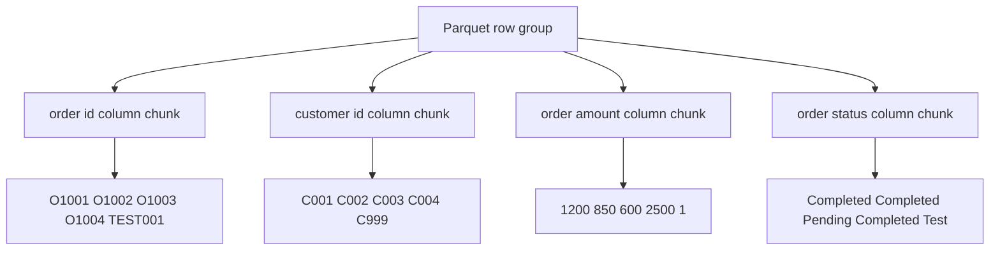

A **row group** is a block of rows inside a Parquet file. Within that row group, each column is stored in its own **column chunk**.

When a query needs only two columns, Spark can avoid reading unnecessary column data.

```sql
SELECT order_id, order_amount
FROM orders;
```

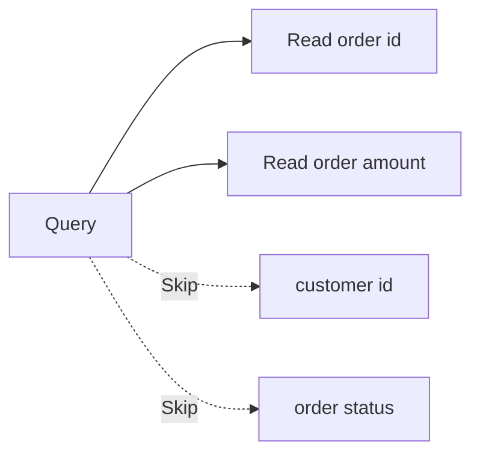

Reading only the required columns is called **column pruning**.

Values from one column also tend to have similar or repeated values. Keeping them together can improve encoding and compression.

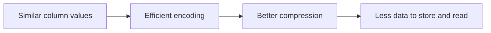

---

## 4 Create and store the order DataFrame

### Cell 02 Create the DataFrame

```python
from pyspark.sql.types import (
    StructType,
    StructField,
    StringType,
    IntegerType
)

order_schema = StructType([
    StructField("order_id", StringType(), False),
    StructField("customer_id", StringType(), False),
    StructField("order_amount", IntegerType(), False),
    StructField("order_status", StringType(), False)
])

order_data = [
    ("O1001", "C001", 1200, "Completed"),
    ("O1002", "C002", 850, "Completed"),
    ("O1003", "C003", 600, "Pending"),
    ("O1004", "C004", 2500, "Completed"),
    ("TEST001", "C999", 1, "Test")
]

orders_df = spark.createDataFrame(order_data, order_schema)

display(orders_df.orderBy("order_id"))
```

### Cell 03 Validate the DataFrame

```python
assert orders_df.count() == 5
assert orders_df.select("order_id").distinct().count() == 5
assert len(orders_df.columns) == 4

print("The order DataFrame is ready.")
```

---

## 5 Store the data as Parquet files

### Cell 04 Write Parquet files

```python
parquet_path = "Files/session04/parquet_orders"

orders_df.write \
    .mode("overwrite") \
    .format("parquet") \
    .save(parquet_path)

print("Parquet data written to:", parquet_path)
```

Spark writes a folder containing one or more part files. The exact number of part files depends on the DataFrame partitions and runtime behavior.

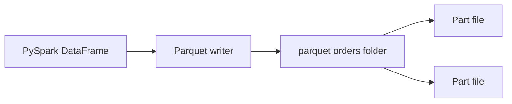

### Cell 05 Inspect the Parquet folder

```python
parquet_items = notebookutils.fs.ls(parquet_path)

for item in sorted(parquet_items, key=lambda value: value.name):
    print(
        f"Name: {item.name} | "
        f"Size: {item.size} bytes | "
        f"File: {item.isFile}"
    )
```

Expected observation:

- The folder contains one or more `.parquet` part files.
- The generated filenames can be different for every run.
- The output is a folder of files, not one fixed filename.

You can also inspect the folder from:

```text
Notebook Lakehouse explorer
└── Files
    └── session04
        └── parquet_orders
```

### Cell 06 Read selected Parquet columns

```python
parquet_orders_df = spark.read.parquet(parquet_path)

selected_columns_df = parquet_orders_df.select(
    "order_id",
    "order_amount"
)

display(selected_columns_df.orderBy("order_id"))
```

Parquet is efficient for storing and reading analytical data. However, a folder of Parquet files does not independently maintain a reliable record of table changes.

| Requirement | Plain Parquet files |
|---|---|
| Store analytical data efficiently | Supported |
| Read selected columns | Supported |
| Track which files form the current table | Additional management required |
| Manage row-level updates and deletes | Additional management required |
| Record successful table changes | Not provided by Parquet alone |

---

## 6 Introduction to Delta tables

A Delta table keeps its actual data in Parquet files and adds a special `_delta_log` folder.

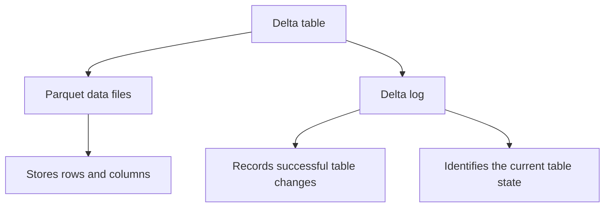

The `_delta_log` is called the **transaction log**.

In this session, a **transaction** means one completed table operation, such as creating the table, inserting rows, updating rows, or deleting rows.

A **table snapshot** is the set of data that belongs to the table at a particular state. Delta uses its log information to determine the current snapshot.

### Plain Parquet and Delta table

| Area | Plain Parquet | Delta table |
|---|---|---|
| Actual data format | Parquet | Parquet |
| Column-based storage | Yes | Yes |
| Transaction log | No | Yes |
| Managed table state | No | Yes |
| `INSERT`, `UPDATE`, and `DELETE` as table operations | Not managed by Parquet alone | Supported |

Delta does not replace Parquet as the data storage format. It manages Parquet files as a reliable table.

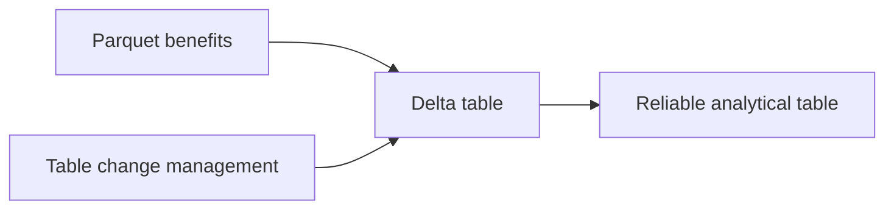

---

## 7 Create the Delta table

### Cell 07 Create or reset the table

```python
spark.sql("DROP TABLE IF EXISTS shopkart_orders")

orders_df.write \
    .format("delta") \
    .mode("overwrite") \
    .saveAsTable("shopkart_orders")

print("Delta table created: shopkart_orders")
```

Refresh the `Tables` section in the Lakehouse explorer if the table does not immediately appear.

### Cell 08 Validate the table

```python
delta_orders_df = spark.table("shopkart_orders")

display(delta_orders_df.orderBy("order_id"))

assert delta_orders_df.count() == 5
assert delta_orders_df.select("order_id").distinct().count() == 5

print("Delta table validation completed.")
```

### Cell 09 Inspect the table details

```python
table_detail = (
    spark.sql("DESCRIBE DETAIL shopkart_orders")
    .first()
    .asDict()
)

print("Format:", table_detail["format"])
print("Location:", table_detail["location"])
print("Current data files:", table_detail["numFiles"])
print("Current data size:", table_detail["sizeInBytes"], "bytes")
```

Expected observations:

- `format` is `delta`.
- `location` points to the table's OneLake storage location.
- `numFiles` shows the files currently used by the table.

### Cell 10 Inspect the storage folders

```python
table_path = table_detail["location"]

print("Table storage items")
for item in sorted(
    notebookutils.fs.ls(table_path),
    key=lambda value: value.name
):
    print(item.name)

print("\nDelta log items")
for item in sorted(
    notebookutils.fs.ls(f"{table_path}/_delta_log"),
    key=lambda value: value.name
):
    print(item.name)
```

The storage location contains:

```text
shopkart_orders
├── Parquet data files
└── _delta_log
    └── Delta log files
```

Never manually edit or delete files inside a Delta table folder. Delta must manage these files through supported table operations.

---

## 8 Create storage inspection helpers

The following functions will help inspect the table after every operation.

### Cell 11 Create the inspection functions

```python
import json


def get_delta_table_path(table_name):
    detail = spark.sql(
        f"DESCRIBE DETAIL {table_name}"
    ).first().asDict()

    return detail["location"]


def get_delta_json_logs(table_name):
    path = get_delta_table_path(table_name)

    return sorted(
        [
            item
            for item in notebookutils.fs.ls(f"{path}/_delta_log")
            if item.isFile and item.name.endswith(".json")
        ],
        key=lambda item: item.name
    )


def show_latest_delta_commit(table_name):
    json_logs = get_delta_json_logs(table_name)

    if not json_logs:
        print("No JSON log file was found.")
        return

    latest_log = json_logs[-1]
    log_text = notebookutils.fs.head(latest_log.path, 200000)

    print("Latest Delta log file:", latest_log.name)

    for line in log_text.splitlines():
        if not line.strip():
            continue

        action = json.loads(line)

        if "commitInfo" in action:
            operation = action["commitInfo"].get(
                "operation",
                "Unknown"
            )
            print("COMMIT OPERATION:", operation)

        elif "add" in action:
            print("ADD FILE:", action["add"].get("path"))

            if action["add"].get("deletionVector"):
                print("  Deletion vector information is present.")

        elif "remove" in action:
            print("REMOVE FILE:", action["remove"].get("path"))


def show_delta_storage_summary(table_name):
    detail = spark.sql(
        f"DESCRIBE DETAIL {table_name}"
    ).first().asDict()

    print("Table:", table_name)
    print("Format:", detail["format"])
    print("Current data files:", detail["numFiles"])
    print("Current size:", detail["sizeInBytes"], "bytes")
    print("JSON log files:", len(get_delta_json_logs(table_name)))
```

### Cell 12 Inspect the initial Delta commit

```python
show_delta_storage_summary("shopkart_orders")
show_latest_delta_commit("shopkart_orders")
```

The initial write creates Parquet data and records the table creation or write in `_delta_log`.

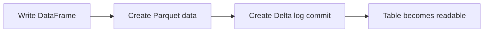

The table becomes visible as a completed new state only after the Delta commit succeeds.

---

## 9 Internal working of SELECT

`SELECT` reads data but does not change the table.

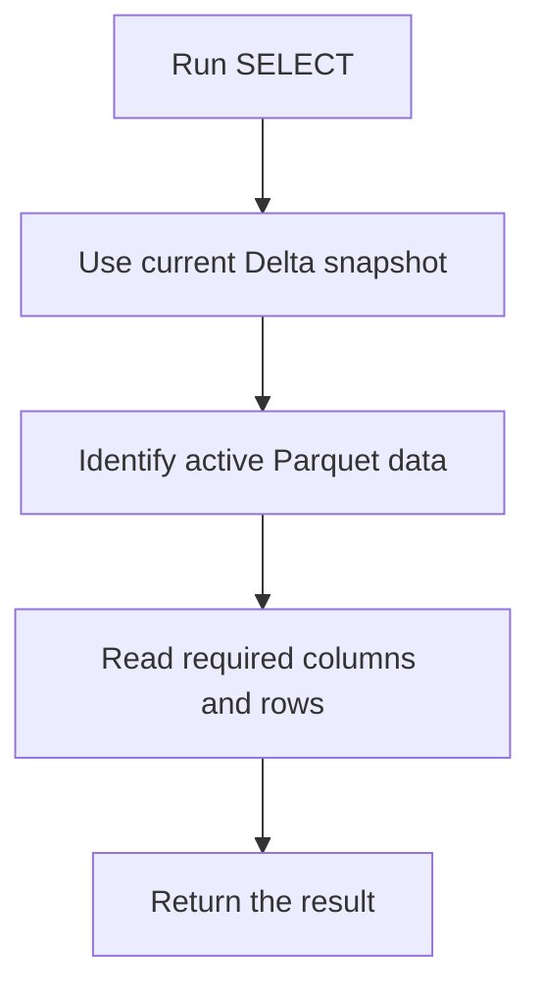

### Cell 13 Run SELECT and verify the log

```python
logs_before_select = len(
    get_delta_json_logs("shopkart_orders")
)

selected_orders = spark.sql("""
    SELECT order_id, order_amount
    FROM shopkart_orders
    ORDER BY order_id
""")

display(selected_orders)

logs_after_select = len(
    get_delta_json_logs("shopkart_orders")
)

assert logs_before_select == logs_after_select

print("SELECT created no new Delta log commit.")
```

`SELECT` does not create a new Parquet file or Delta table version because it does not change the data.

---

## 10 Internal working of INSERT

ShopKart receives a new valid order, `O1005`.

### Before INSERT

```text
Current rows: 5
New order: O1005
```

### Cell 14 Insert the new order

```python
spark.sql("""
    INSERT INTO shopkart_orders
    VALUES ('O1005', 'C005', 1500, 'Pending')
""")

print("Order O1005 inserted.")
```

### Cell 15 Validate and inspect INSERT

```python
display(
    spark.sql("""
        SELECT *
        FROM shopkart_orders
        WHERE order_id = 'O1005'
    """)
)

assert spark.table("shopkart_orders").count() == 6
assert spark.sql("""
    SELECT *
    FROM shopkart_orders
    WHERE order_id = 'O1005'
""").count() == 1

show_delta_storage_summary("shopkart_orders")
show_latest_delta_commit("shopkart_orders")
```

### What INSERT changes

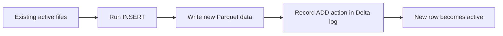

An insert generally adds new data files. Existing active data files normally do not need to be rewritten.

---

## 11 Internal working of UPDATE

The amount for order `O1003` was stored as `600`. The confirmed amount is `650`, and the order is now completed.

### Cell 16 View the original record

```python
display(
    spark.sql("""
        SELECT *
        FROM shopkart_orders
        WHERE order_id = 'O1003'
    """)
)
```

### Cell 17 Update the record

```python
spark.sql("""
    UPDATE shopkart_orders
    SET order_amount = 650,
        order_status = 'Completed'
    WHERE order_id = 'O1003'
""")

print("Order O1003 updated.")
```

### Cell 18 Validate and inspect UPDATE

```python
updated_order = spark.sql("""
    SELECT *
    FROM shopkart_orders
    WHERE order_id = 'O1003'
""")

display(updated_order)

updated_values = updated_order.first()

assert updated_values["order_amount"] == 650
assert updated_values["order_status"] == "Completed"
assert spark.table("shopkart_orders").count() == 6

show_delta_storage_summary("shopkart_orders")
show_latest_delta_commit("shopkart_orders")
```

### What UPDATE changes

Every successful update records a new logical table state. The exact physical storage action depends on the Fabric runtime and the Delta table features.

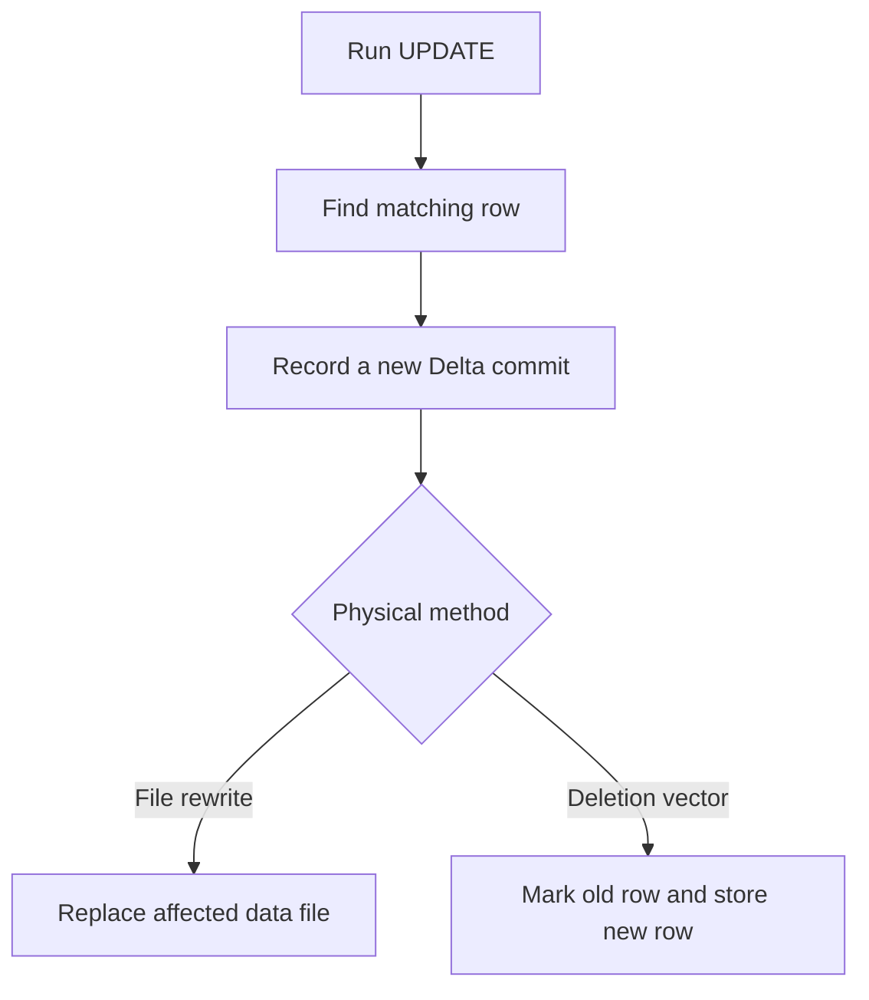

With the file-rewrite method, Delta can mark an affected file as removed from the current table state and add a replacement file.

With deletion vectors, Fabric can mark the old row position as no longer valid and store the corrected row without immediately rewriting every unchanged row in the original file.

The query result is the same in both cases: only the corrected value appears in the current table state.

---

## 12 Internal working of DELETE

`TEST001` is a test record and must not remain in the production order table.

### Cell 19 Confirm the record exists

```python
display(
    spark.sql("""
        SELECT *
        FROM shopkart_orders
        WHERE order_id = 'TEST001'
    """)
)
```

### Cell 20 Delete the test record

```python
spark.sql("""
    DELETE FROM shopkart_orders
    WHERE order_id = 'TEST001'
""")

print("Test order deleted from the current table state.")
```

### Cell 21 Validate and inspect DELETE

```python
deleted_order_count = spark.sql("""
    SELECT *
    FROM shopkart_orders
    WHERE order_id = 'TEST001'
""").count()

current_orders = spark.table("shopkart_orders")

assert deleted_order_count == 0
assert current_orders.count() == 5
assert current_orders.select("order_id").distinct().count() == 5

display(current_orders.orderBy("order_id"))

show_delta_storage_summary("shopkart_orders")
show_latest_delta_commit("shopkart_orders")
```

### What DELETE changes

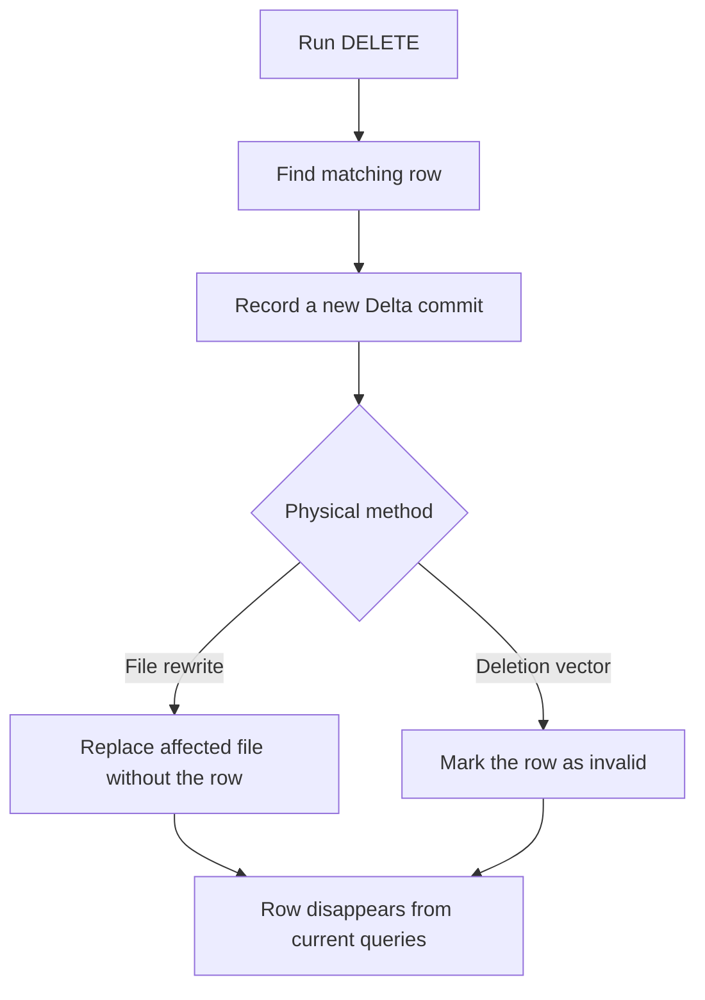

Deleting a row from the current table state does not always mean that its bytes are immediately erased from storage. Fabric can keep older or marked data files until a later maintenance operation removes data that is no longer required.

This session does not perform physical cleanup.

---

## 13 Logical changes and physical changes

| Operation | Logical result seen by the user | Possible physical storage result | New Delta commit |
|---|---|---|---|
| `SELECT` | Returns the current data | Reads active Parquet data | No |
| `INSERT` | New row appears | Adds new Parquet data | Yes |
| `UPDATE` | Corrected value appears | Rewrites affected files or uses deletion-vector information | Yes |
| `DELETE` | Matching row disappears | Rewrites affected files or marks the row as invalid | Yes |

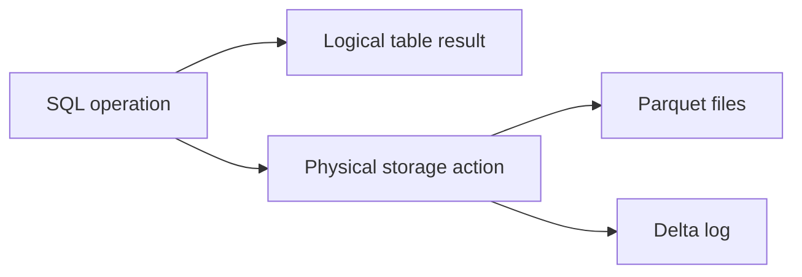

The logical result describes what a query returns. The physical result describes what Delta records or writes in OneLake to produce that result.

---

## 14 Delta table advantages and considerations

| Advantages | Considerations |
|---|---|
| Keeps the storage benefits of Parquet | Maintains additional Delta metadata |
| Manages active files as one table | Files should not be changed manually |
| Supports insert, update, and delete | Physical behavior can vary with runtime optimizations |
| Records successful table changes | Old or invalid data can remain physically stored until maintenance |
| Provides a foundation for later recovery and optimization features | Delta-aware tools must be used to interpret the table correctly |

---

## 15 Final table validation

### Cell 22 Run the final validation

```python
final_orders = spark.table("shopkart_orders")

assert final_orders.count() == 5
assert final_orders.select("order_id").distinct().count() == 5
assert final_orders.filter("order_id = 'O1005'").count() == 1
assert final_orders.filter("order_id = 'TEST001'").count() == 0

o1003 = final_orders.filter(
    "order_id = 'O1003'"
).first()

assert o1003["order_amount"] == 650
assert o1003["order_status"] == "Completed"

display(final_orders.orderBy("order_id"))

print("All Session 4 validations passed.")
```

Expected final data:

| order_id | customer_id | order_amount | order_status |
|---|---|---:|---|
| O1001 | C001 | 1200 | Completed |
| O1002 | C002 | 850 | Completed |
| O1003 | C003 | 650 | Completed |
| O1004 | C004 | 2500 | Completed |
| O1005 | C005 | 1500 | Pending |

---

## 16 Session summary

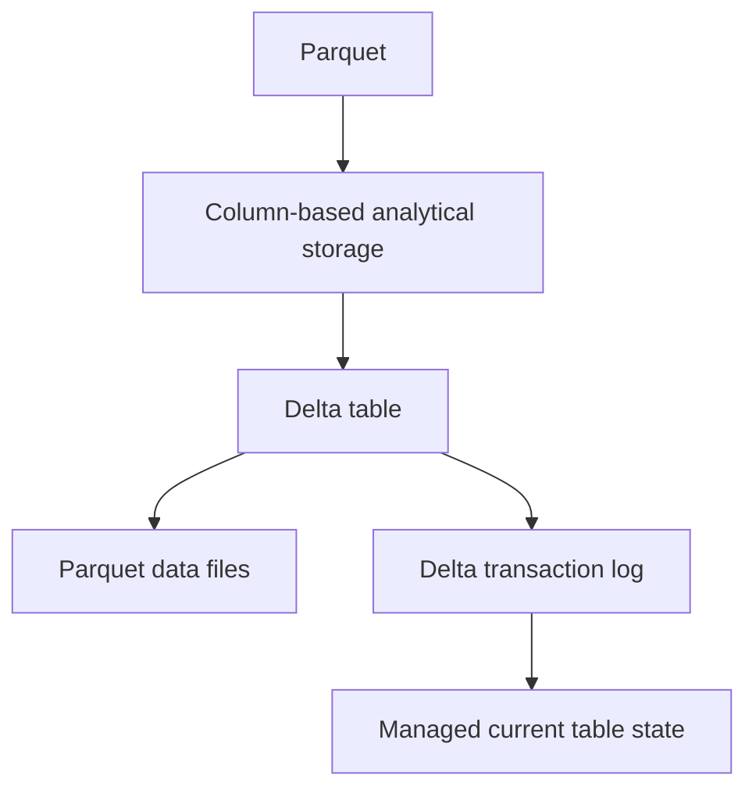

- Parquet stores analytical data in a column-based format.
- A Delta table stores its actual data in Parquet files.
- `_delta_log` records completed table changes and helps identify the current table state.
- `SELECT` reads data and creates no new Delta commit.
- `INSERT`, `UPDATE`, and `DELETE` change the table and create new Delta commits.
- The visible table result and the physical storage result are related but not always identical.

## Active Recall

1. What are the two main storage parts of a Delta table?
2. Why does `SELECT` not create a new Delta commit?
3. How is an `INSERT` physically different from an `UPDATE`?
4. Why can a deleted row disappear from queries while some related data still remains physically stored?

---

## Official references

- [Fabric trial capacity](https://learn.microsoft.com/fabric/fundamentals/fabric-trial)
- [Create a Lakehouse in Microsoft Fabric](https://learn.microsoft.com/fabric/data-engineering/create-lakehouse)
- [Explore Lakehouse data with a Notebook](https://learn.microsoft.com/fabric/data-engineering/lakehouse-notebook-explore)
- [Load data into a Lakehouse with a Notebook](https://learn.microsoft.com/fabric/data-engineering/lakehouse-notebook-load-data)
- [Lakehouse and Delta Lake tables](https://learn.microsoft.com/fabric/data-engineering/lakehouse-and-delta-tables)
- [NotebookUtils file system utilities](https://learn.microsoft.com/fabric/data-engineering/notebookutils/notebookutils-file-system)
- [Inspect Delta table metadata](https://learn.microsoft.com/fabric/data-engineering/delta-lake-describe)
- [Deletion vectors for Delta tables](https://learn.microsoft.com/fabric/data-engineering/delta-lake-deletion-vectors)
