# Session 5 Delta History Time Travel and Targeted Recovery

## Session overview

This session explains how a data engineer can investigate a bad table change, read an earlier Delta table state, and recover only the affected data.

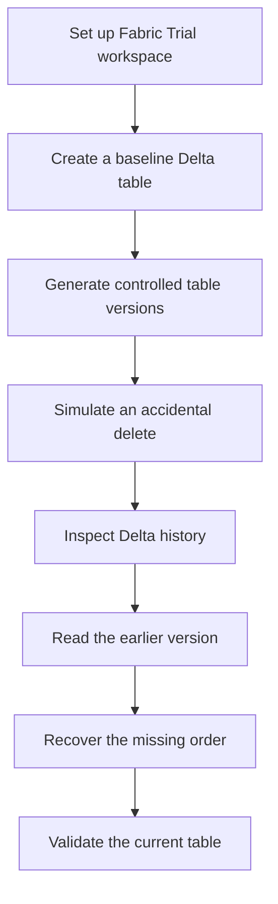

By the end of the session, you will be able to:

| Topic | What you will understand |
|---|---|
| Delta versions | How successful table changes create numbered table states |
| Table history | How to inspect the operations performed on a Delta table |
| Time travel | How to read an earlier version without changing the current table |
| Investigation | How to compare the current table with a known-good version |
| Targeted recovery | How to restore only the missing record and avoid duplicates |

---

## 1 Fabric Trial setup

### 1.1 Create the workspace

1. Sign in to [Microsoft Fabric](https://app.fabric.microsoft.com).
2. Select **Workspaces**.
3. Select **+ New workspace**.
4. Enter the following details:

| Setting | Value |
|---|---|
| Name | `TG117_Fabric_Session05` |
| Description | `Delta history time travel and targeted recovery` |
| Workspace type | **Fabric Trial capacity** |

5. Select **Apply**.

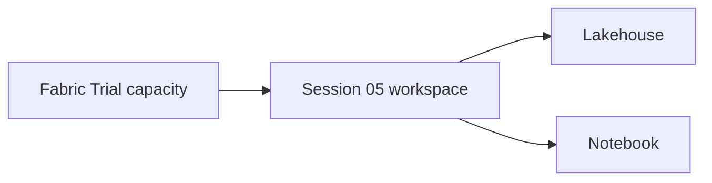

### 1.2 Create the Lakehouse

1. Open `TG117_Fabric_Session05`.
2. Select **+ New item**.
3. Search for and select **Lakehouse**.
4. Enter the name:

```text
LH_Delta_History
```

5. If the **Lakehouse schemas** option is displayed, clear it for this session.
6. Select **Create**.

### 1.3 Create the Notebook

1. Open `LH_Delta_History`.
2. Select **Analyze data with** from the Lakehouse ribbon.
3. Select **Notebook** and then **New notebook**.
4. Rename the Notebook:

```text
NB_Delta_History_Recovery
```

5. Confirm that `LH_Delta_History` appears in the Notebook's Lakehouse explorer and is marked as the default Lakehouse.

If the Notebook option is not shown on the Lakehouse ribbon, use:

```text
Workspace → + New item → Notebook
Notebook → Add lakehouse → Existing lakehouse → LH_Delta_History
```

### Cell 01 Verify the connection

```python
print("Spark application:", spark.sparkContext.applicationId)

assert notebookutils.fs.exists("Files")
assert notebookutils.fs.exists("Tables")

print("The default Lakehouse is accessible.")
```

The first Spark cell can take additional time while Fabric starts the Spark session.

---

## 2 Production requirement

ShopKart stores order data in a Delta table. During a cleanup operation, a valid order is accidentally deleted instead of a test order.

The data engineer must answer four questions:

1. What operation changed the table?
2. Which table version existed before the problem?
3. Which record is missing from the current table?
4. How can the missing record be recovered without removing other valid changes?

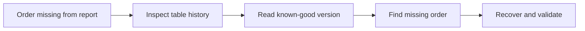

---

## 3 Create the baseline Delta table

### Cell 02 Create the order DataFrame

```python
from pyspark.sql.types import (
    StructType,
    StructField,
    StringType,
    IntegerType
)

order_schema = StructType([
    StructField("order_id", StringType(), False),
    StructField("customer_id", StringType(), False),
    StructField("order_amount", IntegerType(), False),
    StructField("order_status", StringType(), False)
])

order_data = [
    ("O1001", "C001", 1200, "Completed"),
    ("O1002", "C002", 850, "Completed"),
    ("O1003", "C003", 600, "Pending"),
    ("O1004", "C004", 2500, "Completed"),
    ("TEST001", "C999", 1, "Test")
]

orders_df = spark.createDataFrame(order_data, order_schema)

display(orders_df.orderBy("order_id"))
```

### Cell 03 Create a clean Delta table

```python
spark.sql("DROP TABLE IF EXISTS shopkart_orders")

orders_df.write \
    .format("delta") \
    .mode("overwrite") \
    .saveAsTable("shopkart_orders")

print("Baseline Delta table created.")
```

### Cell 04 Validate the baseline

```python
baseline_df = spark.table("shopkart_orders")

assert baseline_df.count() == 5
assert baseline_df.select("order_id").distinct().count() == 5
assert baseline_df.filter("order_id = 'O1004'").count() == 1
assert baseline_df.filter("order_id = 'TEST001'").count() == 1

display(baseline_df.orderBy("order_id"))

print("Baseline validation completed.")
```

The initial write creates the first Delta table version.

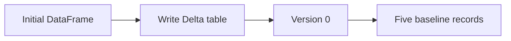

---

## 4 Understand Delta table versions

A Delta table version represents the table state created after a successful data-changing operation.

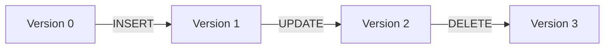

The current version is the latest successful table state. Earlier versions remain useful for investigation as long as their transaction information and required data files are still available.

On a clean execution of this session, the expected progression is:

| Expected version | Operation | Table state |
|---:|---|---|
| 0 | Initial write | Baseline orders |
| 1 | Insert | Order `O1005` added |
| 2 | Update | Order `O1003` corrected |
| 3 | Accidental delete | Order `O1004` missing |
| 4 | Targeted recovery | Order `O1004` restored |
| 5 | Correct cleanup | Test order removed |

The recovery code will discover the required version dynamically instead of assuming a fixed version number.

---

## 5 Generate controlled table versions

### 5.1 Insert a new order

### Cell 05 Run INSERT

```python
spark.sql("""
    INSERT INTO shopkart_orders
    VALUES ('O1005', 'C005', 1500, 'Pending')
""")

assert spark.table("shopkart_orders").count() == 6

print("Order O1005 inserted.")
```

### 5.2 Correct an order

The confirmed amount for order `O1003` is `650`, and the order is completed.

### Cell 06 Run UPDATE

```python
spark.sql("""
    UPDATE shopkart_orders
    SET order_amount = 650,
        order_status = 'Completed'
    WHERE order_id = 'O1003'
""")

corrected_order = (
    spark.table("shopkart_orders")
    .filter("order_id = 'O1003'")
    .first()
)

assert corrected_order["order_amount"] == 650
assert corrected_order["order_status"] == "Completed"

print("Order O1003 corrected.")
```

### Cell 07 View the current valid state

```python
current_df = spark.table("shopkart_orders")

assert current_df.count() == 6
assert current_df.select("order_id").distinct().count() == 6

display(current_df.orderBy("order_id"))
```

At this point, `O1004` is still present and all planned changes are complete.

---

## 6 Simulate an accidental deletion

The intended task is to remove `TEST001`. An incorrect condition deletes the valid order `O1004` instead.

### Cell 08 Run the incorrect DELETE

```python
spark.sql("""
    DELETE FROM shopkart_orders
    WHERE order_id = 'O1004'
""")

print("DELETE operation completed.")
```

### Cell 09 Detect the problem

```python
after_delete_df = spark.table("shopkart_orders")

display(after_delete_df.orderBy("order_id"))

assert after_delete_df.count() == 5
assert after_delete_df.filter("order_id = 'O1004'").count() == 0
assert after_delete_df.filter("order_id = 'TEST001'").count() == 1

print("O1004 is missing, while TEST001 still exists.")
```

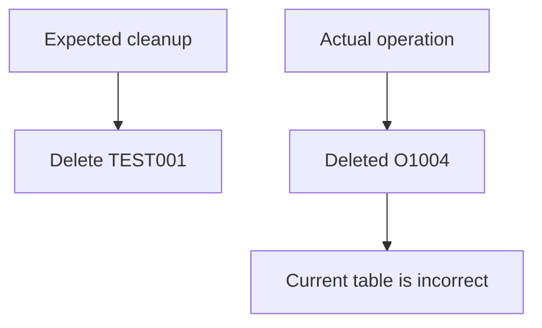

The table should not be changed again until the bad operation and the correct recovery source have been identified.

---

## 7 Inspect Delta table history

`DESCRIBE HISTORY` returns the available operation history for a Delta table. It is read-only and does not change the table.

### Cell 10 Read the history

```python
history_df = spark.sql(
    "DESCRIBE HISTORY shopkart_orders"
)

display(
    history_df.select(
        "version",
        "timestamp",
        "operation",
        "operationParameters",
        "operationMetrics"
    ).orderBy("version", ascending=False)
)
```

### Important history columns

| Column | Meaning |
|---|---|
| `version` | Number assigned to the table state created by the operation |
| `timestamp` | Time when the operation was committed |
| `operation` | Type of operation, such as `WRITE`, `UPDATE`, or `DELETE` |
| `operationParameters` | Conditions or settings supplied to the operation |
| `operationMetrics` | Available operation measurements, such as affected rows or files |

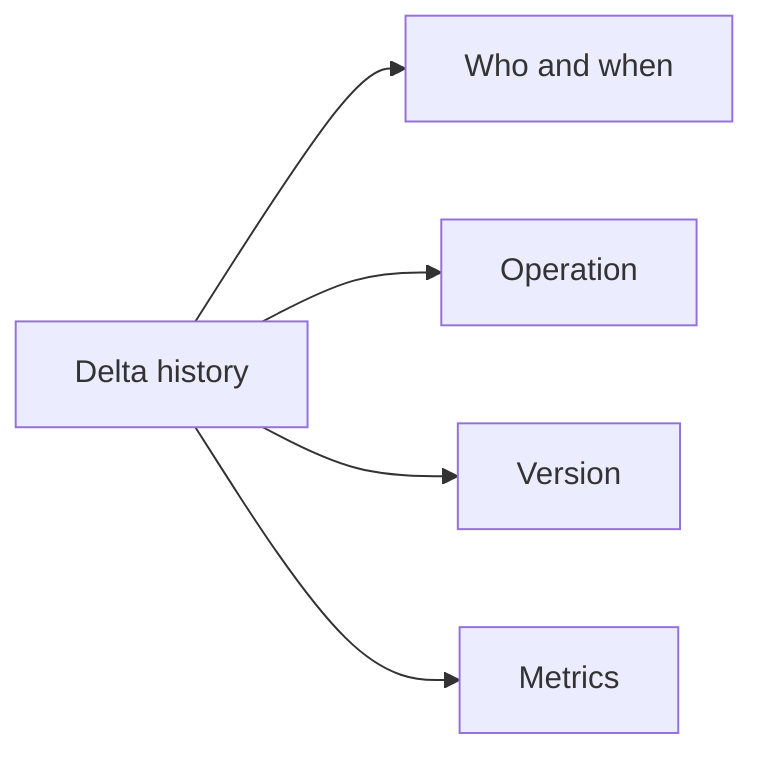

The exact metrics displayed can vary by operation, Fabric runtime, and enabled Delta features.

---

## 8 Find the version before the accidental delete

The recovery logic should discover the version instead of assuming that the bad delete always created version 3.

### Cell 11 Locate the DELETE version

```python
from pyspark.sql import functions as F

latest_delete = (
    history_df
    .filter(F.col("operation") == "DELETE")
    .orderBy(F.desc("version"))
    .select("version", "timestamp", "operationParameters")
    .first()
)

assert latest_delete is not None

delete_version = int(latest_delete["version"])
version_before_delete = delete_version - 1

print("Accidental DELETE version:", delete_version)
print("Version before DELETE:", version_before_delete)
```

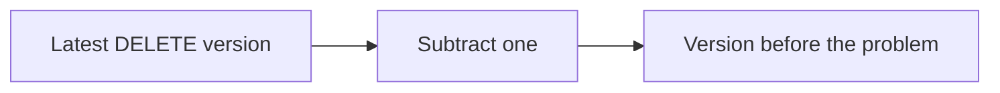

This approach works even if the table version numbers differ from the expected clean-run sequence.

---

## 9 Read the earlier version using time travel

**Time travel** means reading the table as it existed at an earlier version or timestamp.

Time travel is read-only:

- It does not modify the current table.
- It does not automatically recover deleted data.
- It provides an earlier snapshot that can be inspected and compared.

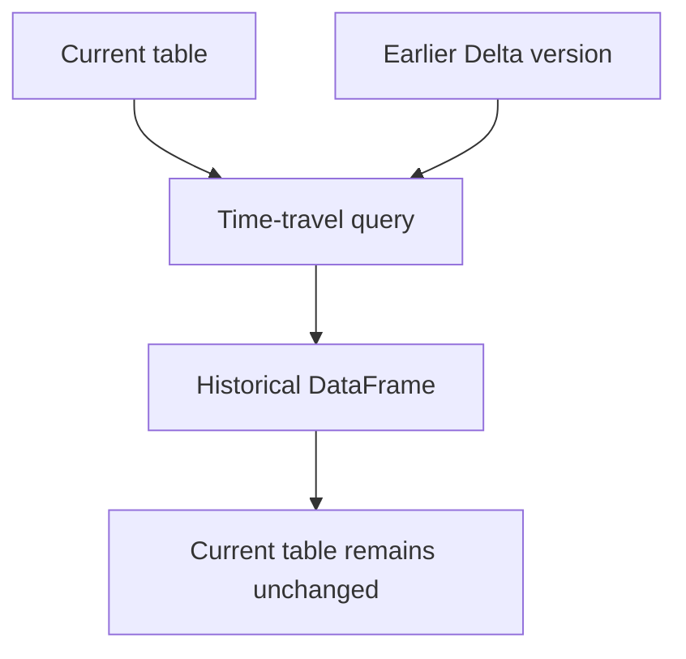

### Cell 12 Get the Delta table location

```python
table_detail = (
    spark.sql("DESCRIBE DETAIL shopkart_orders")
    .first()
    .asDict()
)

table_path = table_detail["location"]

print("Delta table location:", table_path)
```

### Cell 13 Read the version before DELETE

```python
before_delete_df = (
    spark.read
    .format("delta")
    .option("versionAsOf", version_before_delete)
    .load(table_path)
)

display(before_delete_df.orderBy("order_id"))

assert before_delete_df.count() == 6
assert before_delete_df.filter("order_id = 'O1004'").count() == 1
```

### Cell 14 Confirm that time travel changed nothing

```python
current_after_time_travel_df = spark.table(
    "shopkart_orders"
)

assert current_after_time_travel_df.count() == 5
assert current_after_time_travel_df.filter(
    "order_id = 'O1004'"
).count() == 0

print("The historical version was read without changing the current table.")
```

---

## 10 Compare the current and historical states

The historical version contains six order IDs. The current table contains five. A left anti join can identify records that existed earlier but are now missing.

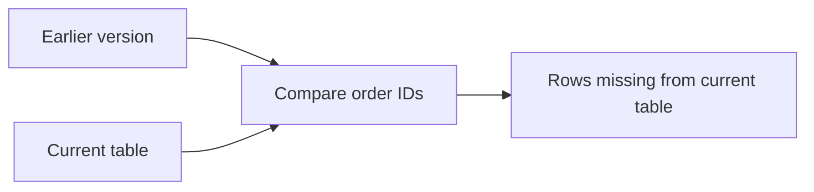

### Cell 15 Find the missing record

```python
current_order_ids_df = (
    spark.table("shopkart_orders")
    .select("order_id")
)

missing_rows_df = before_delete_df.join(
    current_order_ids_df,
    on="order_id",
    how="left_anti"
)

display(missing_rows_df)

assert missing_rows_df.count() == 1
assert missing_rows_df.filter(
    "order_id = 'O1004'"
).count() == 1

print("The missing order has been identified.")
```

Expected missing record:

| order_id | customer_id | order_amount | order_status |
|---|---|---:|---|
| O1004 | C004 | 2500 | Completed |

---

## 11 Recover only the missing record

The table also contains valid changes made after its initial creation:

- `O1005` was inserted.
- `O1003` was corrected.

Replacing the complete table with a much older version could remove valid changes. The safer action in this scenario is to append only the verified missing record.

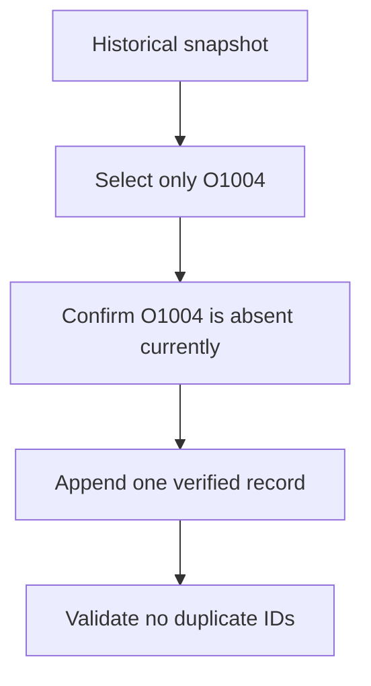

### Cell 16 Protect against duplicate recovery

```python
record_to_recover_df = missing_rows_df.filter(
    "order_id = 'O1004'"
)

current_o1004_count = (
    spark.table("shopkart_orders")
    .filter("order_id = 'O1004'")
    .count()
)

assert record_to_recover_df.count() == 1
assert current_o1004_count == 0

print("The record is ready for targeted recovery.")
```

### Cell 17 Recover the record

```python
record_to_recover_df.write \
    .format("delta") \
    .mode("append") \
    .saveAsTable("shopkart_orders")

print("Order O1004 recovered.")
```

### Cell 18 Validate the recovery

```python
recovered_table_df = spark.table("shopkart_orders")

duplicate_ids_df = (
    recovered_table_df
    .groupBy("order_id")
    .count()
    .filter(F.col("count") > 1)
)

assert recovered_table_df.count() == 6
assert recovered_table_df.filter(
    "order_id = 'O1004'"
).count() == 1
assert duplicate_ids_df.count() == 0

display(recovered_table_df.orderBy("order_id"))

print("Targeted recovery validation completed.")
```

---

## 12 Perform the intended cleanup correctly

After the valid order is recovered, the actual test record can be removed using the correct condition.

### Cell 19 Delete the test record

```python
spark.sql("""
    DELETE FROM shopkart_orders
    WHERE order_id = 'TEST001'
""")

print("Test order removed using the correct condition.")
```

### Cell 20 Run the final validation

```python
final_orders_df = spark.table("shopkart_orders")

duplicate_ids_df = (
    final_orders_df
    .groupBy("order_id")
    .count()
    .filter(F.col("count") > 1)
)

assert final_orders_df.count() == 5
assert final_orders_df.select("order_id").distinct().count() == 5
assert final_orders_df.filter("order_id = 'O1004'").count() == 1
assert final_orders_df.filter("order_id = 'O1005'").count() == 1
assert final_orders_df.filter("order_id = 'TEST001'").count() == 0
assert duplicate_ids_df.count() == 0

o1003 = final_orders_df.filter(
    "order_id = 'O1003'"
).first()

assert o1003["order_amount"] == 650
assert o1003["order_status"] == "Completed"

display(final_orders_df.orderBy("order_id"))

print("All Session 5 validations passed.")
```

Expected final data:

| order_id | customer_id | order_amount | order_status |
|---|---|---:|---|
| O1001 | C001 | 1200 | Completed |
| O1002 | C002 | 850 | Completed |
| O1003 | C003 | 650 | Completed |
| O1004 | C004 | 2500 | Completed |
| O1005 | C005 | 1500 | Pending |

---

## 13 Review the completed history

### Cell 21 Display the final history

```python
final_history_df = spark.sql(
    "DESCRIBE HISTORY shopkart_orders"
)

display(
    final_history_df.select(
        "version",
        "timestamp",
        "operation",
        "operationParameters",
        "operationMetrics"
    ).orderBy("version", ascending=False)
)
```

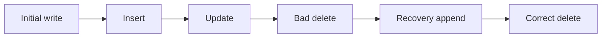

The recovery append and correct delete create new versions. Delta does not erase the earlier history when a correction is made.

---

## 14 Time travel targeted recovery and full restore

| Approach | What it does | Changes current table | Suitable use |
|---|---|---|---|
| Time travel | Reads an earlier table snapshot | No | Investigation and comparison |
| Targeted recovery | Copies selected verified data into the current table | Yes | Recovering specific missing or damaged records |
| Full table restore | Makes an earlier complete table state current again | Yes | Rolling back a broadly incorrect table state |

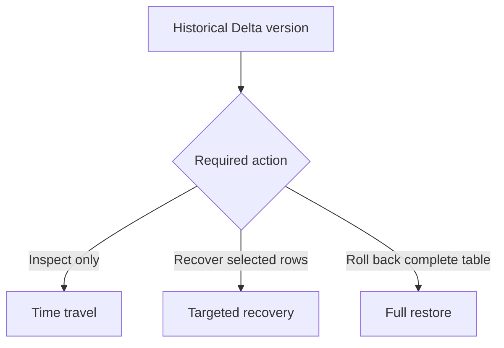

Full restore is not used in this exercise because the objective is to recover one deleted order while preserving the valid insert and update.

---

## 15 Session summary

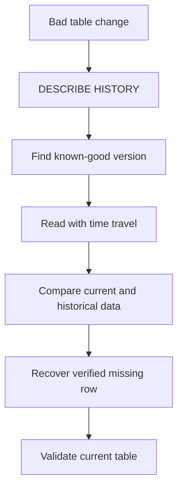

- Every successful Delta write creates a new table version.
- `DESCRIBE HISTORY` shows available versions and their operations.
- Time travel reads an earlier snapshot without changing the current table.
- The historical and current states can be compared to identify missing data.
- Targeted recovery preserves valid current changes while restoring only the affected record.
- Recovery must include row-count and duplicate checks.

## Active Recall

1. What is the difference between Delta history and time travel?
2. Does reading an earlier version change the current Delta table?
3. Why should recovery code discover the required version instead of assuming a fixed version number?
4. When is targeted recovery safer than restoring the complete table?

---

## Official references

- [Fabric Trial workspace](https://learn.microsoft.com/fabric/data-engineering/tutorial-lakehouse-get-started)
- [Create a Lakehouse in Microsoft Fabric](https://learn.microsoft.com/fabric/data-engineering/create-lakehouse)
- [Explore Lakehouse data with a Notebook](https://learn.microsoft.com/fabric/data-engineering/lakehouse-notebook-explore)
- [Inspect Delta table metadata and history](https://learn.microsoft.com/fabric/data-engineering/delta-lake-describe)
- [Query Delta tables with time travel](https://learn.microsoft.com/fabric/data-engineering/delta-lake-time-travel)
- [Restore Delta tables](https://learn.microsoft.com/fabric/data-engineering/delta-lake-restore)
- [NotebookUtils for Microsoft Fabric](https://learn.microsoft.com/fabric/data-engineering/notebook-utilities)
