# Session 6 Delta Merge and Idempotent Incremental Loads

## Session overview

This session explains how a data engineer can process an incoming batch containing both new and changed records without creating duplicates in the target Delta table.

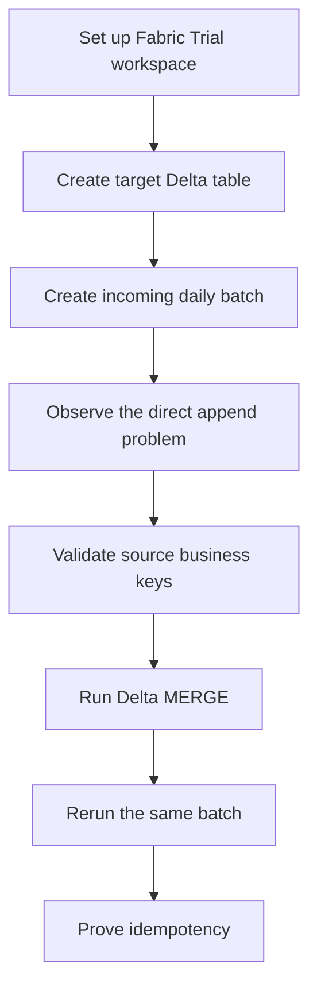

By the end of the session, you will be able to:

| Topic | What you will understand |
|---|---|
| Incremental batch | How a batch can contain new, changed, and unchanged records |
| Business key | How `order_id` identifies the same business record across datasets |
| Append problem | Why directly appending an incremental batch creates duplicates |
| Delta `MERGE` | How matched rows are updated and unmatched rows are inserted |
| Idempotency | How rerunning the same batch produces the same target data |
| Validation | How to check keys, row counts, duplicates, and merge metrics |

---

## 1 Fabric Trial setup

### 1.1 Create the workspace

1. Sign in to [Microsoft Fabric](https://app.fabric.microsoft.com).
2. Select **Workspaces**.
3. Select **+ New workspace**.
4. Enter the following details:

| Setting | Value |
|---|---|
| Name | `TG117_Fabric_Session06` |
| Description | `Delta merge and idempotent incremental loads` |
| Workspace type | **Fabric Trial capacity** |

5. Select **Apply**.

### 1.2 Create the Lakehouse

1. Open `TG117_Fabric_Session06`.
2. Select **+ New item**.
3. Search for and select **Lakehouse**.
4. Enter the name:

```text
LH_Delta_Merge
```

5. If the **Lakehouse schemas** option is displayed, clear it for this session.
6. Select **Create**.

### 1.3 Create the Notebook

1. Open `LH_Delta_Merge`.
2. Select **Analyze data with** from the Lakehouse ribbon.
3. Select **Notebook** and then **New notebook**.
4. Rename the Notebook:

```text
NB_Delta_Merge_Idempotency
```

5. Confirm that `LH_Delta_Merge` appears in the Notebook's Lakehouse explorer and is marked as the default Lakehouse.

If the Notebook option is not shown on the Lakehouse ribbon, use:

```text
Workspace → + New item → Notebook
Notebook → Add lakehouse → Existing lakehouse → LH_Delta_Merge
```

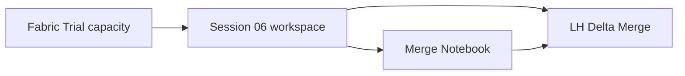

### Cell 01 Verify the connection

```python
print("Spark application:", spark.sparkContext.applicationId)

assert notebookutils.fs.exists("Files")
assert notebookutils.fs.exists("Tables")

print("The default Lakehouse is accessible.")
```

The first Spark cell can take additional time while Fabric starts the Spark session.

---

## 2 Production requirement

ShopKart already has an order table. At the end of the day, the data engineer receives a new batch containing:

- An existing order whose values have changed
- An existing order whose values have not changed
- New orders that do not yet exist in the target table

The batch may be rerun if a pipeline times out or its completion status is uncertain. Rerunning it must not create duplicate orders.

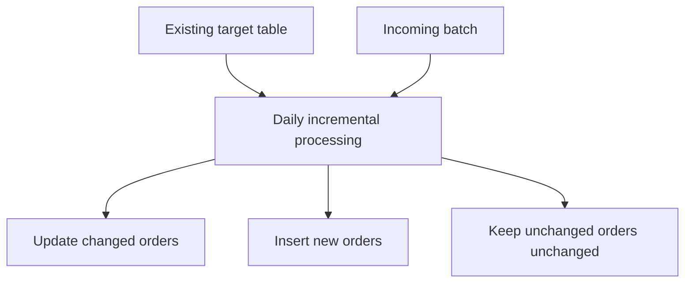

---

## 3 Create the target Delta table

### Cell 02 Create the baseline DataFrame

```python
from pyspark.sql.types import (
    StructType,
    StructField,
    StringType,
    IntegerType
)

order_schema = StructType([
    StructField("order_id", StringType(), False),
    StructField("customer_id", StringType(), False),
    StructField("order_amount", IntegerType(), False),
    StructField("order_status", StringType(), False)
])

target_data = [
    ("O1001", "C001", 1200, "Completed"),
    ("O1002", "C002", 850, "Pending"),
    ("O1003", "C003", 600, "Pending"),
    ("O1004", "C004", 2500, "Completed")
]

target_df = spark.createDataFrame(
    target_data,
    order_schema
)

display(target_df.orderBy("order_id"))
```

### Cell 03 Create a clean target table

```python
spark.sql("DROP TABLE IF EXISTS shopkart_orders")
spark.sql("DROP TABLE IF EXISTS append_problem_orders")

target_df.write \
    .format("delta") \
    .mode("overwrite") \
    .saveAsTable("shopkart_orders")

print("Target Delta table created.")
```

### Cell 04 Validate the target table

```python
current_target_df = spark.table("shopkart_orders")

assert current_target_df.count() == 4
assert current_target_df.select(
    "order_id"
).distinct().count() == 4

display(current_target_df.orderBy("order_id"))

print("Target validation completed.")
```

Expected target state:

| order_id | customer_id | order_amount | order_status |
|---|---|---:|---|
| O1001 | C001 | 1200 | Completed |
| O1002 | C002 | 850 | Pending |
| O1003 | C003 | 600 | Pending |
| O1004 | C004 | 2500 | Completed |

---

## 4 Create the incoming daily batch

### Cell 05 Create the source DataFrame

```python
incoming_data = [
    ("O1002", "C002", 900, "Completed"),
    ("O1004", "C004", 2500, "Completed"),
    ("O1005", "C005", 1500, "Pending"),
    ("O1006", "C006", 700, "Completed")
]

incoming_orders_df = spark.createDataFrame(
    incoming_data,
    order_schema
)

incoming_orders_df.createOrReplaceTempView(
    "incoming_orders"
)

display(incoming_orders_df.orderBy("order_id"))
```

### Decide what should happen to every source row

| Source order | Present in target | Values changed | Required action |
|---|---|---|---|
| O1002 | Yes | Yes | Update |
| O1004 | Yes | No | Keep unchanged |
| O1005 | No | Not applicable | Insert |
| O1006 | No | Not applicable | Insert |

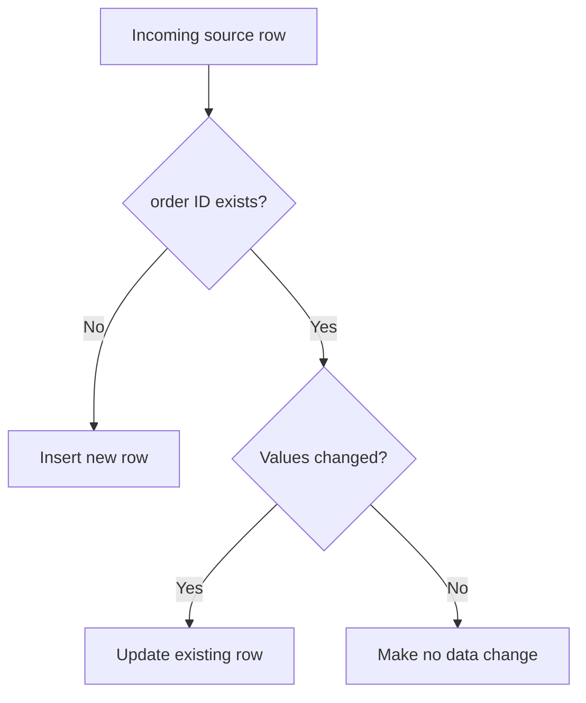

---

## 5 Understand the business key

A **business key** is a column or combination of columns that identifies one business record.

For the ShopKart order table:

```text
Business key = order_id
```

The merge condition will use `order_id` to decide whether a source record already exists in the target.

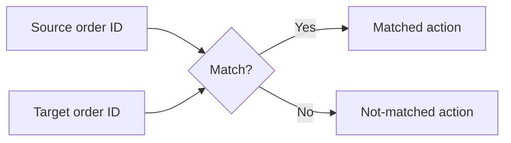

The matching key should represent the identity of the record. Using a mutable value such as `order_status` as the key would create incorrect matches.

---

## 6 Why direct append is incorrect

Appending the complete incoming batch does not check whether an `order_id` already exists.

To demonstrate the problem safely, create a separate table. The correct target table will remain unchanged.

### Cell 06 Create the append demonstration table

```python
spark.table("shopkart_orders").write \
    .format("delta") \
    .mode("overwrite") \
    .saveAsTable("append_problem_orders")

incoming_orders_df.write \
    .format("delta") \
    .mode("append") \
    .saveAsTable("append_problem_orders")

print("Incoming batch appended to the demonstration table.")
```

### Cell 07 Find duplicate business keys

```python
from pyspark.sql import functions as F

append_problem_df = spark.table(
    "append_problem_orders"
)

append_duplicates_df = (
    append_problem_df
    .groupBy("order_id")
    .count()
    .filter(F.col("count") > 1)
    .orderBy("order_id")
)

display(append_problem_df.orderBy("order_id"))
display(append_duplicates_df)

assert append_problem_df.count() == 8
assert append_problem_df.select(
    "order_id"
).distinct().count() == 6
assert append_duplicates_df.count() == 2

print("Direct append created duplicate business keys.")
```

Expected duplicate result:

| order_id | count |
|---|---:|
| O1002 | 2 |
| O1004 | 2 |

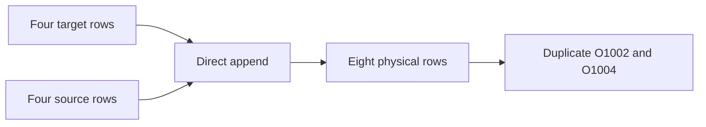

### Cell 08 Remove the demonstration table

```python
spark.sql("DROP TABLE IF EXISTS append_problem_orders")

assert spark.table("shopkart_orders").count() == 4

print("The correct target table remains unchanged.")
```

---

## 7 Understand MERGE and upsert

`MERGE` compares a source dataset with a target Delta table using a matching condition.

An **upsert** combines two actions:

- Update a target record when the key matches
- Insert a source record when the key does not match

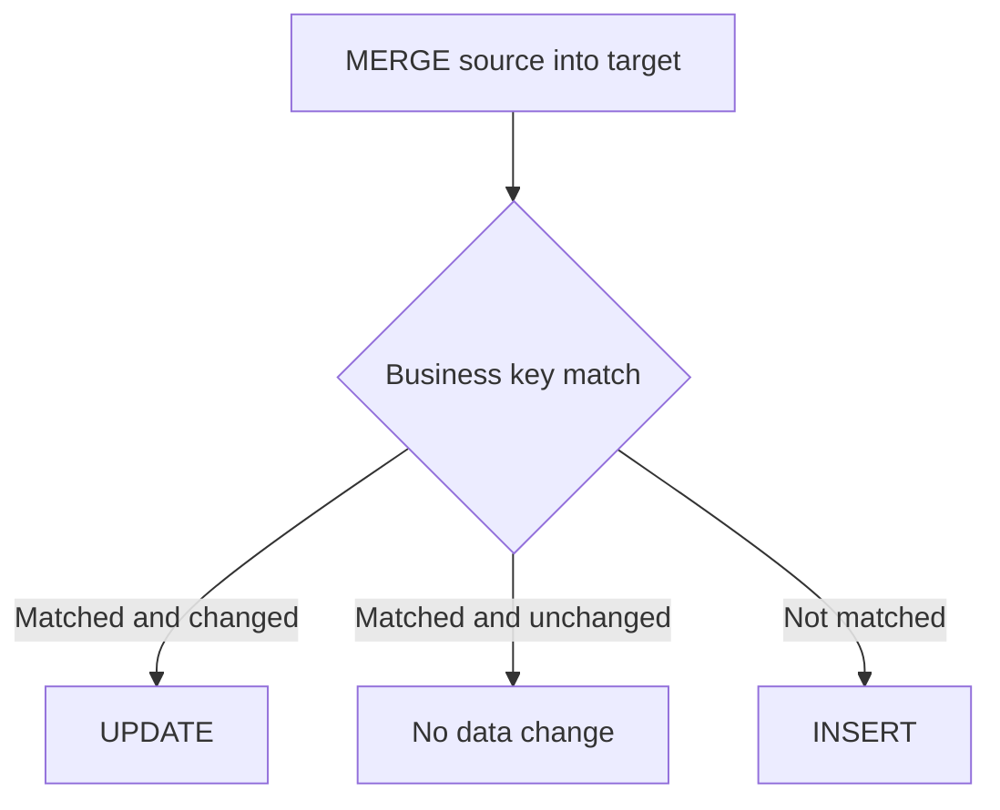

The target is the table being changed. The source provides the incoming records.

| MERGE part | Purpose in this exercise |
|---|---|
| `MERGE INTO shopkart_orders` | Selects the target Delta table |
| `USING incoming_orders` | Selects the incoming source view |
| `ON target.order_id = source.order_id` | Matches the same business order |
| `WHEN MATCHED AND ...` | Updates only when values changed |
| `WHEN NOT MATCHED` | Inserts new orders |

---

## 8 Validate the source before MERGE

The source must contain a valid and unique business key. If two source rows have the same key, both can attempt to modify the same target row.

### Cell 09 Check null and duplicate keys

```python
null_key_count = incoming_orders_df.filter(
    F.col("order_id").isNull()
).count()

duplicate_source_keys_df = (
    incoming_orders_df
    .groupBy("order_id")
    .count()
    .filter(F.col("count") > 1)
)

assert null_key_count == 0
assert duplicate_source_keys_df.count() == 0
assert incoming_orders_df.count() == 4

print("Source key validation passed.")
```

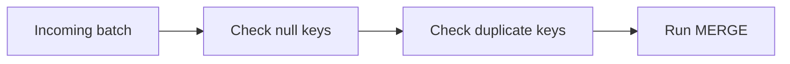

---

## 9 Capture the target state before MERGE

### Cell 10 Record the before state

```python
target_before_merge_df = spark.table(
    "shopkart_orders"
)

display(target_before_merge_df.orderBy("order_id"))

before_merge_rows = sorted(
    [tuple(row) for row in target_before_merge_df.collect()]
)

assert len(before_merge_rows) == 4

print("Target state captured before MERGE.")
```

Expected changes after the first merge:

| Measurement | Before MERGE | After MERGE |
|---|---:|---:|
| Total rows | 4 | 6 |
| Distinct order IDs | 4 | 6 |
| Updated rows | 0 | 1 |
| Newly inserted rows | 0 | 2 |

---

## 10 Run the first MERGE

The matched condition checks whether any non-key value changed. This prevents an unchanged order such as `O1004` from being updated unnecessarily.

### Cell 11 Execute MERGE

```python
merge_sql = """
    MERGE INTO shopkart_orders AS target
    USING incoming_orders AS source
    ON target.order_id = source.order_id

    WHEN MATCHED AND (
        target.customer_id <> source.customer_id
        OR target.order_amount <> source.order_amount
        OR target.order_status <> source.order_status
    ) THEN UPDATE SET
        target.customer_id = source.customer_id,
        target.order_amount = source.order_amount,
        target.order_status = source.order_status

    WHEN NOT MATCHED THEN INSERT (
        order_id,
        customer_id,
        order_amount,
        order_status
    ) VALUES (
        source.order_id,
        source.customer_id,
        source.order_amount,
        source.order_status
    )
"""

spark.sql(merge_sql)

print("First MERGE completed.")
```

### Internal decision flow

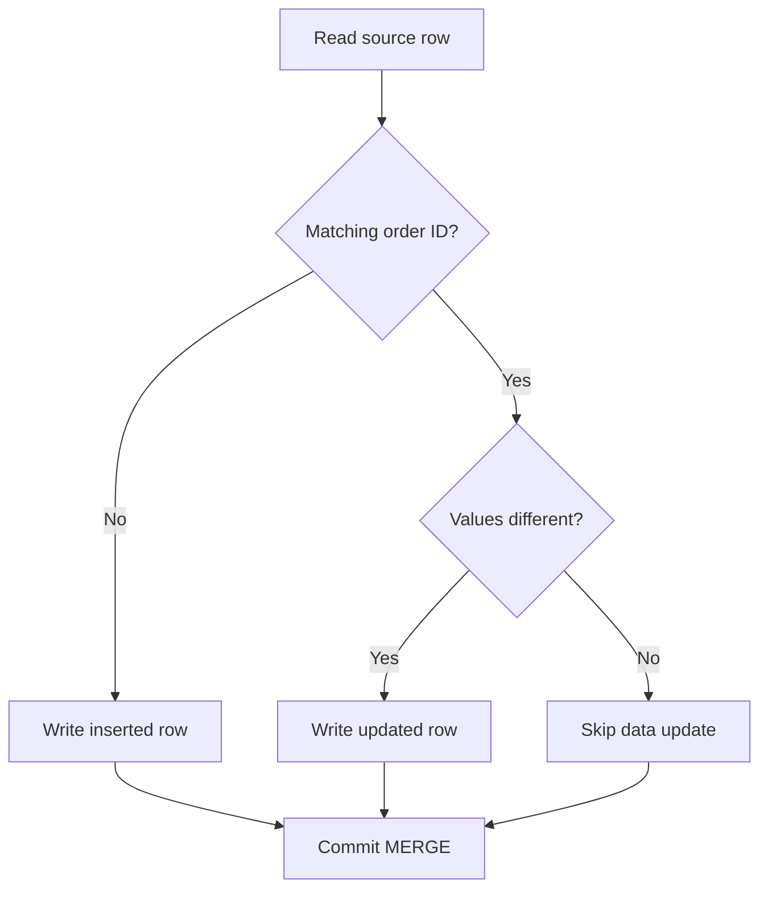

---

## 11 Validate the first MERGE

### Cell 12 Validate counts and business keys

```python
target_after_merge_df = spark.table(
    "shopkart_orders"
)

duplicate_target_keys_df = (
    target_after_merge_df
    .groupBy("order_id")
    .count()
    .filter(F.col("count") > 1)
)

assert target_after_merge_df.count() == 6
assert target_after_merge_df.select(
    "order_id"
).distinct().count() == 6
assert duplicate_target_keys_df.count() == 0

display(target_after_merge_df.orderBy("order_id"))

print("Target keys and row counts are valid.")
```

### Cell 13 Validate updated and inserted orders

```python
o1002 = target_after_merge_df.filter(
    "order_id = 'O1002'"
).first()

o1004 = target_after_merge_df.filter(
    "order_id = 'O1004'"
).first()

assert o1002["order_amount"] == 900
assert o1002["order_status"] == "Completed"

assert o1004["order_amount"] == 2500
assert o1004["order_status"] == "Completed"

assert target_after_merge_df.filter(
    "order_id = 'O1005'"
).count() == 1

assert target_after_merge_df.filter(
    "order_id = 'O1006'"
).count() == 1

print("Update, unchanged, and insert validations passed.")
```

Expected target state:

| order_id | customer_id | order_amount | order_status | Result |
|---|---|---:|---|---|
| O1001 | C001 | 1200 | Completed | Existing row retained |
| O1002 | C002 | 900 | Completed | Updated |
| O1003 | C003 | 600 | Pending | Existing row retained |
| O1004 | C004 | 2500 | Completed | Matched but unchanged |
| O1005 | C005 | 1500 | Pending | Inserted |
| O1006 | C006 | 700 | Completed | Inserted |

---

## 12 Inspect the first MERGE history

`DESCRIBE HISTORY` can show the `MERGE` operation and its available operation metrics.

### Cell 14 Read the latest MERGE entry

```python
first_merge_history = (
    spark.sql("DESCRIBE HISTORY shopkart_orders")
    .filter(F.col("operation") == "MERGE")
    .orderBy(F.desc("version"))
    .select(
        "version",
        "timestamp",
        "operation",
        "operationParameters",
        "operationMetrics"
    )
    .first()
)

assert first_merge_history is not None

first_merge_metrics = (
    first_merge_history["operationMetrics"] or {}
)

print("MERGE version:", first_merge_history["version"])
print("Source rows:", first_merge_metrics.get("numSourceRows"))
print("Inserted rows:", first_merge_metrics.get("numTargetRowsInserted"))
print("Updated rows:", first_merge_metrics.get("numTargetRowsUpdated"))
```

For this data, the expected logical result is:

| Metric | Expected value |
|---|---:|
| Source rows | 4 |
| Target rows inserted | 2 |
| Target rows updated | 1 |

Metric names and additional file-level measurements can vary by Fabric runtime and enabled Delta features.

### Cell 15 Validate available row metrics

```python
if "numSourceRows" in first_merge_metrics:
    assert int(first_merge_metrics["numSourceRows"]) == 4

if "numTargetRowsInserted" in first_merge_metrics:
    assert int(
        first_merge_metrics["numTargetRowsInserted"]
    ) == 2

if "numTargetRowsUpdated" in first_merge_metrics:
    assert int(
        first_merge_metrics["numTargetRowsUpdated"]
    ) == 1

print("Available MERGE metrics are valid.")
```

---

## 13 Understand idempotency

An operation is **idempotent** when applying the same input multiple times produces the same final data state.

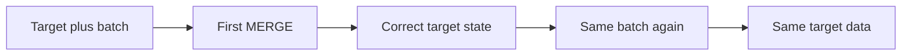

Idempotency does not necessarily mean that Fabric records no new operation. Fabric can record another `MERGE` commit while the target rows remain unchanged.

The conditional `WHEN MATCHED` clause improves the rerun because identical matched rows do not need a logical update.

---

## 14 Rerun the same batch

### Cell 16 Capture the state before the rerun

```python
before_rerun_df = spark.table("shopkart_orders")

before_rerun_rows = sorted(
    [tuple(row) for row in before_rerun_df.collect()]
)

before_rerun_count = before_rerun_df.count()
before_rerun_distinct_count = before_rerun_df.select(
    "order_id"
).distinct().count()

history_version_before_rerun = (
    spark.sql("DESCRIBE HISTORY shopkart_orders")
    .agg(F.max("version").alias("latest_version"))
    .first()["latest_version"]
)

assert before_rerun_count == 6
assert before_rerun_distinct_count == 6

print("State captured before rerun.")
```

### Cell 17 Execute the identical MERGE again

```python
spark.sql(merge_sql)

print("Identical batch rerun completed.")
```

### Cell 18 Prove that the data is unchanged

```python
after_rerun_df = spark.table("shopkart_orders")

after_rerun_rows = sorted(
    [tuple(row) for row in after_rerun_df.collect()]
)

duplicate_keys_after_rerun_df = (
    after_rerun_df
    .groupBy("order_id")
    .count()
    .filter(F.col("count") > 1)
)

assert after_rerun_df.count() == 6
assert after_rerun_df.select(
    "order_id"
).distinct().count() == 6
assert duplicate_keys_after_rerun_df.count() == 0
assert before_rerun_rows == after_rerun_rows

display(after_rerun_df.orderBy("order_id"))

print("Idempotency proved: the target data is unchanged.")
```

---

## 15 Inspect the rerun metrics

### Cell 19 Check whether the rerun created a new history entry

```python
history_after_rerun_df = spark.sql(
    "DESCRIBE HISTORY shopkart_orders"
)

latest_history_after_rerun = (
    history_after_rerun_df
    .orderBy(F.desc("version"))
    .select(
        "version",
        "timestamp",
        "operation",
        "operationMetrics"
    )
    .first()
)

assert latest_history_after_rerun is not None

history_version_after_rerun = int(
    latest_history_after_rerun["version"]
)

rerun_created_new_version = (
    history_version_after_rerun
    > history_version_before_rerun
)

if rerun_created_new_version:
    assert latest_history_after_rerun["operation"] == "MERGE"

    rerun_metrics = (
        latest_history_after_rerun["operationMetrics"]
        or {}
    )

    print(
        "Rerun MERGE version:",
        history_version_after_rerun
    )
    print(
        "Source rows:",
        rerun_metrics.get("numSourceRows")
    )
    print(
        "Inserted rows:",
        rerun_metrics.get("numTargetRowsInserted")
    )
    print(
        "Updated rows:",
        rerun_metrics.get("numTargetRowsUpdated")
    )
else:
    rerun_metrics = {}
    print("No new Delta version was required by the rerun.")
```

Expected logical rerun result:

| Measurement | Expected result |
|---|---:|
| Source rows checked | 4 |
| New target rows | 0 |
| Changed target rows | 0 |
| Duplicate business keys | 0 |
| Final target rows | 6 |

### Cell 20 Validate available rerun metrics

```python
if rerun_created_new_version:
    if "numTargetRowsInserted" in rerun_metrics:
        assert int(
            rerun_metrics["numTargetRowsInserted"]
        ) == 0

    if "numTargetRowsUpdated" in rerun_metrics:
        assert int(
            rerun_metrics["numTargetRowsUpdated"]
        ) == 0

    print("Available rerun metrics confirm no row changes.")
else:
    print("The rerun required no new table version.")
```

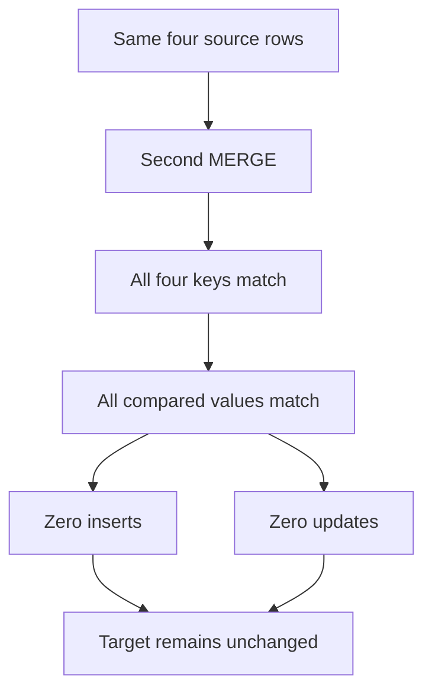

---

## 16 Final validation

### Cell 21 Run complete validation

```python
final_orders_df = spark.table("shopkart_orders")

assert final_orders_df.count() == 6
assert final_orders_df.select(
    "order_id"
).distinct().count() == 6

expected_final_rows = sorted([
    ("O1001", "C001", 1200, "Completed"),
    ("O1002", "C002", 900, "Completed"),
    ("O1003", "C003", 600, "Pending"),
    ("O1004", "C004", 2500, "Completed"),
    ("O1005", "C005", 1500, "Pending"),
    ("O1006", "C006", 700, "Completed")
])

actual_final_rows = sorted(
    [tuple(row) for row in final_orders_df.collect()]
)

assert actual_final_rows == expected_final_rows

display(final_orders_df.orderBy("order_id"))

print("All Session 6 validations passed.")
```

---

## 17 Common MERGE mistakes

| Mistake | Result |
|---|---|
| Directly appending an incremental batch | Existing business keys are duplicated |
| Using the wrong matching key | Unrelated rows can be updated or new duplicates inserted |
| Allowing duplicate keys in the source | Multiple source rows can try to change one target row |
| Allowing null business keys | Records cannot be matched reliably |
| Unconditionally updating every match | Unchanged rows can be processed again unnecessarily |
| Using different source and target data types | The merge can fail with a schema or casting error |
| Using `WHEN NOT MATCHED BY SOURCE DELETE` without careful scope | Valid target rows absent from one batch can be deleted |

The source-based delete clause is intentionally not used in this session.

---

## 18 Session summary

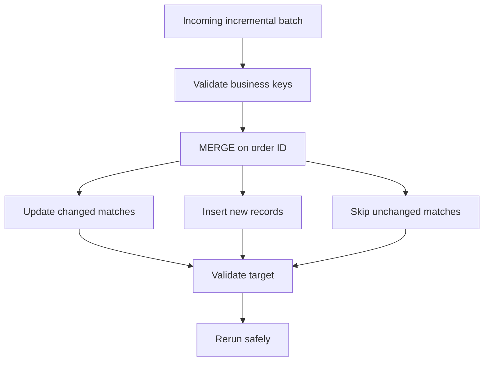

- Direct append is unsuitable when an incremental batch contains existing business keys.
- `MERGE` compares source and target records using a business key.
- `WHEN MATCHED` updates existing records.
- `WHEN NOT MATCHED` inserts new records.
- A condition on the matched action can avoid unnecessary updates.
- An idempotent rerun produces the same target data without duplicates.
- Source-key and target-state validations provide evidence that the merge behaved correctly.

## Active Recall

1. Why does directly appending an incremental batch create duplicate business keys?
2. What is the purpose of the `ON` condition in a `MERGE` operation?
3. Why does the matched clause compare source and target values before updating?
4. How can you prove that rerunning a batch is data-idempotent?

---

## Official references

- [Fabric Trial workspace](https://learn.microsoft.com/fabric/data-engineering/tutorial-lakehouse-get-started)
- [Create a Lakehouse in Microsoft Fabric](https://learn.microsoft.com/fabric/data-engineering/create-lakehouse)
- [Explore Lakehouse data with a Notebook](https://learn.microsoft.com/fabric/data-engineering/lakehouse-notebook-explore)
- [Partitioning for Delta tables and MERGE syntax](https://learn.microsoft.com/fabric/data-engineering/delta-lake-partitioning)
- [Concurrency control for Delta tables](https://learn.microsoft.com/fabric/data-engineering/delta-lake-concurrency-control)
- [Low shuffle MERGE optimization](https://learn.microsoft.com/fabric/data-engineering/low-shuffle-merge)
- [Inspect Delta table metadata and history](https://learn.microsoft.com/fabric/data-engineering/delta-lake-describe)
- [Troubleshoot Lakehouse and MERGE errors](https://learn.microsoft.com/fabric/data-engineering/troubleshoot-lakehouse)
