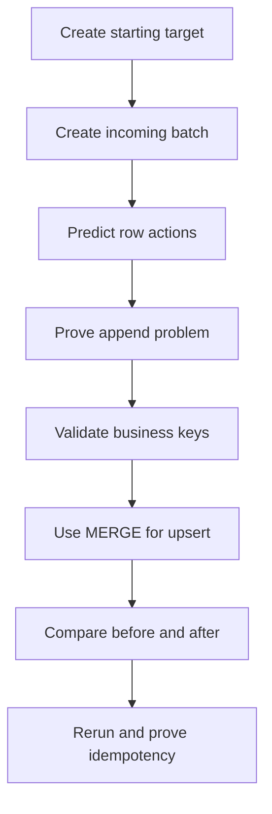
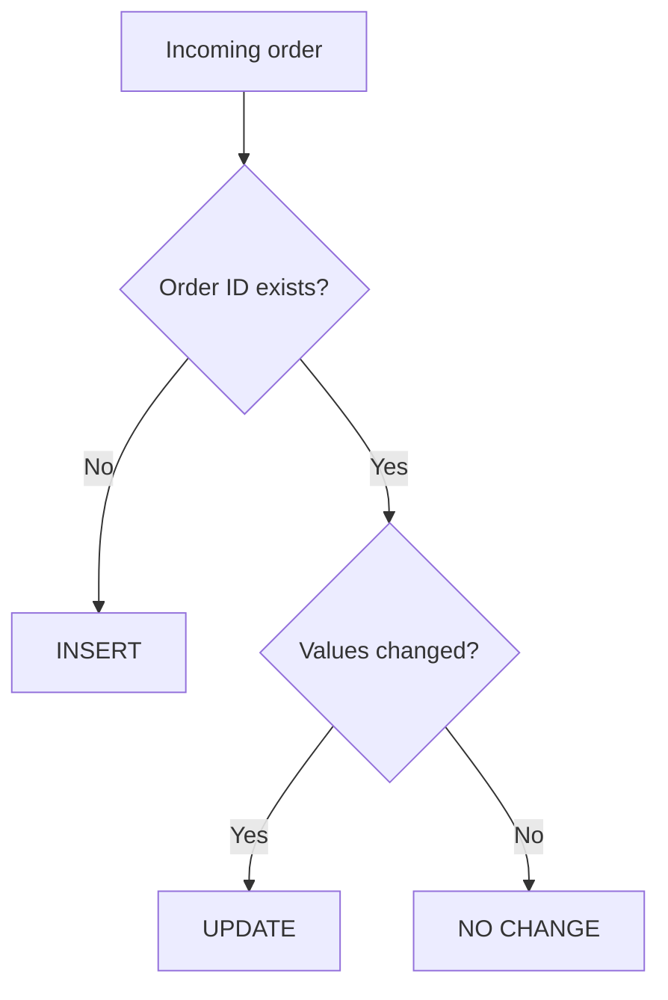
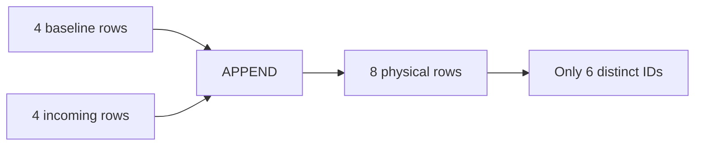
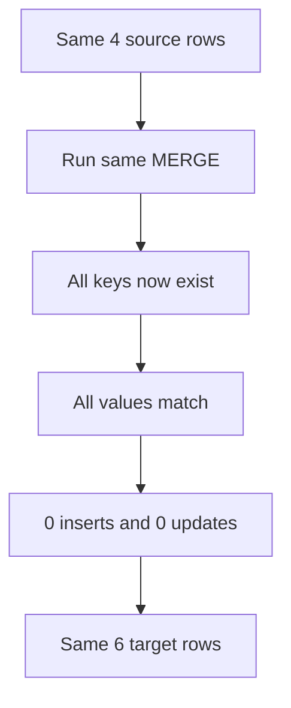

# Session 6 Delta Merge and Idempotent Incremental Loads

## Session overview

A daily incremental batch can contain a new record, a changed existing record, or an unchanged existing record. This session processes all three cases and reruns the same batch to prove that the final data remains correct.



| By the end of the session | Evidence produced in the notebook |
|---|---|
| Distinguish append, MERGE, and upsert | Comparison and append failure demonstration |
| Explain how MERGE chooses an action | Planned action for every incoming row |
| Update changed rows and insert new rows | Complete before-and-after comparison |
| Avoid rewriting unchanged matched rows | Conditional update and MERGE metrics |
| Prove data idempotency | Identical target state before and after a rerun |

Run every cell from top to bottom. Cell 02 deliberately resets the session tables so the demonstration always begins from the same state.

---

## 1 Fabric Trial setup

### 1.1 Create the workspace

1. Sign in to [Microsoft Fabric](https://app.fabric.microsoft.com).
2. Select **Workspaces** and then **+ New workspace**.
3. Enter:

| Setting | Value |
|---|---|
| Name | <code>TG117_Fabric_Session06</code> |
| Description | <code>Delta merge and idempotent incremental loads</code> |
| Advanced → Workspace type | **Fabric Trial capacity** |

4. Select **Apply**.

### 1.2 Confirm the Spark runtime

New Fabric workspaces use Runtime 2.0 by default. It includes Apache Spark 4.1 and Delta Lake 4.2.

For an older workspace, verify:

```text
Workspace → Workspace settings
→ Data Engineering/Science
→ Spark settings
→ Environment
→ Runtime version 2.0
```

### 1.3 Create the Lakehouse and Notebook

1. Open <code>TG117_Fabric_Session06</code>.
2. Select **+ New item → Lakehouse**.
3. Name it <code>LH_Delta_Merge</code>.
4. If **Lakehouse schemas** is displayed, leave it turned off for this session.
5. Select **Create**.
6. Open the Lakehouse and select **Analyze data with → Notebook → New notebook**.
7. Rename it <code>NB_Delta_Merge_Idempotency</code>.
8. Confirm that <code>LH_Delta_Merge</code> has the pin icon marking it as the default Lakehouse.

If the Notebook option is not visible:

```text
Workspace → + New item → Notebook
Notebook → Add lakehouse → Existing lakehouse → LH_Delta_Merge
```

### Cell 01 Verify the notebook connection

**Purpose:** Confirm that Spark has started and that relative paths can reach the default Lakehouse.

```python
print("Spark version:", spark.version)
print("Current Spark database:", spark.catalog.currentDatabase())

files_root_exists = notebookutils.fs.exists("Files")

assert files_root_exists, (
    "The Files area is not accessible. "
    "Confirm that LH_Delta_Merge is attached and set as default."
)

print("Default Lakehouse connection verified.")
```

The first Spark cell can take additional time while Fabric starts the Spark session.

---

## 2 Business requirement

The data engineer maintains <code>shopkart_orders</code>. A daily batch contains new and existing orders. The same batch might be submitted again after a timeout or an uncertain pipeline result.

| Incoming situation | Required target action |
|---|---|
| Order ID does not exist | Insert the order |
| Order ID exists and values changed | Update the existing order |
| Order ID exists and values are identical | Make no data change |
| The same batch is submitted again | Keep the same final target data |



The <code>order_id</code> column is the business key. It identifies the same business order in the source and target.

---

## 3 Task 1 Create the known starting target

### Purpose and state change

Create four existing orders as the controlled starting state.

| Before | Action | After |
|---|---|---|
| No session table is required | Reset and create <code>shopkart_orders</code> | 4 rows and 4 distinct order IDs |

### Cell 02 Reset and create the target Delta table

```python
from pyspark.sql import functions as F
from pyspark.sql.types import (
    StructType,
    StructField,
    StringType,
    IntegerType
)

order_schema = StructType([
    StructField("order_id", StringType(), False),
    StructField("customer_id", StringType(), False),
    StructField("order_amount", IntegerType(), False),
    StructField("order_status", StringType(), False)
])

target_data = [
    ("O1001", "C001", 1200, "Completed"),
    ("O1002", "C002", 850, "Pending"),
    ("O1003", "C003", 600, "Pending"),
    ("O1004", "C004", 2500, "Completed")
]

target_df = spark.createDataFrame(target_data, order_schema)

spark.sql("DROP TABLE IF EXISTS shopkart_orders")
spark.sql("DROP TABLE IF EXISTS append_problem_orders")

target_df.write \
    .format("delta") \
    .mode("overwrite") \
    .saveAsTable("shopkart_orders")

starting_target_df = spark.table("shopkart_orders")

assert starting_target_df.count() == 4
assert starting_target_df.select("order_id").distinct().count() == 4

display(starting_target_df.orderBy("order_id"))
print("Starting target created and validated.")
```

### Expected result

| order_id | customer_id | order_amount | order_status |
|---|---|---:|---|
| O1001 | C001 | 1200 | Completed |
| O1002 | C002 | 850 | Pending |
| O1003 | C003 | 600 | Pending |
| O1004 | C004 | 2500 | Completed |

**What this proves:** Every later change can be measured against a known four-row target.

---

## 4 Task 2 Create the batch and predict every action

### Purpose and expected decisions

Inspect the incoming rows before changing the target.

| Source order | Present in target | Values changed | Expected action |
|---|---:|---:|---|
| O1002 | Yes | Yes | UPDATE |
| O1004 | Yes | No | NO CHANGE |
| O1005 | No | Not applicable | INSERT |
| O1006 | No | Not applicable | INSERT |

### Cell 03 Create the incoming batch

```python
incoming_data = [
    ("O1002", "C002", 900, "Completed"),
    ("O1004", "C004", 2500, "Completed"),
    ("O1005", "C005", 1500, "Pending"),
    ("O1006", "C006", 700, "Completed")
]

incoming_orders_df = spark.createDataFrame(
    incoming_data,
    order_schema
)

incoming_orders_df.createOrReplaceTempView("incoming_orders")

assert incoming_orders_df.count() == 4

display(incoming_orders_df.orderBy("order_id"))
print("Incoming batch created.")
```

### Cell 04 Preview what MERGE should do

The <code>&lt;=&gt;</code> operator is null-safe equality. It treats two nulls as equal and one null versus one non-null value as different.

```python
planned_actions_df = spark.sql("""
    SELECT
        source.order_id,
        target.order_amount AS target_amount,
        source.order_amount AS incoming_amount,
        target.order_status AS target_status,
        source.order_status AS incoming_status,
        CASE
            WHEN target.order_id IS NULL
                THEN 'INSERT'
            WHEN NOT (
                target.customer_id <=> source.customer_id
                AND target.order_amount <=> source.order_amount
                AND target.order_status <=> source.order_status
            )
                THEN 'UPDATE'
            ELSE 'NO CHANGE'
        END AS planned_action
    FROM incoming_orders AS source
    LEFT JOIN shopkart_orders AS target
        ON target.order_id = source.order_id
    ORDER BY source.order_id
""")

expected_actions = {
    "O1002": "UPDATE",
    "O1004": "NO CHANGE",
    "O1005": "INSERT",
    "O1006": "INSERT"
}

actual_actions = {
    row["order_id"]: row["planned_action"]
    for row in planned_actions_df.collect()
}

assert actual_actions == expected_actions

display(planned_actions_df)
print("Every incoming row has an expected action.")
```

### Expected result

| order_id | target_amount | incoming_amount | target_status | incoming_status | planned_action |
|---|---:|---:|---|---|---|
| O1002 | 850 | 900 | Pending | Completed | UPDATE |
| O1004 | 2500 | 2500 | Completed | Completed | NO CHANGE |
| O1005 | null | 1500 | null | Pending | INSERT |
| O1006 | null | 700 | null | Completed | INSERT |

**What this proves:** The requirement has been translated into a row-by-row decision before any write occurs.

---

## 5 Task 3 Prove why direct append is unsafe

### Purpose and state change

Append adds every source row without checking whether its business key already exists. A separate table keeps this failure demonstration away from the correct target.

| Before | Action | After |
|---|---|---|
| 4 baseline rows | Append all 4 incoming rows | 8 physical rows but only 6 distinct order IDs |

### Cell 05 Append to the demonstration table

```python
target_df.write \
    .format("delta") \
    .mode("overwrite") \
    .saveAsTable("append_problem_orders")

incoming_orders_df.write \
    .format("delta") \
    .mode("append") \
    .saveAsTable("append_problem_orders")

append_problem_df = spark.table("append_problem_orders")

append_duplicates_df = (
    append_problem_df
    .groupBy("order_id")
    .count()
    .filter(F.col("count") > 1)
    .orderBy("order_id")
)

assert append_problem_df.count() == 8
assert append_problem_df.select("order_id").distinct().count() == 6
assert append_duplicates_df.count() == 2

display(append_problem_df.orderBy("order_id"))
display(append_duplicates_df)

print("Append created duplicate business keys.")
```

### Expected duplicate result

| order_id | count |
|---|---:|
| O1002 | 2 |
| O1004 | 2 |



**What this proves:** Append is suitable for purely new rows, not a mixed incremental batch containing existing keys.

### Cell 06 Remove only the demonstration table

```python
spark.sql("DROP TABLE IF EXISTS append_problem_orders")

correct_target_df = spark.table("shopkart_orders")

assert correct_target_df.count() == 4
assert correct_target_df.select("order_id").distinct().count() == 4

print("Demonstration table removed.")
print("The correct target still contains four rows.")
```

---

## 6 Upsert is the goal and MERGE is the command

| Term | Meaning | Role in this session |
|---|---|---|
| Upsert | Update an existing key or insert a new key | Required business behavior |
| MERGE | Delta command that compares source and target and executes configured clauses | Command used to implement the upsert |

A <code>MERGE</code> implements an upsert when it has both:

- <code>WHEN MATCHED ... UPDATE</code>
- <code>WHEN NOT MATCHED ... INSERT</code>

Not every <code>MERGE</code> is an upsert. MERGE can also implement update-only, insert-only, delete, or full synchronization logic.

| Operation | Checks the key | Updates existing rows | Inserts new rows | Suitable here |
|---|---:|---:|---:|---:|
| Append | No | No | Yes | No |
| MERGE with matched update only | Yes | Yes | No | Incomplete |
| MERGE with not-matched insert only | Yes | No | Yes | Incomplete |
| MERGE configured as an upsert | Yes | Yes | Yes | Yes |

---

## 7 Task 4 Validate both sides before MERGE

### Purpose

Delta does not automatically enforce business-key uniqueness. Validate both source and target before writing.

### Cell 07 Run key safety checks

```python
def key_profile(dataframe, key_column):
    null_key_count = dataframe.filter(
        F.col(key_column).isNull()
    ).count()

    duplicate_key_count = (
        dataframe
        .groupBy(key_column)
        .count()
        .filter(F.col("count") > 1)
        .count()
    )

    return null_key_count, duplicate_key_count


source_nulls, source_duplicates = key_profile(
    incoming_orders_df,
    "order_id"
)

target_before_merge_df = spark.table("shopkart_orders")

target_nulls, target_duplicates = key_profile(
    target_before_merge_df,
    "order_id"
)

key_checks_df = spark.createDataFrame(
    [
        ("incoming source", source_nulls, source_duplicates),
        ("target table", target_nulls, target_duplicates)
    ],
    ["dataset", "null_order_ids", "duplicate_order_ids"]
)

display(key_checks_df)

if source_nulls > 0 or source_duplicates > 0:
    raise ValueError(
        "MERGE stopped: source keys are not valid and unique."
    )

if target_nulls > 0 or target_duplicates > 0:
    raise ValueError(
        "MERGE stopped: target keys are not valid and unique."
    )

print("Source and target key checks passed.")
```

### Expected result

| dataset | null_order_ids | duplicate_order_ids |
|---|---:|---:|
| incoming source | 0 | 0 |
| target table | 0 | 0 |

**What this proves:** Each business key has one reliable source row and at most one reliable target row.

---

## 8 Task 5 Execute a conditional upsert with MERGE

### Purpose and expected state change

Update O1002, insert O1005 and O1006, and avoid rewriting identical O1004.

| Measurement | Before MERGE | Expected after MERGE |
|---|---:|---:|
| Total target rows | 4 | 6 |
| Distinct order IDs | 4 | 6 |
| Updated rows | 0 | 1 |
| Inserted rows | 0 | 2 |
| Unchanged source match | 0 | 1 |

### Cell 08 Capture the before-state and run MERGE

```python
before_merge_rows = sorted(
    tuple(row)
    for row in spark.table("shopkart_orders").collect()
)

version_before_merge = int(
    spark.sql("DESCRIBE HISTORY shopkart_orders")
    .agg(F.max("version").alias("latest_version"))
    .first()["latest_version"]
)

assert len(before_merge_rows) == 4

merge_sql = """
    MERGE INTO shopkart_orders AS target
    USING incoming_orders AS source
    ON target.order_id = source.order_id

    WHEN MATCHED AND NOT (
        target.customer_id <=> source.customer_id
        AND target.order_amount <=> source.order_amount
        AND target.order_status <=> source.order_status
    ) THEN UPDATE SET
        target.customer_id = source.customer_id,
        target.order_amount = source.order_amount,
        target.order_status = source.order_status

    WHEN NOT MATCHED THEN INSERT (
        order_id,
        customer_id,
        order_amount,
        order_status
    ) VALUES (
        source.order_id,
        source.customer_id,
        source.order_amount,
        source.order_status
    )
"""

spark.sql(merge_sql)

print("MERGE completed.")
print("Target version before MERGE:", version_before_merge)
```

| MERGE section | Decision |
|---|---|
| <code>ON target.order_id = source.order_id</code> | Does the same order exist? |
| <code>WHEN MATCHED AND NOT (...)</code> | Did one or more compared values change? |
| <code>WHEN NOT MATCHED</code> | Is this a new order ID? |

Null-safe comparisons prevent a future issue: normal inequality can return an unknown result when one side is null.

---

## 9 Task 6 Prove the first MERGE result

### Cell 09 Validate counts, keys, and complete row values

```python
target_after_merge_df = spark.table("shopkart_orders")

duplicate_target_keys_df = (
    target_after_merge_df
    .groupBy("order_id")
    .count()
    .filter(F.col("count") > 1)
)

expected_after_first_merge = sorted([
    ("O1001", "C001", 1200, "Completed"),
    ("O1002", "C002", 900, "Completed"),
    ("O1003", "C003", 600, "Pending"),
    ("O1004", "C004", 2500, "Completed"),
    ("O1005", "C005", 1500, "Pending"),
    ("O1006", "C006", 700, "Completed")
])

actual_after_first_merge = sorted(
    tuple(row)
    for row in target_after_merge_df.collect()
)

assert target_after_merge_df.count() == 6
assert target_after_merge_df.select("order_id").distinct().count() == 6
assert duplicate_target_keys_df.count() == 0
assert actual_after_first_merge == expected_after_first_merge

display(target_after_merge_df.orderBy("order_id"))
print("Counts, keys, and complete row values are correct.")
```

### Cell 10 Display before-and-after evidence

```python
before_df = target_df.alias("before")
after_df = target_after_merge_df.alias("after")

same_non_key_values = (
    F.col("before.customer_id").eqNullSafe(
        F.col("after.customer_id")
    )
    & F.col("before.order_amount").eqNullSafe(
        F.col("after.order_amount")
    )
    & F.col("before.order_status").eqNullSafe(
        F.col("after.order_status")
    )
)

before_after_df = (
    before_df
    .join(
        after_df,
        F.col("before.order_id") == F.col("after.order_id"),
        "full"
    )
    .select(
        F.coalesce(
            F.col("before.order_id"),
            F.col("after.order_id")
        ).alias("order_id"),
        F.col("before.order_amount").alias("before_amount"),
        F.col("after.order_amount").alias("after_amount"),
        F.col("before.order_status").alias("before_status"),
        F.col("after.order_status").alias("after_status"),
        F.when(
            F.col("before.order_id").isNull(),
            F.lit("INSERTED")
        )
        .when(
            F.col("after.order_id").isNull(),
            F.lit("DELETED")
        )
        .when(
            ~same_non_key_values,
            F.lit("UPDATED")
        )
        .otherwise(
            F.lit("UNCHANGED")
        )
        .alias("result")
    )
    .orderBy("order_id")
)

display(before_after_df)
```

### Expected comparison

| order_id | before_amount | after_amount | before_status | after_status | result |
|---|---:|---:|---|---|---|
| O1001 | 1200 | 1200 | Completed | Completed | UNCHANGED |
| O1002 | 850 | 900 | Pending | Completed | UPDATED |
| O1003 | 600 | 600 | Pending | Pending | UNCHANGED |
| O1004 | 2500 | 2500 | Completed | Completed | UNCHANGED |
| O1005 | null | 1500 | null | Pending | INSERTED |
| O1006 | null | 700 | null | Completed | INSERTED |

**What this proves:** The actual result matches the prediction made before MERGE.

---

## 10 Task 7 Inspect the Delta transaction evidence

### Cell 11 Read the latest MERGE entry

```python
first_merge_history = (
    spark.sql("DESCRIBE HISTORY shopkart_orders")
    .filter(F.col("operation") == "MERGE")
    .orderBy(F.desc("version"))
    .select(
        "version",
        "timestamp",
        "operation",
        "operationParameters",
        "operationMetrics"
    )
    .first()
)

assert first_merge_history is not None
assert int(first_merge_history["version"]) > version_before_merge

first_merge_metrics = dict(
    first_merge_history["operationMetrics"] or {}
)

print("MERGE version:", first_merge_history["version"])
print("Source rows:", first_merge_metrics.get("numSourceRows"))
print(
    "Inserted rows:",
    first_merge_metrics.get("numTargetRowsInserted")
)
print(
    "Updated rows:",
    first_merge_metrics.get("numTargetRowsUpdated")
)

expected_metrics = {
    "numSourceRows": 4,
    "numTargetRowsInserted": 2,
    "numTargetRowsUpdated": 1
}

for metric_name, expected_value in expected_metrics.items():
    if metric_name in first_merge_metrics:
        assert int(first_merge_metrics[metric_name]) == expected_value

print("Available row metrics match the expected result.")
```

| Logical metric | Expected value |
|---|---:|
| Source rows examined | 4 |
| Target rows inserted | 2 |
| Target rows updated | 1 |

Fabric can return extra file-level metrics. The exact set can vary by runtime and enabled Delta features, so a metric is asserted only when present.

---

## 11 Conditional update versus unconditional update

The displayed values can look correct in both cases, but rerun behavior differs.

| Matched clause | First run | Identical rerun |
|---|---|---|
| <code>WHEN MATCHED THEN UPDATE</code> | Updates changed O1002 and also processes identical O1004 | Matched rows can be updated again |
| <code>WHEN MATCHED AND values changed THEN UPDATE</code> | Updates only O1002 | Zero logical updates |

The conditional clause avoids unnecessary logical updates and produces clearer rerun metrics.

---

## 12 Task 8 Rerun and prove idempotency

An operation is data-idempotent when repeating the same input produces the same final data state.

Data idempotency does not necessarily mean that no command is recorded. Fabric may record another MERGE transaction with zero inserted and zero updated rows.

### Cell 12 Capture the stable state and rerun the same MERGE

```python
before_rerun_rows = sorted(
    tuple(row)
    for row in spark.table("shopkart_orders").collect()
)

version_before_rerun = int(
    spark.sql("DESCRIBE HISTORY shopkart_orders")
    .agg(F.max("version").alias("latest_version"))
    .first()["latest_version"]
)

assert len(before_rerun_rows) == 6

spark.sql(merge_sql)

print("The identical incoming batch was submitted again.")
```

### Cell 13 Compare the target and inspect the rerun

```python
after_rerun_df = spark.table("shopkart_orders")

after_rerun_rows = sorted(
    tuple(row)
    for row in after_rerun_df.collect()
)

duplicate_keys_after_rerun = (
    after_rerun_df
    .groupBy("order_id")
    .count()
    .filter(F.col("count") > 1)
    .count()
)

assert after_rerun_rows == before_rerun_rows
assert after_rerun_df.count() == 6
assert after_rerun_df.select("order_id").distinct().count() == 6
assert duplicate_keys_after_rerun == 0

latest_history = (
    spark.sql("DESCRIBE HISTORY shopkart_orders")
    .orderBy(F.desc("version"))
    .select("version", "operation", "operationMetrics")
    .first()
)

latest_version = int(latest_history["version"])
rerun_created_new_version = latest_version > version_before_rerun

if rerun_created_new_version:
    assert latest_history["operation"] == "MERGE"

    rerun_metrics = dict(
        latest_history["operationMetrics"] or {}
    )

    if "numTargetRowsInserted" in rerun_metrics:
        assert int(rerun_metrics["numTargetRowsInserted"]) == 0

    if "numTargetRowsUpdated" in rerun_metrics:
        assert int(rerun_metrics["numTargetRowsUpdated"]) == 0

    print("Rerun created MERGE version:", latest_version)
    print(
        "Rerun inserted rows:",
        rerun_metrics.get("numTargetRowsInserted")
    )
    print(
        "Rerun updated rows:",
        rerun_metrics.get("numTargetRowsUpdated")
    )
else:
    print("The rerun did not require a new Delta version.")

display(after_rerun_df.orderBy("order_id"))
print("Idempotency proved: the target data is unchanged.")
```

### Expected rerun result

| Measurement | Expected result |
|---|---:|
| Source rows examined | 4 |
| New target rows | 0 |
| Updated target rows | 0 |
| Duplicate order IDs | 0 |
| Final target rows | 6 |
| Data compared with the pre-rerun state | Identical |



---

## 13 Final notebook validation

### Cell 14 Run the complete final assertion

```python
final_orders_df = spark.table("shopkart_orders")

expected_final_rows = sorted([
    ("O1001", "C001", 1200, "Completed"),
    ("O1002", "C002", 900, "Completed"),
    ("O1003", "C003", 600, "Pending"),
    ("O1004", "C004", 2500, "Completed"),
    ("O1005", "C005", 1500, "Pending"),
    ("O1006", "C006", 700, "Completed")
])

actual_final_rows = sorted(
    tuple(row)
    for row in final_orders_df.collect()
)

assert actual_final_rows == expected_final_rows
assert final_orders_df.count() == 6
assert final_orders_df.select("order_id").distinct().count() == 6

display(final_orders_df.orderBy("order_id"))
print("All Session 6 validations passed.")
```

---

## 14 Important differences

| Concepts that look similar | Clear difference |
|---|---|
| Append and insert | Both add rows, but append does not check existing business keys |
| MERGE and upsert | MERGE is a command; upsert is update-or-insert behavior configured with MERGE clauses |
| MERGE and update | MERGE can choose update, insert, delete, or no action; update changes only existing rows |
| Deduplication and idempotency | Deduplication prevents repeated keys; idempotency means a rerun reaches the same final state |
| Same visible values and zero updates | Unconditional update may write identical values again; conditional update avoids the logical rewrite |
| No row changes and no transaction | Data can remain unchanged even if another MERGE transaction is recorded |

---

## 15 Blind spots prevented

| Blind spot | Possible surprise | Protection used here |
|---|---|---|
| Unknown starting state | Expected counts do not match | Cell 02 resets the session tables |
| Duplicate source keys | Multiple rows try to update one target row | Source duplicate validation |
| Duplicate target keys | One business record already exists more than once | Target duplicate validation |
| Null business keys | Rows cannot be identified reliably | Null-key validation |
| Mutable value used in ON | A changed row looks new | Stable <code>order_id</code> match |
| Normal inequality with nullable data | A change involving null can be missed | Null-safe <code>&lt;=&gt;</code> |
| Unconditional matched update | Identical rows are processed again | Changed-values condition |
| Non-deterministic update expression | Rerun changes data again | Deterministic source values |
| Delete for rows absent from an incremental batch | Valid older rows are removed | No <code>WHEN NOT MATCHED BY SOURCE DELETE</code> |
| Different source and target data types | MERGE fails or casts unexpectedly | One explicit schema |
| Concurrent writers | Another job changes files during this run | Outside this single-writer exercise; production needs concurrency planning |

An upsert is not automatically idempotent. For example, <code>target.amount + source.amount</code> or a newly generated current timestamp would change the target again during a rerun.

---

## 16 Session summary

- Append is unsafe when a batch can contain existing business keys.
- Upsert is the update-or-insert requirement; MERGE is the command used to implement it.
- The ON condition identifies the same business record.
- The matched condition updates only changed values.
- The not-matched clause inserts new business keys.
- Source and target validation prevents ambiguous behavior.
- Before-and-after evidence proves every row-level result.
- Rerunning the same deterministic batch produces the same final data.

## Active Recall

1. Why is upsert not a separate Delta command from MERGE in this exercise?
2. What does the ON condition decide, and why must it use a stable key?
3. Why is the changed-values condition added to WHEN MATCHED?
4. What evidence proves that the rerun is data-idempotent?

---

## Official references

- [Fabric trial capacity](https://learn.microsoft.com/en-us/fabric/fundamentals/fabric-trial)
- [Create a Fabric workspace](https://learn.microsoft.com/en-us/fabric/data-engineering/tutorial-lakehouse-get-started)
- [Create a Lakehouse](https://learn.microsoft.com/en-us/fabric/data-engineering/create-lakehouse)
- [Explore Lakehouse data with a Notebook](https://learn.microsoft.com/en-us/fabric/data-engineering/lakehouse-notebook-explore)
- [NotebookUtils file system utilities](https://learn.microsoft.com/en-us/fabric/data-engineering/notebookutils/notebookutils-file-system)
- [Fabric Runtime 2.0](https://learn.microsoft.com/en-us/fabric/data-engineering/runtime-2-0)
- [Inspect Delta table history](https://learn.microsoft.com/en-us/fabric/data-engineering/delta-lake-describe)
- [Low shuffle MERGE](https://learn.microsoft.com/en-us/fabric/data-engineering/low-shuffle-merge)
- [Concurrency control](https://learn.microsoft.com/en-us/fabric/data-engineering/delta-lake-concurrency-control)
- [Troubleshoot Lakehouse and MERGE errors](https://learn.microsoft.com/en-us/fabric/data-engineering/troubleshoot-lakehouse)
