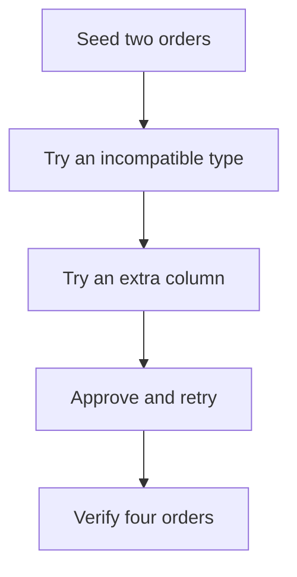

# Session 7 — Delta Schema Enforcement and Evolution

An eComSphere orders feed sends two unexpected changes. One batch sends a nested value where the table expects a number. Another batch adds a sales channel. You’ll test each write and prove what happened to the table.

A **schema** describes the columns and their data types. **Schema enforcement** checks whether an incoming write fits the table’s schema. **Schema evolution** allows a supported change, such as adding a column that the team has agreed to keep.



| Incoming change | Write setting | Expected result |
|---|---|---|
| Integer amount becomes a nested object | `mergeSchema=false` | Rejected. The target keeps its two rows and two columns. |
| A batch adds `sales_channel` | `mergeSchema=false` | Rejected. The target still has two rows and two columns. |
| Retry the same `sales_channel` batch | `mergeSchema=true` | Two rows are appended. The new column appears and older rows show `NULL`. |

## Start here

1. Open your Fabric Trial workspace. If you need one, select **Workspaces → + New workspace → Advanced → Workspace type → Fabric Trial capacity → Apply**.
2. Open a Lakehouse reserved for training. To create one, open the workspace and select **+ New item → Lakehouse**, enter `LH_Fabric_Labs`, then select **Create**.
3. Open the Lakehouse and select **Analyze data with → Notebook → New**. Name the notebook `NB_S07_Delta_Schema` and use **PySpark (Python)**. In the notebook explorer, confirm that the intended Lakehouse has the pin marking it as the default. If you change the default after starting Spark, restart the Spark session before running Cell 1.
4. Put each code block in its own cell. Run the cells individually. Cells 2 and 4 intentionally show red errors, then Cells 3 and 5 verify the table.

### Cell 1 — Seed the target and both incoming batches

This cell writes two starting orders to the lab table `s07_orders_lab` and prepares two incoming DataFrames in memory. Run it only in your training Lakehouse. On a restart, `overwriteSchema` restores the original two-column schema and overwrite mode restores the two starting rows. The first cell may take a little longer while Spark starts.

```python
table_name = "s07_orders_lab"
base_schema = "order_id INT, order_amount INT"

starting_orders = spark.createDataFrame(
    [(1001, 500), (1002, 750)],
    base_schema
)

wrong_type_batch = spark.createDataFrame(
    [(1003, (900, "INR"))],
    "order_id INT, order_amount STRUCT<amount: INT, currency: STRING>"
)

new_column_batch = spark.createDataFrame(
    [(1004, 800, "Web"), (1005, 950, "App")],
    base_schema + ", sales_channel STRING"
)

(starting_orders.write
    .format("delta")
    .mode("overwrite")
    .option("overwriteSchema", "true")
    .saveAsTable(table_name))

def target_state():
    target = spark.table(table_name)
    rows = [tuple(row) for row in target.orderBy("order_id").collect()]
    return target.schema, rows

starting_state = target_state()
assert starting_state[0].simpleString() == "struct<order_id:int,order_amount:int>"
assert starting_state[1] == [(1001, 500), (1002, 750)]

spark.table(table_name).printSchema()
spark.table(table_name).orderBy("order_id").show()
```

| order_id (INT) | order_amount (INT) |
|---:|---:|
| 1001 | 500 |
| 1002 | 750 |

You now have a baseline of **two rows and two columns**. The incoming batches are still in memory. The `target_state()` helper will read the persisted table afresh for each comparison.

## Task 1 — Reject a nested amount in an integer column

**Purpose.** See how Delta protects an existing column’s data type. Order `1003` carries a value with two named fields, `amount` and `currency`. The target’s `order_amount` holds a single integer.

### Cell 2 — Inspect the incoming type and attempt the write

```python
wrong_type_batch.printSchema()
wrong_type_batch.show(truncate=False)

(wrong_type_batch.write
    .format("delta")
    .mode("append")
    .option("mergeSchema", "false")
    .saveAsTable(table_name))
```

**Expected result.** The write fails. The printed input schema shows `order_amount` as a `struct` with two fields. Look for an incompatible type or a failed field merge involving `order_amount`. The exact error text can vary. A permissions, connection, or missing-table error needs to be resolved before continuing.

### Cell 3 — Verify the original orders and schema

```python
assert target_state() == starting_state, "The target differs from the starting state."
spark.table(table_name).orderBy("order_id").show()
```

You still see orders `1001` and `1002`. The assertion compares the schema and every row, so an unchanged count alone cannot pass the check. If the source adopts this nested format intentionally, agree on how to extract the amount and retain the currency before loading it.

## Task 2 — Reject an unapproved new column

**Purpose.** Isolate a different schema change. This batch keeps both existing column types and adds a third column, `sales_channel`. Before this step, the target still has two rows and two columns.

### Cell 4 — Append with schema evolution disabled

```python
new_column_batch.printSchema()
new_column_batch.orderBy("order_id").show()

(new_column_batch.write
    .format("delta")
    .mode("append")
    .option("mergeSchema", "false")
    .saveAsTable(table_name))
```

**Expected result.** The write fails with a schema mismatch. The incoming schema contains `sales_channel` and the target schema has no such column.

### Cell 5 — Verify the target still has two columns

```python
assert target_state() == starting_state, "The target differs from the starting state."
spark.table(table_name).printSchema()
spark.table(table_name).orderBy("order_id").show()
```

The target still has its original rows and schema. The team can now decide whether this column belongs in the table.

## Task 3 — Add the approved column and verify old and new rows

**Purpose.** Retry the same two rows with `mergeSchema=true` for this write. Before running it, predict the value of `sales_channel` on an order that already exists.

### Cell 6 — Allow schema evolution for this append

```python
assert target_state() == starting_state, "Run Cell 1 to restart the lab."

(new_column_batch.write
    .format("delta")
    .mode("append")
    .option("mergeSchema", "true")
    .saveAsTable(table_name))
```

The write should succeed. Delta adds the column and appends the two incoming orders.

### Cell 7 — Prove the new schema and all four rows

```python
final_schema, final_rows = target_state()

assert final_schema.simpleString() == (
    "struct<order_id:int,order_amount:int,sales_channel:string>"
)
assert final_schema["sales_channel"].nullable
assert final_rows == [
    (1001, 500, None),
    (1002, 750, None),
    (1004, 800, "Web"),
    (1005, 950, "App"),
]

spark.table(table_name).printSchema()
spark.table(table_name).orderBy("order_id").show()
```

| order_id (INT) | order_amount (INT) | sales_channel (STRING) |
|---:|---:|---|
| 1001 | 500 | NULL |
| 1002 | 750 | NULL |
| 1004 | 800 | Web |
| 1005 | 950 | App |

The old orders show `NULL` because their records had no sales-channel value. Populating historical values would require a separate backfill from a trusted source. Order `1003` is absent because its batch was rejected.

`mergeSchema` controls schema evolution for this append. Delta SQL `MERGE` matches rows by a key and can update or insert them. If you want to repeat the exercise or your Spark session has restarted, begin at Cell 1 and run the cells in order.

## Active recall

1. What does schema enforcement check when you append to a Delta table?
2. Why did the extra column need a different response from the nested `order_amount`?
3. Why do existing orders show `NULL`, and what would you need to fill those values?

## References

- [Schema evolution for Delta tables](https://learn.microsoft.com/en-us/fabric/data-engineering/delta-lake-schema-evolution)
- [Create a Fabric Trial workspace](https://learn.microsoft.com/en-us/fabric/data-engineering/tutorial-lakehouse-get-started)
- [Create a Lakehouse](https://learn.microsoft.com/en-us/fabric/data-engineering/create-lakehouse)
- [Explore Lakehouse data with a notebook](https://learn.microsoft.com/en-us/fabric/data-engineering/lakehouse-notebook-explore)
